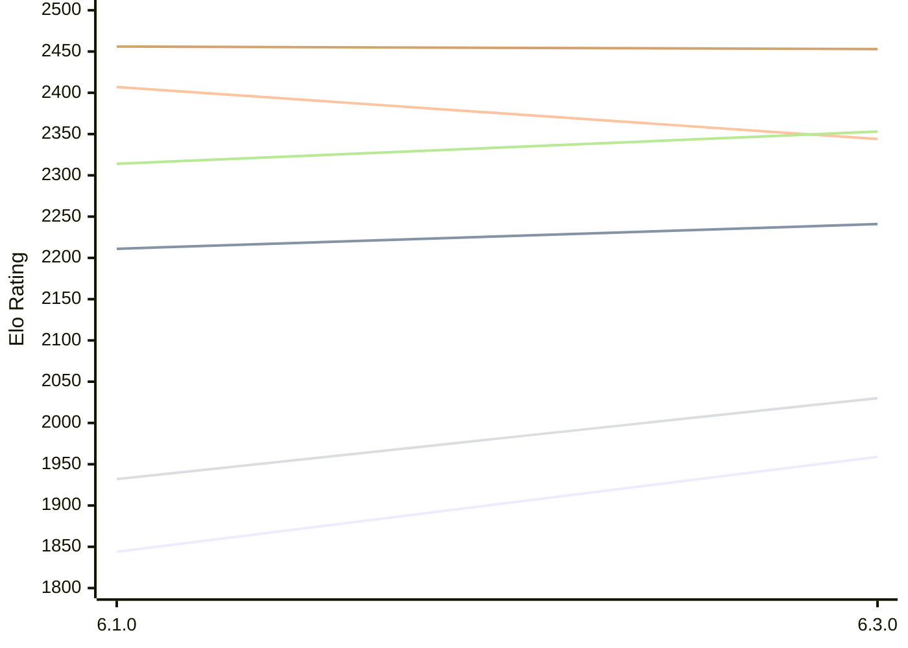

# Engine: Luminex

Author: Cheng Chang

Home: https://github.com/changcheng967/Luminex

## Elo Ratings E1 (Ultra 7 265T (1.50 GHz) - E-Core)

| Version | Published | STC 8.0+0.08s  | LTC 60.0+0.60s | VLTC 2m24s+1.12s | Comment |
| --- | --- | --- | --- | --- | --- |
| 6.3.0 | 2026-10-27 | 1959(+115) | 2241(+30) | 2344(-63) |  |
| 6.1.0 | 2026-09-24 | 1844 | 2211 | 2407 |  |
 | | | cElo (∆ prev) | cElo (∆ prev) | cElo (∆ prev) | 

## Elo Ratings P1 (Ultra 7 265T (1.50 GHz) - P-Core)

| Version | Published | STC 8.0+0.08s  | LTC 60.0+0.60s | VLTC 2m24s+1.12s | Comment |
| --- | --- | --- | --- | --- | --- |
| 6.3.0 | 2026-10-27 | 2030(+98) | 2353(+39) | 2453(-3) |  |
| 6.1.0 | 2026-09-24 | 1932 | 2314 | 2456 |  |
 | | | cElo (∆ prev) | cElo (∆ prev) | cElo (∆ prev) | 

## Elo Ratings T1 (i5-7500T 2.70GHz)

| Version | Published | STC 8.0+0.08s  | LTC 60.0+0.60s | VLTC 2m24s+1.12s | Comment |
| --- | --- | --- | --- | --- | --- |
| 6.1.0 | 2026-09-24 | 1932 | 2314 | 2456 |  |
 | | | cElo (∆ prev) | cElo (∆ prev) | cElo (∆ prev) | 

<a href="https://github.com/computer-chess-index/cci/issues/new?template=submit-version.yml&title=[VERSION]+Luminex+<version>&body=###%20Engine%20name%0ALuminex%0A%0A###%20Version%0A6.3.0" target="_blank">Submit new version</a>

 Test Conditions:

GUI/CLI: <a href=https://github.com/cutechess/cutechess target="_blank">Cute-Chess</a> 
Elo Calculation: <a href=https://www.remi-coulom.fr/Bayesian-Elo/ target="_blank">Bayesian-Elo</a> 
CPU for P1: Intel(R) Core(TM) Ultra 7 265T (1.50 GHz) - P-Core 
CPU for E1: Intel(R) Core(TM) Ultra 7 265T (1.50 GHz) - E-Core 
CPU for T1: Intel(R) Core(TM) i5-7500T 2.70GHz 
Opening book: 8_moves_v3 
\* STC: 8.0+0.08s, LTC: 60.0+0.60s, VLTC: 2m24s+1.12s

 Lists:
Ratings: <a href=https://github.com/computer-chess-index/cci/blob/main/lists/CCIRatings.csv target="_blank">Complete list</a>

Generated: 2026-11-06 05:39:33

## Ratings Verlauf E1 / P1

## Detailed Evaluation Results

| Version | Time Control | Variant | Elo  | Range +/- | Matches | Score | Average Opponent Elo | Draws |
| --- | --- |--- | --- | --- | --- | --- | --- | --- |
| 6.3.0 | VLTC (2m24s+1.12s) | P1 | 2453 | 50 | 140 | 53% | 2430 | 24% |
|  |  | E1 | 2344 | 39 | 236 | 50% | 2337 | 18% |
|  | LTC (60.0+0.60s) | P1 | 2353 | 45 | 176 | 53% | 2326 | 18% |
|  |  | E1 | 2241 | 43 | 200 | 50% | 2240 | 16% |
|  | STC (8.0+0.08s) | P1 | 2030 | 42 | 204 | 47% | 2063 | 21% |
|  |  | E1 | 1959 | 43 | 204 | 50% | 1959 | 15% |
| --- | --- |--- | --- | --- | --- | --- | --- | --- |
| 6.1.0 | VLTC (2m24s+1.12s) | P1 | 2456 | 63 | 80 | 50% | 2456 | 30% |
|  |  | E1 | 2407 | 44 | 182 | 49% | 2419 | 22% |
|  | LTC (60.0+0.60s) | P1 | 2314 | 48 | 164 | 55% | 2250 | 18% |
|  |  | E1 | 2211 | 43 | 200 | 52% | 2180 | 16% |
|  | STC (8.0+0.08s) | P1 | 1932 | 44 | 212 | 59% | 1797 | 18% |
|  |  | E1 | 1844 | 40 | 250 | 55% | 1746 | 17% |