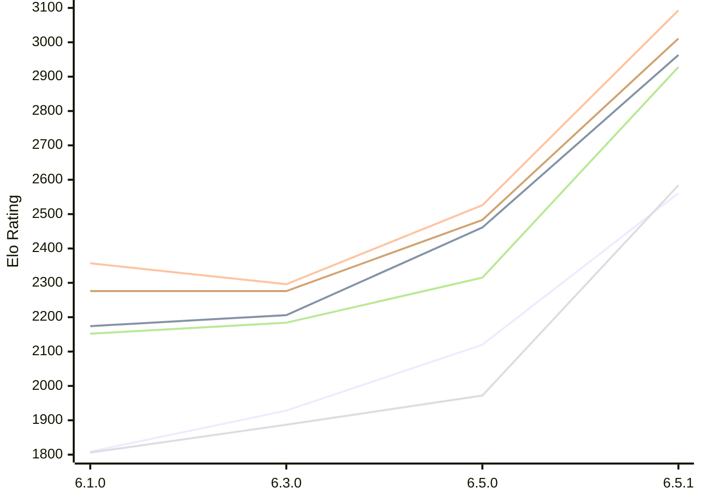

# Engine: Luminex

Author: Cheng Chang

Home: https://github.com/changcheng967/Luminex

## Elo Ratings E1 (Ultra 7 265T (1.50 GHz) - E-Core)

| Version | Published | STC 8.0+0.08s  | LTC 60.0+0.60s | VLTC 2m24s+1.12s | Comment |
| --- | --- | --- | --- | --- | --- |
| 6.5.1 | 2026-11-07 | 2561(+441) | 2963(+502) | 3093(+567) |  |
| 6.5.0 | 2026-11-06 | 2120(+192) | 2461(+255) | 2526(+230) |  |
| 6.3.0 | 2026-10-27 | 1928(+119) | 2206(+32) | 2296(-61) |  |
| 6.1.0 | 2026-09-24 | 1809 | 2174 | 2357 |  |
 | | | cElo (∆ prev) | cElo (∆ prev) | cElo (∆ prev) | 

## Elo Ratings P1 (Ultra 7 265T (1.50 GHz) - P-Core)

| Version | Published | STC 8.0+0.08s  | LTC 60.0+0.60s | VLTC 2m24s+1.12s | Comment |
| --- | --- | --- | --- | --- | --- |
| 6.5.1 | 2026-11-07 | 2584(+612) | 2928(+613) | 3011(+528) |  |
| 6.5.0 | 2026-11-06 | 1972(+85) | 2315(+131) | 2483(+207) |  |
| 6.3.0 | 2026-10-27 | 1887(+81) | 2184(+32) | 2276(0) |  |
| 6.1.0 | 2026-09-24 | 1806 | 2152 | 2276 |  |
 | | | cElo (∆ prev) | cElo (∆ prev) | cElo (∆ prev) | 

## Elo Ratings T1 (i5-7500T 2.70GHz)

| Version | Published | STC 8.0+0.08s  | LTC 60.0+0.60s | VLTC 2m24s+1.12s | Comment |
| --- | --- | --- | --- | --- | --- |
| 6.1.0 | 2026-09-24 | 1806 | 2152 | 2276 |  |
 | | | cElo (∆ prev) | cElo (∆ prev) | cElo (∆ prev) | 

<a href="https://github.com/computer-chess-index/cci/issues/new?template=submit-version.yml&title=[VERSION]+Luminex+<version>&body=###%20Engine%20name%0ALuminex%0A%0A###%20Version%0A6.5.1" target="_blank">Submit new version</a>

 Test Conditions:

GUI/CLI: <a href=https://github.com/cutechess/cutechess target="_blank">Cute-Chess</a> 
Elo Calculation: <a href=https://www.remi-coulom.fr/Bayesian-Elo/ target="_blank">Bayesian-Elo</a> 
CPU for P1: Intel(R) Core(TM) Ultra 7 265T (1.50 GHz) - P-Core 
CPU for E1: Intel(R) Core(TM) Ultra 7 265T (1.50 GHz) - E-Core 
CPU for T1: Intel(R) Core(TM) i5-7500T 2.70GHz 
Opening book: 8_moves_v3 
\* STC: 8.0+0.08s, LTC: 60.0+0.60s, VLTC: 2m24s+1.12s

 Lists:
Ratings: <a href=https://github.com/computer-chess-index/cci/blob/main/lists/CCIRatings.csv target="_blank">Complete list</a>

Generated: 2026-11-14 05:39:41

## Ratings Verlauf E1 / P1

## Detailed Evaluation Results

| Version | Time Control | Variant | Elo  | Range +/- | Matches | Score | Average Opponent Elo | Draws |
| --- | --- |--- | --- | --- | --- | --- | --- | --- |
| 6.5.1 | VLTC (2m24s+1.12s) | P1 | 3011 | 33 | 282 | 59% | 2919 | 43% |
|  |  | E1 | 3093 | 31 | 328 | 57% | 3013 | 43% |
|  | LTC (60.0+0.60s) | P1 | 2928 | 47 | 152 | 55% | 2866 | 31% |
|  |  | E1 | 2963 | 27 | 410 | 48% | 2974 | 41% |
|  | STC (8.0+0.08s) | E1 | 2561 | 35 | 274 | 57% | 2480 | 33% |
|  |  | P1 | 2584 | 44 | 180 | 56% | 2518 | 34% |
| --- | --- |--- | --- | --- | --- | --- | --- | --- |
| 6.5.0 | VLTC (2m24s+1.12s) | P1 | 2483 | 50 | 144 | 52% | 2450 | 23% |
|  |  | E1 | 2526 | 43 | 192 | 52% | 2489 | 24% |
|  | LTC (60.0+0.60s) | P1 | 2315 | 52 | 136 | 49% | 2321 | 19% |
|  |  | E1 | 2461 | 40 | 224 | 53% | 2426 | 27% |
|  | STC (8.0+0.08s) | P1 | 1972 | 48 | 156 | 47% | 2002 | 22% |
|  |  | E1 | 2120 | 42 | 196 | 53% | 2093 | 27% |
| --- | --- |--- | --- | --- | --- | --- | --- | --- |
| 6.3.0 | VLTC (2m24s+1.12s) | P1 | 2276 | 50 | 140 | 53% | 2253 | 24% |
|  |  | E1 | 2296 | 39 | 240 | 50% | 2290 | 18% |
|  | LTC (60.0+0.60s) | P1 | 2184 | 45 | 176 | 53% | 2159 | 18% |
|  |  | E1 | 2206 | 42 | 204 | 51% | 2199 | 15% |
|  | STC (8.0+0.08s) | E1 | 1928 | 42 | 212 | 51% | 1920 | 16% |
|  |  | P1 | 1887 | 42 | 204 | 47% | 1920 | 21% |
| --- | --- |--- | --- | --- | --- | --- | --- | --- |
| 6.1.0 | VLTC (2m24s+1.12s) | P1 | 2276 | 63 | 80 | 50% | 2276 | 30% |
|  |  | E1 | 2357 | 44 | 182 | 49% | 2369 | 22% |
|  | LTC (60.0+0.60s) | P1 | 2152 | 48 | 164 | 55% | 2091 | 18% |
|  |  | E1 | 2174 | 43 | 200 | 52% | 2142 | 16% |
|  | STC (8.0+0.08s) | P1 | 1806 | 44 | 212 | 59% | 1681 | 18% |
|  |  | E1 | 1809 | 40 | 250 | 55% | 1715 | 17% |