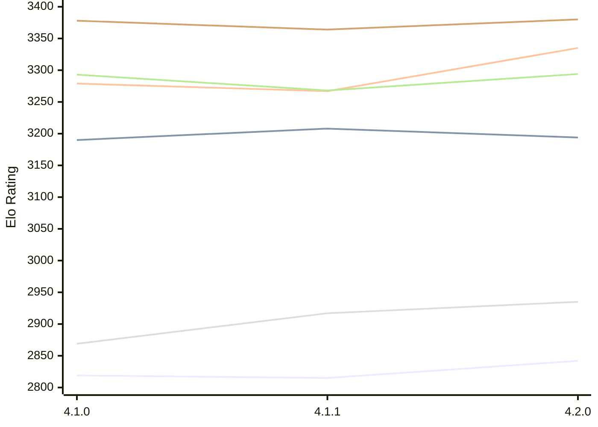

# Engine: LunaChessEngine

Author: Daniele Marpino

Home: https://github.com/Spunc595/Luna-Chess-Engine

## Elo Ratings E1 (Ultra 7 265T (1.50 GHz) - E-Core)

| Version | Published | STC 8.0+0.08s  | LTC 60.0+0.60s | VLTC 2m24s+1.12s | Comment |
| --- | --- | --- | --- | --- | --- |
| 4.2.0 | 2026-11-04 | 2842(+27) | 3194(-14) | 3335(+68) |  |
| 4.1.1 | 2026-11-02 | 2815(-4) | 3208(+18) | 3267(-12) |  |
| 4.1.0 | 2026-10-16 | 2819 | 3190 | 3279 |  |
 | | | cElo (∆ prev) | cElo (∆ prev) | cElo (∆ prev) | 

## Elo Ratings P1 (Ultra 7 265T (1.50 GHz) - P-Core)

| Version | Published | STC 8.0+0.08s  | LTC 60.0+0.60s | VLTC 2m24s+1.12s | Comment |
| --- | --- | --- | --- | --- | --- |
| 4.2.0 | 2026-11-04 | 2935(+18) | 3294(+26) | 3380(+16) |  |
| 4.1.1 | 2026-11-02 | 2917(+48) | 3268(-25) | 3364(-14) |  |
| 4.1.0 | 2026-10-16 | 2869 | 3293 | 3378 |  |
 | | | cElo (∆ prev) | cElo (∆ prev) | cElo (∆ prev) | 

## Elo Ratings T1 (i5-7500T 2.70GHz)

| Version | Published | STC 8.0+0.08s  | LTC 60.0+0.60s | VLTC 2m24s+1.12s | Comment |
| --- | --- | --- | --- | --- | --- |
| 4.1.0 | 2026-10-16 | 2869 | 3293 | 3378 |  |
 | | | cElo (∆ prev) | cElo (∆ prev) | cElo (∆ prev) | 

<a href="https://github.com/computer-chess-index/cci/issues/new?template=submit-version.yml&title=[VERSION]+LunaChessEngine+<version>&body=###%20Engine%20name%0ALunaChessEngine%0A%0A###%20Version%0A4.2.0" target="_blank">Submit new version</a>

 Test Conditions:

GUI/CLI: <a href=https://github.com/cutechess/cutechess target="_blank">Cute-Chess</a> 
Elo Calculation: <a href=https://www.remi-coulom.fr/Bayesian-Elo/ target="_blank">Bayesian-Elo</a> 
CPU for P1: Intel(R) Core(TM) Ultra 7 265T (1.50 GHz) - P-Core 
CPU for E1: Intel(R) Core(TM) Ultra 7 265T (1.50 GHz) - E-Core 
CPU for T1: Intel(R) Core(TM) i5-7500T 2.70GHz 
Opening book: 8_moves_v3 
\* STC: 8.0+0.08s, LTC: 60.0+0.60s, VLTC: 2m24s+1.12s

 Lists:
Ratings: <a href=https://github.com/computer-chess-index/cci/blob/main/lists/CCIRatings.csv target="_blank">Complete list</a>

Generated: 2026-11-08 05:39:33

## Ratings Verlauf E1 / P1

## Detailed Evaluation Results

| Version | Time Control | Variant | Elo  | Range +/- | Matches | Score | Average Opponent Elo | Draws |
| --- | --- |--- | --- | --- | --- | --- | --- | --- |
| 4.2.0 | VLTC (2m24s+1.12s) | E1 | 3335 | 29 | 312 | 49% | 3343 | 67% |
|  |  | P1 | 3380 | 43 | 136 | 48% | 3393 | 70% |
|  | LTC (60.0+0.60s) | E1 | 3194 | 36 | 202 | 50% | 3189 | 60% |
|  |  | P1 | 3294 | 44 | 136 | 49% | 3303 | 60% |
|  | STC (8.0+0.08s) | E1 | 2842 | 36 | 230 | 49% | 2849 | 40% |
|  |  | P1 | 2935 | 45 | 152 | 47% | 2961 | 40% |
| --- | --- |--- | --- | --- | --- | --- | --- | --- |
| 4.1.1 | VLTC (2m24s+1.12s) | P1 | 3364 | 38 | 188 | 52% | 3349 | 59% |
|  |  | E1 | 3267 | 34 | 232 | 49% | 3272 | 58% |
|  | LTC (60.0+0.60s) | P1 | 3268 | 43 | 158 | 55% | 3231 | 46% |
|  |  | E1 | 3208 | 40 | 168 | 50% | 3204 | 59% |
|  | STC (8.0+0.08s) | P1 | 2917 | 50 | 124 | 56% | 2862 | 36% |
|  |  | E1 | 2815 | 36 | 236 | 48% | 2832 | 38% |
| --- | --- |--- | --- | --- | --- | --- | --- | --- |
| 4.1.0 | VLTC (2m24s+1.12s) | P1 | 3378 | 38 | 190 | 52% | 3333 | 60% |
|  |  | E1 | 3279 | 32 | 280 | 56% | 3202 | 55% |
|  | LTC (60.0+0.60s) | P1 | 3293 | 42 | 174 | 56% | 3123 | 48% |
|  |  | E1 | 3190 | 33 | 294 | 58% | 3038 | 45% |
|  | STC (8.0+0.08s) | P1 | 2869 | 38 | 240 | 54% | 2697 | 35% |
|  |  | E1 | 2819 | 34 | 298 | 57% | 2584 | 36% |