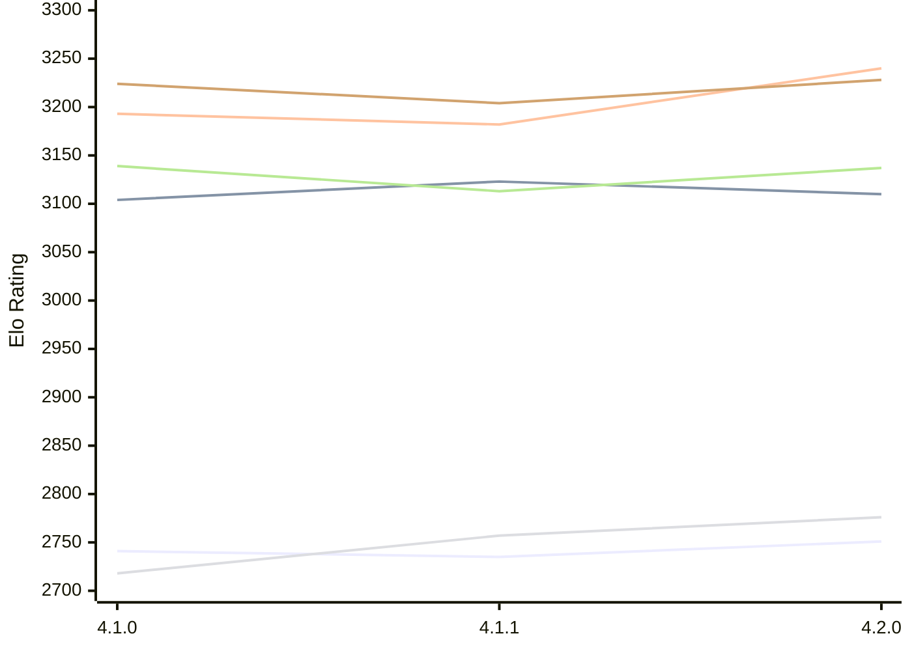

# Engine: LunaChessEngine

Author: Daniele Marpino

Home: https://github.com/Spunc595/Luna-Chess-Engine

## Elo Ratings E1 (Ultra 7 265T (1.50 GHz) - E-Core)

| Version | Published | STC 8.0+0.08s  | LTC 60.0+0.60s | VLTC 2m24s+1.12s | Comment |
| --- | --- | --- | --- | --- | --- |
| 4.2.0 | 2026-11-04 | 2751(+16) | 3110(-13) | 3240(+58) |  |
| 4.1.1 | 2026-11-02 | 2735(-6) | 3123(+19) | 3182(-11) |  |
| 4.1.0 | 2026-10-16 | 2741 | 3104 | 3193 |  |
 | | | cElo (∆ prev) | cElo (∆ prev) | cElo (∆ prev) | 

## Elo Ratings P1 (Ultra 7 265T (1.50 GHz) - P-Core)

| Version | Published | STC 8.0+0.08s  | LTC 60.0+0.60s | VLTC 2m24s+1.12s | Comment |
| --- | --- | --- | --- | --- | --- |
| 4.2.0 | 2026-11-04 | 2776(+19) | 3137(+24) | 3228(+24) |  |
| 4.1.1 | 2026-11-02 | 2757(+39) | 3113(-26) | 3204(-20) |  |
| 4.1.0 | 2026-10-16 | 2718 | 3139 | 3224 |  |
 | | | cElo (∆ prev) | cElo (∆ prev) | cElo (∆ prev) | 

## Elo Ratings T1 (i5-7500T 2.70GHz)

| Version | Published | STC 8.0+0.08s  | LTC 60.0+0.60s | VLTC 2m24s+1.12s | Comment |
| --- | --- | --- | --- | --- | --- |
| 4.1.0 | 2026-10-16 | 2718 | 3139 | 3224 |  |
 | | | cElo (∆ prev) | cElo (∆ prev) | cElo (∆ prev) | 

<a href="https://github.com/computer-chess-index/cci/issues/new?template=submit-version.yml&title=[VERSION]+LunaChessEngine+<version>&body=###%20Engine%20name%0ALunaChessEngine%0A%0A###%20Version%0A4.2.0" target="_blank">Submit new version</a>

 Test Conditions:

GUI/CLI: <a href=https://github.com/cutechess/cutechess target="_blank">Cute-Chess</a> 
Elo Calculation: <a href=https://www.remi-coulom.fr/Bayesian-Elo/ target="_blank">Bayesian-Elo</a> 
CPU for P1: Intel(R) Core(TM) Ultra 7 265T (1.50 GHz) - P-Core 
CPU for E1: Intel(R) Core(TM) Ultra 7 265T (1.50 GHz) - E-Core 
CPU for T1: Intel(R) Core(TM) i5-7500T 2.70GHz 
Opening book: 8_moves_v3 
\* STC: 8.0+0.08s, LTC: 60.0+0.60s, VLTC: 2m24s+1.12s

 Lists:
Ratings: <a href=https://github.com/computer-chess-index/cci/blob/main/lists/CCIRatings.csv target="_blank">Complete list</a>

Generated: 2026-11-13 05:40:03

## Ratings Verlauf E1 / P1

## Detailed Evaluation Results

| Version | Time Control | Variant | Elo  | Range +/- | Matches | Score | Average Opponent Elo | Draws |
| --- | --- |--- | --- | --- | --- | --- | --- | --- |
| 4.2.0 | VLTC (2m24s+1.12s) | P1 | 3228 | 37 | 184 | 49% | 3236 | 68% |
|  |  | E1 | 3240 | 26 | 384 | 49% | 3251 | 67% |
|  | LTC (60.0+0.60s) | E1 | 3110 | 33 | 246 | 50% | 3106 | 59% |
|  |  | P1 | 3137 | 40 | 164 | 48% | 3147 | 62% |
|  | STC (8.0+0.08s) | E1 | 2751 | 34 | 260 | 48% | 2750 | 40% |
|  |  | P1 | 2776 | 42 | 172 | 47% | 2805 | 40% |
| --- | --- |--- | --- | --- | --- | --- | --- | --- |
| 4.1.1 | VLTC (2m24s+1.12s) | P1 | 3204 | 37 | 196 | 51% | 3195 | 59% |
|  |  | E1 | 3182 | 34 | 232 | 49% | 3187 | 58% |
|  | LTC (60.0+0.60s) | P1 | 3113 | 43 | 158 | 55% | 3075 | 46% |
|  |  | E1 | 3123 | 39 | 176 | 50% | 3117 | 60% |
|  | STC (8.0+0.08s) | P1 | 2757 | 49 | 136 | 53% | 2730 | 35% |
|  |  | E1 | 2735 | 36 | 248 | 48% | 2750 | 37% |
| --- | --- |--- | --- | --- | --- | --- | --- | --- |
| 4.1.0 | VLTC (2m24s+1.12s) | P1 | 3224 | 38 | 190 | 52% | 3181 | 60% |
|  |  | E1 | 3193 | 32 | 280 | 56% | 3117 | 55% |
|  | LTC (60.0+0.60s) | P1 | 3139 | 42 | 174 | 56% | 2978 | 48% |
|  |  | E1 | 3104 | 33 | 294 | 58% | 2958 | 45% |
|  | STC (8.0+0.08s) | P1 | 2718 | 38 | 240 | 54% | 2560 | 35% |
|  |  | E1 | 2741 | 34 | 298 | 57% | 2516 | 36% |