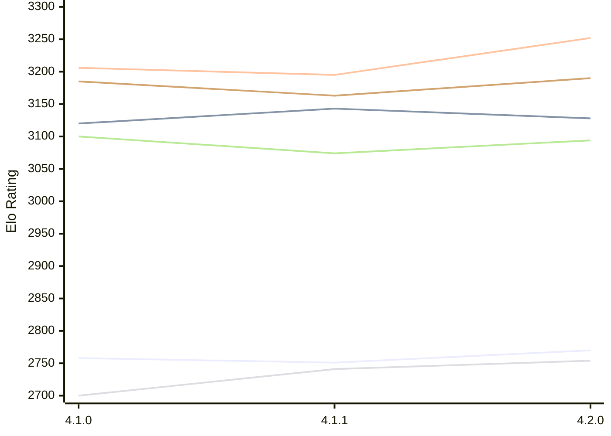

# Engine: LunaChessEngine

Author: Daniele Marpino

Home: https://github.com/Spunc595/Luna-Chess-Engine

## Elo Ratings E1 (Ultra 7 265T (1.50 GHz) - E-Core)

| Version | Published | STC 8.0+0.08s  | LTC 60.0+0.60s | VLTC 2m24s+1.12s | Comment |
| --- | --- | --- | --- | --- | --- |
| 4.2.0 | 2026-11-04 | 2770(+19) | 3128(-15) | 3252(+57) |  |
| 4.1.1 | 2026-11-02 | 2751(-7) | 3143(+23) | 3195(-11) |  |
| 4.1.0 | 2026-10-16 | 2758 | 3120 | 3206 |  |
 | | | cElo (∆ prev) | cElo (∆ prev) | cElo (∆ prev) | 

## Elo Ratings P1 (Ultra 7 265T (1.50 GHz) - P-Core)

| Version | Published | STC 8.0+0.08s  | LTC 60.0+0.60s | VLTC 2m24s+1.12s | Comment |
| --- | --- | --- | --- | --- | --- |
| 4.2.0 | 2026-11-04 | 2754(+13) | 3094(+20) | 3190(+27) |  |
| 4.1.1 | 2026-11-02 | 2741(+41) | 3074(-26) | 3163(-22) |  |
| 4.1.0 | 2026-10-16 | 2700 | 3100 | 3185 |  |
 | | | cElo (∆ prev) | cElo (∆ prev) | cElo (∆ prev) | 

## Elo Ratings T1 (i5-7500T 2.70GHz)

| Version | Published | STC 8.0+0.08s  | LTC 60.0+0.60s | VLTC 2m24s+1.12s | Comment |
| --- | --- | --- | --- | --- | --- |
| 4.1.0 | 2026-10-16 | 2700 | 3100 | 3185 |  |
 | | | cElo (∆ prev) | cElo (∆ prev) | cElo (∆ prev) | 

<a href="https://github.com/computer-chess-index/cci/issues/new?template=submit-version.yml&title=[VERSION]+LunaChessEngine+<version>&body=###%20Engine%20name%0ALunaChessEngine%0A%0A###%20Version%0A4.2.0" target="_blank">Submit new version</a>

 Test Conditions:

GUI/CLI: <a href=https://github.com/cutechess/cutechess target="_blank">Cute-Chess</a> 
Elo Calculation: <a href=https://www.remi-coulom.fr/Bayesian-Elo/ target="_blank">Bayesian-Elo</a> 
CPU for P1: Intel(R) Core(TM) Ultra 7 265T (1.50 GHz) - P-Core 
CPU for E1: Intel(R) Core(TM) Ultra 7 265T (1.50 GHz) - E-Core 
CPU for T1: Intel(R) Core(TM) i5-7500T 2.70GHz 
Opening book: 8_moves_v3 
\* STC: 8.0+0.08s, LTC: 60.0+0.60s, VLTC: 2m24s+1.12s

 Lists:
Ratings: <a href=https://github.com/computer-chess-index/cci/blob/main/lists/CCIRatings.csv target="_blank">Complete list</a>

Generated: 2026-11-14 05:39:44

## Ratings Verlauf E1 / P1

## Detailed Evaluation Results

| Version | Time Control | Variant | Elo  | Range +/- | Matches | Score | Average Opponent Elo | Draws |
| --- | --- |--- | --- | --- | --- | --- | --- | --- |
| 4.2.0 | VLTC (2m24s+1.12s) | P1 | 3190 | 37 | 184 | 49% | 3197 | 68% |
|  |  | E1 | 3252 | 26 | 384 | 49% | 3262 | 67% |
|  | LTC (60.0+0.60s) | P1 | 3094 | 40 | 168 | 48% | 3109 | 61% |
|  |  | E1 | 3128 | 33 | 246 | 50% | 3124 | 59% |
|  | STC (8.0+0.08s) | P1 | 2754 | 42 | 176 | 46% | 2785 | 40% |
|  |  | E1 | 2770 | 34 | 272 | 47% | 2774 | 40% |
| --- | --- |--- | --- | --- | --- | --- | --- | --- |
| 4.1.1 | VLTC (2m24s+1.12s) | P1 | 3163 | 36 | 208 | 50% | 3162 | 59% |
|  |  | E1 | 3195 | 33 | 240 | 49% | 3200 | 59% |
|  | LTC (60.0+0.60s) | P1 | 3074 | 43 | 162 | 54% | 3046 | 46% |
|  |  | E1 | 3143 | 39 | 180 | 51% | 3135 | 59% |
|  | STC (8.0+0.08s) | P1 | 2741 | 46 | 148 | 53% | 2719 | 35% |
|  |  | E1 | 2751 | 35 | 256 | 48% | 2766 | 36% |
| --- | --- |--- | --- | --- | --- | --- | --- | --- |
| 4.1.0 | VLTC (2m24s+1.12s) | E1 | 3206 | 32 | 280 | 56% | 3132 | 55% |
|  |  | P1 | 3185 | 38 | 190 | 52% | 3144 | 60% |
|  | LTC (60.0+0.60s) | E1 | 3120 | 33 | 294 | 58% | 2973 | 45% |
|  |  | P1 | 3100 | 42 | 174 | 56% | 2943 | 48% |
|  | STC (8.0+0.08s) | E1 | 2758 | 34 | 298 | 57% | 2530 | 36% |
|  |  | P1 | 2700 | 38 | 240 | 54% | 2543 | 35% |