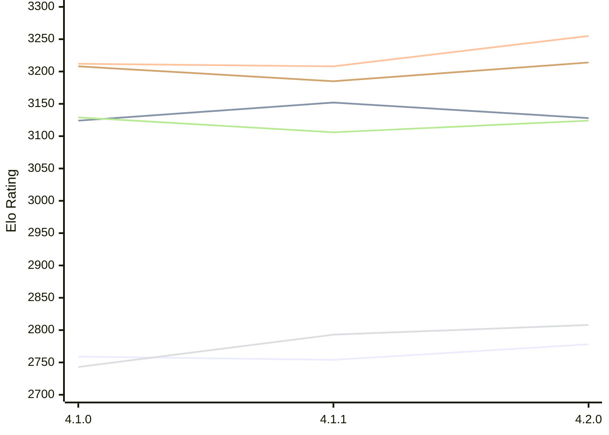

# Engine: LunaChessEngine

Author: Daniele Marpino

Home: https://github.com/Spunc595/Luna-Chess-Engine

## Elo Ratings E1 (Ultra 7 265T (1.50 GHz) - E-Core)

| Version | Published | STC 8.0+0.08s  | LTC 60.0+0.60s | VLTC 2m24s+1.12s | Comment |
| --- | --- | --- | --- | --- | --- |
| 4.2.0 | 2026-11-04 | 2778(+24) | 3128(-24) | 3255(+47) |  |
| 4.1.1 | 2026-11-02 | 2754(-5) | 3152(+28) | 3208(-4) |  |
| 4.1.0 | 2026-10-16 | 2759 | 3124 | 3212 |  |
 | | | cElo (∆ prev) | cElo (∆ prev) | cElo (∆ prev) | 

## Elo Ratings P1 (Ultra 7 265T (1.50 GHz) - P-Core)

| Version | Published | STC 8.0+0.08s  | LTC 60.0+0.60s | VLTC 2m24s+1.12s | Comment |
| --- | --- | --- | --- | --- | --- |
| 4.2.0 | 2026-11-04 | 2808(+15) | 3124(+18) | 3214(+29) |  |
| 4.1.1 | 2026-11-02 | 2793(+50) | 3106(-23) | 3185(-23) |  |
| 4.1.0 | 2026-10-16 | 2743 | 3129 | 3208 |  |
 | | | cElo (∆ prev) | cElo (∆ prev) | cElo (∆ prev) | 

## Elo Ratings T1 (i5-7500T 2.70GHz)

| Version | Published | STC 8.0+0.08s  | LTC 60.0+0.60s | VLTC 2m24s+1.12s | Comment |
| --- | --- | --- | --- | --- | --- |
| 4.1.0 | 2026-10-16 | 2743 | 3129 | 3208 |  |
 | | | cElo (∆ prev) | cElo (∆ prev) | cElo (∆ prev) | 

<a href="https://github.com/computer-chess-index/cci/issues/new?template=submit-version.yml&title=[VERSION]+LunaChessEngine+<version>&body=###%20Engine%20name%0ALunaChessEngine%0A%0A###%20Version%0A4.2.0" target="_blank">Submit new version</a>

 Test Conditions:

GUI/CLI: <a href=https://github.com/cutechess/cutechess target="_blank">Cute-Chess</a> 
Elo Calculation: <a href=https://www.remi-coulom.fr/Bayesian-Elo/ target="_blank">Bayesian-Elo</a> 
CPU for P1: Intel(R) Core(TM) Ultra 7 265T (1.50 GHz) - P-Core 
CPU for E1: Intel(R) Core(TM) Ultra 7 265T (1.50 GHz) - E-Core 
CPU for T1: Intel(R) Core(TM) i5-7500T 2.70GHz 
Opening book: 8_moves_v3 
\* STC: 8.0+0.08s, LTC: 60.0+0.60s, VLTC: 2m24s+1.12s

 Lists:
Ratings: <a href=https://github.com/computer-chess-index/cci/blob/main/lists/CCIRatings.csv target="_blank">Complete list</a>

Generated: 2026-11-26 05:40:22

## Ratings Verlauf E1 / P1

## Detailed Evaluation Results

| Version | Time Control | Variant | Elo  | Range +/- | Matches | Score | Average Opponent Elo | Draws |
| --- | --- |--- | --- | --- | --- | --- | --- | --- |
| 4.2.0 | VLTC (2m24s+1.12s) | E1 | 3255 | 25 | 410 | 48% | 3268 | 69% |
|  |  | P1 | 3214 | 36 | 196 | 49% | 3221 | 68% |
|  | LTC (60.0+0.60s) | E1 | 3128 | 31 | 274 | 50% | 3129 | 60% |
|  |  | P1 | 3124 | 35 | 212 | 48% | 3141 | 61% |
|  | STC (8.0+0.08s) | E1 | 2778 | 32 | 320 | 48% | 2778 | 37% |
|  |  | P1 | 2808 | 37 | 228 | 48% | 2828 | 40% |
| --- | --- |--- | --- | --- | --- | --- | --- | --- |
| 4.1.1 | VLTC (2m24s+1.12s) | P1 | 3185 | 36 | 212 | 50% | 3190 | 58% |
|  |  | E1 | 3208 | 32 | 260 | 51% | 3204 | 59% |
|  | LTC (60.0+0.60s) | P1 | 3106 | 37 | 206 | 52% | 3093 | 51% |
|  |  | E1 | 3152 | 38 | 188 | 51% | 3143 | 60% |
|  | STC (8.0+0.08s) | P1 | 2793 | 42 | 182 | 52% | 2773 | 36% |
|  |  | E1 | 2754 | 33 | 292 | 48% | 2768 | 38% |
| --- | --- |--- | --- | --- | --- | --- | --- | --- |
| 4.1.0 | VLTC (2m24s+1.12s) | P1 | 3208 | 38 | 190 | 52% | 3167 | 60% |
|  |  | E1 | 3212 | 32 | 280 | 56% | 3136 | 55% |
|  | LTC (60.0+0.60s) | P1 | 3129 | 42 | 174 | 56% | 2973 | 48% |
|  |  | E1 | 3124 | 33 | 294 | 58% | 2975 | 45% |
|  | STC (8.0+0.08s) | P1 | 2743 | 38 | 240 | 54% | 2583 | 35% |
|  |  | E1 | 2759 | 34 | 298 | 57% | 2529 | 36% |