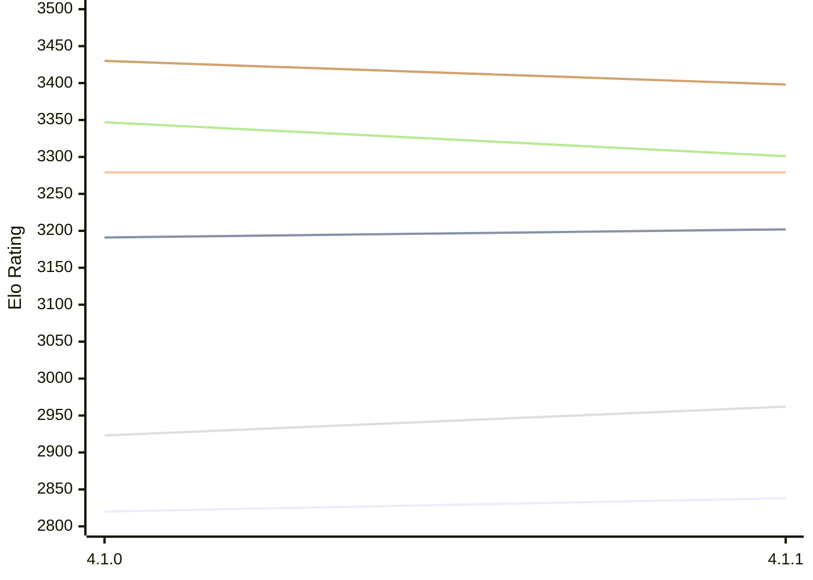

# Engine: LunaChessEngine

Author: Daniele Marpino

Home: https://github.com/Spunc595/Luna-Chess-Engine

## Elo Ratings E1 (Ultra 7 265T (1.50 GHz) - E-Core)

| Version | Published | STC 8.0+0.08s  | LTC 60.0+0.60s | VLTC 2m24s+1.12s | Comment |
| --- | --- | --- | --- | --- | --- |
| 4.1.1 | 2026-11-02 | 2838(+18) | 3202(+11) | 3279(0) |  |
| 4.1.0 | 2026-10-16 | 2820 | 3191 | 3279 |  |
 | | | cElo (∆ prev) | cElo (∆ prev) | cElo (∆ prev) | 

## Elo Ratings P1 (Ultra 7 265T (1.50 GHz) - P-Core)

| Version | Published | STC 8.0+0.08s  | LTC 60.0+0.60s | VLTC 2m24s+1.12s | Comment |
| --- | --- | --- | --- | --- | --- |
| 4.1.1 | 2026-11-02 | 2962(+39) | 3301(-46) | 3398(-32) |  |
| 4.1.0 | 2026-10-16 | 2923 | 3347 | 3430 |  |
 | | | cElo (∆ prev) | cElo (∆ prev) | cElo (∆ prev) | 

## Elo Ratings T1 (i5-7500T 2.70GHz)

| Version | Published | STC 8.0+0.08s  | LTC 60.0+0.60s | VLTC 2m24s+1.12s | Comment |
| --- | --- | --- | --- | --- | --- |
| 4.1.0 | 2026-10-16 | 2923 | 3347 | 3430 |  |
 | | | cElo (∆ prev) | cElo (∆ prev) | cElo (∆ prev) | 

<a href="https://github.com/computer-chess-index/cci/issues/new?template=submit-version.yml&title=[VERSION]+LunaChessEngine+<version>&body=###%20Engine%20name%0ALunaChessEngine%0A%0A###%20Version%0A4.1.1" target="_blank">Submit new version</a>

 Test Conditions:

GUI/CLI: <a href=https://github.com/cutechess/cutechess target="_blank">Cute-Chess</a> 
Elo Calculation: <a href=https://www.remi-coulom.fr/Bayesian-Elo/ target="_blank">Bayesian-Elo</a> 
CPU for P1: Intel(R) Core(TM) Ultra 7 265T (1.50 GHz) - P-Core 
CPU for E1: Intel(R) Core(TM) Ultra 7 265T (1.50 GHz) - E-Core 
CPU for T1: Intel(R) Core(TM) i5-7500T 2.70GHz 
Opening book: 8_moves_v3 
\* STC: 8.0+0.08s, LTC: 60.0+0.60s, VLTC: 2m24s+1.12s

 Lists:
Ratings: <a href=https://github.com/computer-chess-index/cci/blob/main/lists/CCIRatings.csv target="_blank">Complete list</a>

Generated: 2026-11-05 05:39:45

## Ratings Verlauf E1 / P1

## Detailed Evaluation Results

| Version | Time Control | Variant | Elo  | Range +/- | Matches | Score | Average Opponent Elo | Draws |
| --- | --- |--- | --- | --- | --- | --- | --- | --- |
| 4.1.1 | VLTC (2m24s+1.12s) | P1 | 3398 | 57 | 82 | 51% | 3395 | 60% |
|  |  | E1 | 3279 | 53 | 92 | 51% | 3271 | 61% |
|  | LTC (60.0+0.60s) | P1 | 3301 | 59 | 82 | 55% | 3259 | 48% |
|  |  | E1 | 3202 | 46 | 126 | 50% | 3201 | 56% |
|  | STC (8.0+0.08s) | P1 | 2962 | 61 | 88 | 57% | 2894 | 33% |
|  |  | E1 | 2838 | 57 | 92 | 50% | 2836 | 39% |
| --- | --- |--- | --- | --- | --- | --- | --- | --- |
| 4.1.0 | VLTC (2m24s+1.12s) | E1 | 3279 | 32 | 280 | 56% | 3202 | 55% |
|  |  | P1 | 3430 | 38 | 190 | 52% | 3387 | 60% |
|  | LTC (60.0+0.60s) | P1 | 3347 | 42 | 174 | 56% | 3177 | 48% |
|  |  | E1 | 3191 | 33 | 294 | 58% | 3040 | 45% |
|  | STC (8.0+0.08s) | P1 | 2923 | 38 | 240 | 54% | 2750 | 35% |
|  |  | E1 | 2820 | 34 | 298 | 57% | 2585 | 36% |