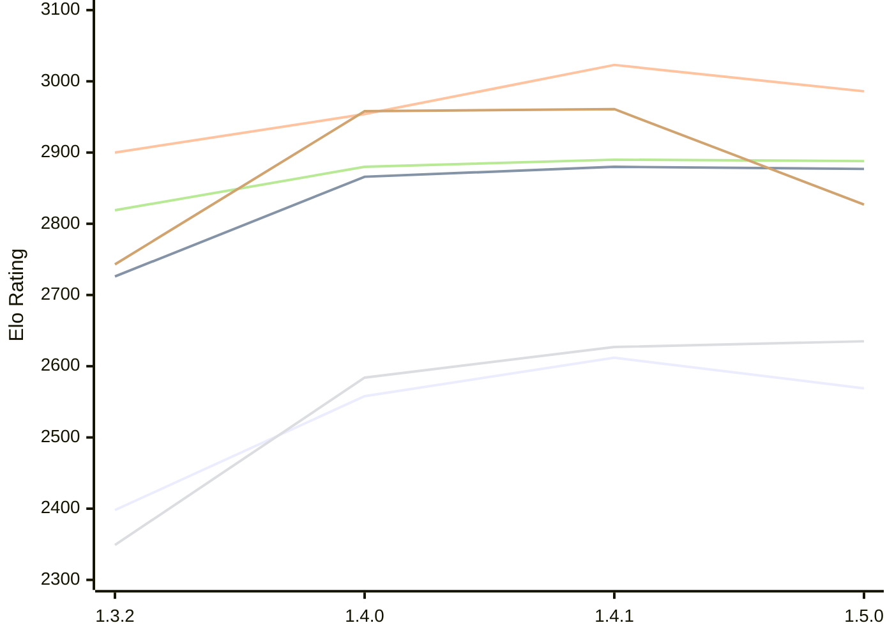

# Engine: Maharajah

Author: Oleksandr Velykotskyi

Home: https://github.com/Villi14/MaharajahCXX

## Elo Ratings E1 (Ultra 7 265T (1.50 GHz) - E-Core)

| Version | Published | STC 8.0+0.08s  | LTC 60.0+0.60s | VLTC 2m24s+1.12s | Comment |
| --- | --- | --- | --- | --- | --- |
| 1.5.0 | 2026-11-21 | 2569(-43) | 2877(-3) | 2986(-37) |  |
| 1.4.1 | 2026-11-17 | 2612(+54) | 2880(+14) | 3023(+69) |  |
| 1.4.0 | 2026-11-15 | 2558(+160) | 2866(+140) | 2954(+54) |  |
| 1.3.2 | 2026-11-11 | 2398 | 2726 | 2900 |  |
 | | | cElo (∆ prev) | cElo (∆ prev) | cElo (∆ prev) | 

## Elo Ratings P1 (Ultra 7 265T (1.50 GHz) - P-Core)

| Version | Published | STC 8.0+0.08s  | LTC 60.0+0.60s | VLTC 2m24s+1.12s | Comment |
| --- | --- | --- | --- | --- | --- |
| 1.5.0 | 2026-11-21 | 2635(+8) | 2888(-2) | 2827(-134) |  |
| 1.4.1 | 2026-11-17 | 2627(+43) | 2890(+10) | 2961(+3) |  |
| 1.4.0 | 2026-11-15 | 2584(+235) | 2880(+61) | 2958(+215) |  |
| 1.3.2 | 2026-11-11 | 2349 | 2819 | 2743 |  |
 | | | cElo (∆ prev) | cElo (∆ prev) | cElo (∆ prev) | 

## Elo Ratings T1 (i5-7500T 2.70GHz)

| Version | Published | STC 8.0+0.08s  | LTC 60.0+0.60s | VLTC 2m24s+1.12s | Comment |
| --- | --- | --- | --- | --- | --- |
| 1.3.2 | 2026-11-11 | 2349 | 2819 | 2743 |  |
 | | | cElo (∆ prev) | cElo (∆ prev) | cElo (∆ prev) | 

<a href="https://github.com/computer-chess-index/cci/issues/new?template=submit-version.yml&title=[VERSION]+Maharajah+<version>&body=###%20Engine%20name%0AMaharajah%0A%0A###%20Version%0A1.5.0" target="_blank">Submit new version</a>

 Test Conditions:

GUI/CLI: <a href=https://github.com/cutechess/cutechess target="_blank">Cute-Chess</a> 
Elo Calculation: <a href=https://www.remi-coulom.fr/Bayesian-Elo/ target="_blank">Bayesian-Elo</a> 
CPU for P1: Intel(R) Core(TM) Ultra 7 265T (1.50 GHz) - P-Core 
CPU for E1: Intel(R) Core(TM) Ultra 7 265T (1.50 GHz) - E-Core 
CPU for T1: Intel(R) Core(TM) i5-7500T 2.70GHz 
Opening book: 8_moves_v3 
\* STC: 8.0+0.08s, LTC: 60.0+0.60s, VLTC: 2m24s+1.12s

 Lists:
Ratings: <a href=https://github.com/computer-chess-index/cci/blob/main/lists/CCIRatings.csv target="_blank">Complete list</a>

Generated: 2026-11-26 05:40:32

## Ratings Verlauf E1 / P1

## Detailed Evaluation Results

| Version | Time Control | Variant | Elo  | Range +/- | Matches | Score | Average Opponent Elo | Draws |
| --- | --- |--- | --- | --- | --- | --- | --- | --- |
| 1.5.0 | VLTC (2m24s+1.12s) | E1 | 2986 | 36 | 242 | 55% | 2942 | 35% |
|  |  | P1 | 2827 | 93 | 38 | 53% | 2803 | 26% |
|  | LTC (60.0+0.60s) | P1 | 2888 | 104 | 28 | 54% | 2849 | 36% |
|  |  | E1 | 2877 | 41 | 208 | 52% | 2861 | 24% |
|  | STC (8.0+0.08s) | P1 | 2635 | 58 | 100 | 52% | 2622 | 25% |
|  |  | E1 | 2569 | 47 | 148 | 54% | 2534 | 29% |
| --- | --- |--- | --- | --- | --- | --- | --- | --- |
| 1.4.1 | VLTC (2m24s+1.12s) | P1 | 2961 | 40 | 198 | 52% | 2944 | 31% |
|  |  | E1 | 3023 | 40 | 200 | 51% | 3012 | 36% |
|  | LTC (60.0+0.60s) | P1 | 2890 | 49 | 138 | 50% | 2888 | 28% |
|  |  | E1 | 2880 | 37 | 236 | 51% | 2870 | 31% |
|  | STC (8.0+0.08s) | P1 | 2627 | 41 | 192 | 49% | 2633 | 30% |
|  |  | E1 | 2612 | 40 | 224 | 53% | 2587 | 22% |
| --- | --- |--- | --- | --- | --- | --- | --- | --- |
| 1.4.0 | VLTC (2m24s+1.12s) | E1 | 2954 | 47 | 148 | 48% | 2978 | 34% |
|  |  | P1 | 2958 | 41 | 178 | 44% | 3012 | 41% |
|  | LTC (60.0+0.60s) | P1 | 2880 | 45 | 160 | 54% | 2844 | 34% |
|  |  | E1 | 2866 | 41 | 198 | 48% | 2884 | 30% |
|  | STC (8.0+0.08s) | P1 | 2584 | 47 | 152 | 54% | 2541 | 25% |
|  |  | E1 | 2558 | 43 | 184 | 48% | 2574 | 28% |
| --- | --- |--- | --- | --- | --- | --- | --- | --- |
| 1.3.2 | VLTC (2m24s+1.12s) | P1 | 2743 | 98 | 40 | 45% | 2658 | 25% |
|  |  | E1 | 2900 | 74 | 64 | 56% | 2807 | 25% |
|  | LTC (60.0+0.60s) | P1 | 2819 | 122 | 36 | 75% | 2387 | 17% |
|  |  | E1 | 2726 | 77 | 62 | 47% | 2757 | 13% |
|  | STC (8.0+0.08s) | P1 | 2349 | 82 | 56 | 58% | 2241 | 20% |
|  |  | E1 | 2398 | 69 | 86 | 45% | 2471 | 10% |