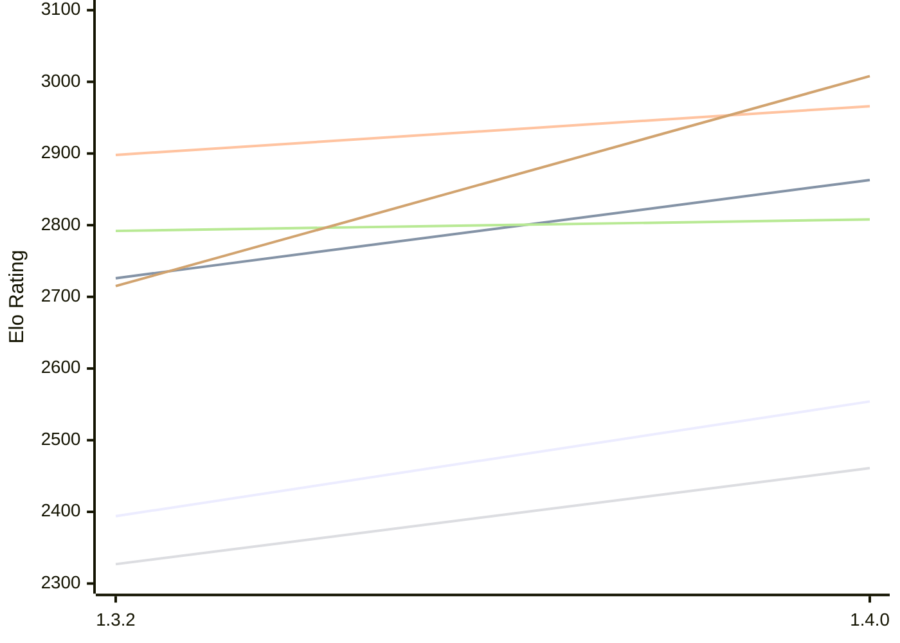

# Engine: Maharajah

Author: Oleksandr Velykotskyi

Home: https://github.com/Villi14/MaharajahCXX

## Elo Ratings E1 (Ultra 7 265T (1.50 GHz) - E-Core)

| Version | Published | STC 8.0+0.08s  | LTC 60.0+0.60s | VLTC 2m24s+1.12s | Comment |
| --- | --- | --- | --- | --- | --- |
| 1.4.0 | 2026-11-15 | 2554(+160) | 2863(+137) | 2966(+68) |  |
| 1.3.2 | 2026-11-11 | 2394 | 2726 | 2898 |  |
 | | | cElo (∆ prev) | cElo (∆ prev) | cElo (∆ prev) | 

## Elo Ratings P1 (Ultra 7 265T (1.50 GHz) - P-Core)

| Version | Published | STC 8.0+0.08s  | LTC 60.0+0.60s | VLTC 2m24s+1.12s | Comment |
| --- | --- | --- | --- | --- | --- |
| 1.4.0 | 2026-11-15 | 2461(+134) | 2808(+16) | 3008(+293) |  |
| 1.3.2 | 2026-11-11 | 2327 | 2792 | 2715 |  |
 | | | cElo (∆ prev) | cElo (∆ prev) | cElo (∆ prev) | 

## Elo Ratings T1 (i5-7500T 2.70GHz)

| Version | Published | STC 8.0+0.08s  | LTC 60.0+0.60s | VLTC 2m24s+1.12s | Comment |
| --- | --- | --- | --- | --- | --- |
| 1.3.2 | 2026-11-11 | 2327 | 2792 | 2715 |  |
 | | | cElo (∆ prev) | cElo (∆ prev) | cElo (∆ prev) | 

<a href="https://github.com/computer-chess-index/cci/issues/new?template=submit-version.yml&title=[VERSION]+Maharajah+<version>&body=###%20Engine%20name%0AMaharajah%0A%0A###%20Version%0A1.4.0" target="_blank">Submit new version</a>

 Test Conditions:

GUI/CLI: <a href=https://github.com/cutechess/cutechess target="_blank">Cute-Chess</a> 
Elo Calculation: <a href=https://www.remi-coulom.fr/Bayesian-Elo/ target="_blank">Bayesian-Elo</a> 
CPU for P1: Intel(R) Core(TM) Ultra 7 265T (1.50 GHz) - P-Core 
CPU for E1: Intel(R) Core(TM) Ultra 7 265T (1.50 GHz) - E-Core 
CPU for T1: Intel(R) Core(TM) i5-7500T 2.70GHz 
Opening book: 8_moves_v3 
\* STC: 8.0+0.08s, LTC: 60.0+0.60s, VLTC: 2m24s+1.12s

 Lists:
Ratings: <a href=https://github.com/computer-chess-index/cci/blob/main/lists/CCIRatings.csv target="_blank">Complete list</a>

Generated: 2026-11-18 05:40:36

## Ratings Verlauf E1 / P1

## Detailed Evaluation Results

| Version | Time Control | Variant | Elo  | Range +/- | Matches | Score | Average Opponent Elo | Draws |
| --- | --- |--- | --- | --- | --- | --- | --- | --- |
| 1.4.0 | VLTC (2m24s+1.12s) | P1 | 3008 | 65 | 72 | 50% | 3005 | 39% |
|  |  | E1 | 2966 | 53 | 112 | 50% | 2965 | 32% |
|  | LTC (60.0+0.60s) | P1 | 2808 | 60 | 88 | 51% | 2796 | 32% |
|  |  | E1 | 2863 | 44 | 170 | 47% | 2889 | 29% |
|  | STC (8.0+0.08s) | P1 | 2461 | 106 | 32 | 53% | 2426 | 13% |
|  |  | E1 | 2554 | 48 | 144 | 47% | 2580 | 27% |
| --- | --- |--- | --- | --- | --- | --- | --- | --- |
| 1.3.2 | VLTC (2m24s+1.12s) | P1 | 2715 | 97 | 40 | 45% | 2643 | 25% |
|  |  | E1 | 2898 | 74 | 64 | 56% | 2805 | 25% |
|  | LTC (60.0+0.60s) | P1 | 2792 | 121 | 36 | 75% | 2373 | 17% |
|  |  | E1 | 2726 | 77 | 62 | 47% | 2755 | 13% |
|  | STC (8.0+0.08s) | E1 | 2394 | 69 | 86 | 45% | 2466 | 10% |
|  |  | P1 | 2327 | 81 | 56 | 58% | 2221 | 20% |