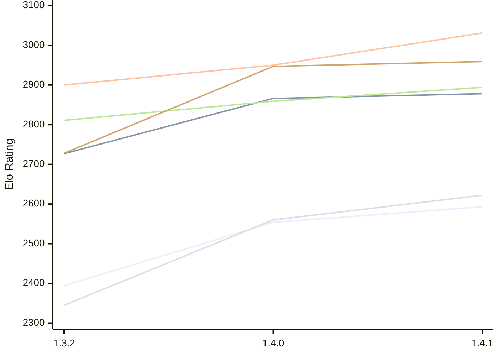

# Engine: Maharajah

Author: Oleksandr Velykotskyi

Home: https://github.com/Villi14/MaharajahCXX

## Elo Ratings E1 (Ultra 7 265T (1.50 GHz) - E-Core)

| Version | Published | STC 8.0+0.08s  | LTC 60.0+0.60s | VLTC 2m24s+1.12s | Comment |
| --- | --- | --- | --- | --- | --- |
| 1.4.1 | 2026-11-17 | 2593(+39) | 2878(+12) | 3031(+81) |  |
| 1.4.0 | 2026-11-15 | 2554(+160) | 2866(+139) | 2950(+50) |  |
| 1.3.2 | 2026-11-11 | 2394 | 2727 | 2900 |  |
 | | | cElo (∆ prev) | cElo (∆ prev) | cElo (∆ prev) | 

## Elo Ratings P1 (Ultra 7 265T (1.50 GHz) - P-Core)

| Version | Published | STC 8.0+0.08s  | LTC 60.0+0.60s | VLTC 2m24s+1.12s | Comment |
| --- | --- | --- | --- | --- | --- |
| 1.4.1 | 2026-11-17 | 2622(+62) | 2894(+35) | 2959(+12) |  |
| 1.4.0 | 2026-11-15 | 2560(+215) | 2859(+48) | 2947(+219) |  |
| 1.3.2 | 2026-11-11 | 2345 | 2811 | 2728 |  |
 | | | cElo (∆ prev) | cElo (∆ prev) | cElo (∆ prev) | 

## Elo Ratings T1 (i5-7500T 2.70GHz)

| Version | Published | STC 8.0+0.08s  | LTC 60.0+0.60s | VLTC 2m24s+1.12s | Comment |
| --- | --- | --- | --- | --- | --- |
| 1.3.2 | 2026-11-11 | 2345 | 2811 | 2728 |  |
 | | | cElo (∆ prev) | cElo (∆ prev) | cElo (∆ prev) | 

<a href="https://github.com/computer-chess-index/cci/issues/new?template=submit-version.yml&title=[VERSION]+Maharajah+<version>&body=###%20Engine%20name%0AMaharajah%0A%0A###%20Version%0A1.4.1" target="_blank">Submit new version</a>

 Test Conditions:

GUI/CLI: <a href=https://github.com/cutechess/cutechess target="_blank">Cute-Chess</a> 
Elo Calculation: <a href=https://www.remi-coulom.fr/Bayesian-Elo/ target="_blank">Bayesian-Elo</a> 
CPU for P1: Intel(R) Core(TM) Ultra 7 265T (1.50 GHz) - P-Core 
CPU for E1: Intel(R) Core(TM) Ultra 7 265T (1.50 GHz) - E-Core 
CPU for T1: Intel(R) Core(TM) i5-7500T 2.70GHz 
Opening book: 8_moves_v3 
\* STC: 8.0+0.08s, LTC: 60.0+0.60s, VLTC: 2m24s+1.12s

 Lists:
Ratings: <a href=https://github.com/computer-chess-index/cci/blob/main/lists/CCIRatings.csv target="_blank">Complete list</a>

Generated: 2026-11-23 05:40:17

## Ratings Verlauf E1 / P1

## Detailed Evaluation Results

| Version | Time Control | Variant | Elo  | Range +/- | Matches | Score | Average Opponent Elo | Draws |
| --- | --- |--- | --- | --- | --- | --- | --- | --- |
| 1.4.1 | VLTC (2m24s+1.12s) | P1 | 2959 | 49 | 136 | 54% | 2921 | 32% |
|  |  | E1 | 3031 | 40 | 196 | 52% | 3015 | 36% |
|  | LTC (60.0+0.60s) | E1 | 2878 | 38 | 220 | 51% | 2871 | 32% |
|  |  | P1 | 2894 | 51 | 126 | 52% | 2873 | 30% |
|  | STC (8.0+0.08s) | E1 | 2593 | 42 | 200 | 51% | 2581 | 21% |
|  |  | P1 | 2622 | 44 | 172 | 50% | 2623 | 30% |
| --- | --- |--- | --- | --- | --- | --- | --- | --- |
| 1.4.0 | VLTC (2m24s+1.12s) | P1 | 2947 | 41 | 178 | 44% | 3002 | 41% |
|  |  | E1 | 2950 | 47 | 144 | 47% | 2982 | 33% |
|  | LTC (60.0+0.60s) | P1 | 2859 | 46 | 152 | 53% | 2828 | 34% |
|  |  | E1 | 2866 | 42 | 190 | 48% | 2888 | 30% |
|  | STC (8.0+0.08s) | P1 | 2560 | 48 | 148 | 53% | 2526 | 25% |
|  |  | E1 | 2554 | 43 | 180 | 48% | 2574 | 28% |
| --- | --- |--- | --- | --- | --- | --- | --- | --- |
| 1.3.2 | VLTC (2m24s+1.12s) | P1 | 2728 | 97 | 40 | 45% | 2643 | 25% |
|  |  | E1 | 2900 | 74 | 64 | 56% | 2807 | 25% |
|  | LTC (60.0+0.60s) | E1 | 2727 | 77 | 62 | 47% | 2757 | 13% |
|  |  | P1 | 2811 | 122 | 36 | 75% | 2380 | 17% |
|  | STC (8.0+0.08s) | E1 | 2394 | 69 | 86 | 45% | 2466 | 10% |
|  |  | P1 | 2345 | 82 | 56 | 58% | 2238 | 20% |