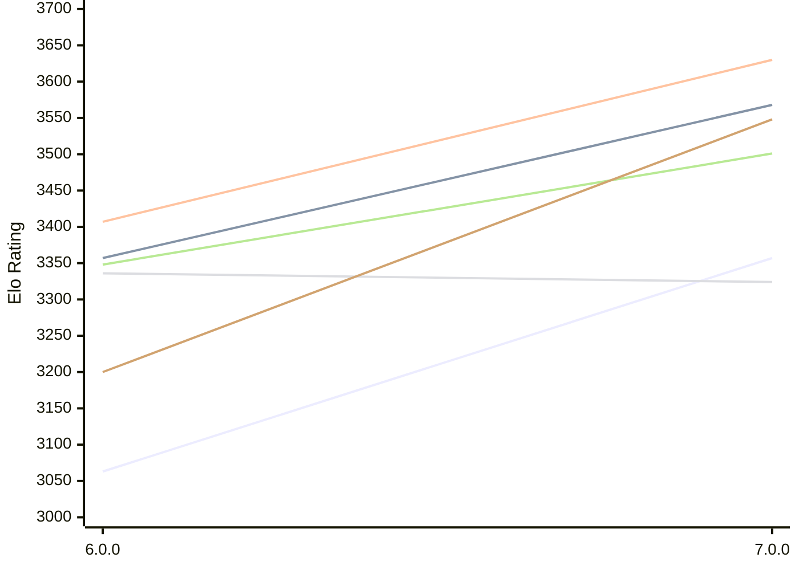
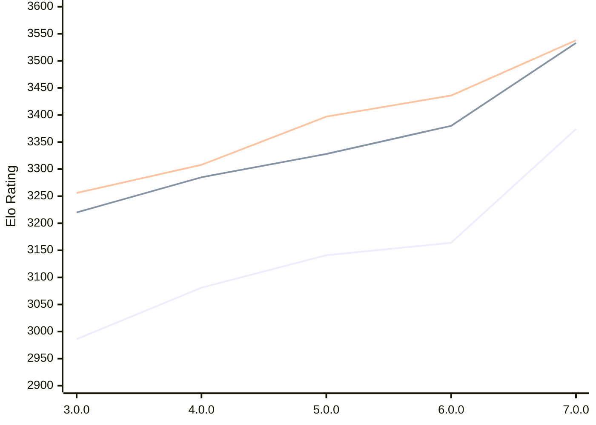

# Engine: Minke

Author: Eduardo Marinho

Home: https://github.com/enfmarinho/Minke

## Elo Ratings E1 (Ultra 7 265T (1.50 GHz) - E-Core)

| Version | Published | STC 8.0+0.08s  | LTC 60.0+0.60s | VLTC 2m24s+1.12s | Comment |
| --- | --- | --- | --- | --- | --- |
| 7.0.0 | 2026-08-27 | 3357(+294) | 3568(+211) | 3630(+223) |  |
| 6.0.0 | 2026-04-25 | 3063 | 3357 | 3407 |  |
 | | | cElo (∆ prev) | cElo (∆ prev) | cElo (∆ prev) | 

## Elo Ratings P1 (Ultra 7 265T (1.50 GHz) - P-Core)

| Version | Published | STC 8.0+0.08s  | LTC 60.0+0.60s | VLTC 2m24s+1.12s | Comment |
| --- | --- | --- | --- | --- | --- |
| 7.0.0 | 2026-08-27 | 3324(-12) | 3501(+153) | 3548(+348) |  |
| 6.0.0 | 2026-04-25 | 3336 | 3348 | 3200 |  |
 | | | cElo (∆ prev) | cElo (∆ prev) | cElo (∆ prev) | 

## Elo Ratings T1 (i5-7500T 2.70GHz)

| Version | Published | STC 8.0+0.08s  | LTC 60.0+0.60s | VLTC 2m24s+1.12s | Comment |
| --- | --- | --- | --- | --- | --- |
| 7.0.0 | 2026-08-27 | 3374(+210) | 3533(+153) | 3538(+102) |  |
| 6.0.0 | 2026-04-25 | 3164(+23) | 3380(+52) | 3436(+39) |  |
| 5.0.0 | 2026-02-13 | 3141(+60) | 3328(+43) | 3397(+89) |  |
| 4.0.0 | 2025-12-29 | 3081(+95) | 3285(+65) | 3308(+52) |  |
| 3.0.0 | 2025-10-20 | 2986 | 3220 | 3256 |  |
 | | | cElo (∆ prev) | cElo (∆ prev) | cElo (∆ prev) | 

<a href="https://github.com/computer-chess-index/cci/issues/new?template=submit-version.yml&title=[VERSION]+Minke+<version>&body=###%20Engine%20name%0AMinke%0A%0A###%20Version%0A7.0.0" target="_blank">Submit new version</a>

 Test Conditions:

GUI/CLI: <a href=https://github.com/cutechess/cutechess target="_blank">Cute-Chess</a> 
Elo Calculation: <a href=https://www.remi-coulom.fr/Bayesian-Elo/ target="_blank">Bayesian-Elo</a> 
CPU for P1: Intel(R) Core(TM) Ultra 7 265T (1.50 GHz) - P-Core 
CPU for E1: Intel(R) Core(TM) Ultra 7 265T (1.50 GHz) - E-Core 
CPU for T1: Intel(R) Core(TM) i5-7500T 2.70GHz 
Opening book: 8_moves_v3 
\* STC: 8.0+0.08s, LTC: 60.0+0.60s, VLTC: 2m24s+1.12s

 Lists:
Ratings: <a href=https://github.com/computer-chess-index/cci/blob/main/lists/CCIRatings.csv target="_blank">Complete list</a>

Generated: 2026-11-22 05:40:25

## Ratings Verlauf E1 / P1

## Ratings Verlauf T1

## Detailed Evaluation Results

| Version | Time Control | Variant | Elo  | Range +/- | Matches | Score | Average Opponent Elo | Draws |
| --- | --- |--- | --- | --- | --- | --- | --- | --- |
| 7.0.0 | VLTC (2m24s+1.12s) | T1 | 3538 | 29 | 280 | 50% | 3541 | 87% |
|  |  | P1 | 3548 | 39 | 144 | 50% | 3549 | 92% |
|  |  | E1 | 3630 | 29 | 264 | 50% | 3629 | 88% |
|  | LTC (60.0+0.60s) | T1 | 3533 | 30 | 260 | 51% | 3526 | 80% |
|  |  | P1 | 3501 | 35 | 184 | 48% | 3515 | 89% |
|  |  | E1 | 3568 | 29 | 276 | 49% | 3576 | 86% |
|  | STC (8.0+0.08s) | T1 | 3374 | 27 | 350 | 48% | 3387 | 63% |
|  |  | P1 | 3324 | 33 | 220 | 48% | 3337 | 78% |
|  |  | E1 | 3357 | 25 | 400 | 49% | 3363 | 67% |
| --- | --- |--- | --- | --- | --- | --- | --- | --- |
| 6.0.0 | VLTC (2m24s+1.12s) | P1 | 3200 | 101 | 26 | 65% | 3078 | 69% |
|  |  | E1 | 3407 | 96 | 26 | 60% | 3339 | 73% |
|  |  | T1 | 3436 | 23 | 450 | 49% | 3441 | 76% |
|  | LTC (60.0+0.60s) | E1 | 3357 | 80 | 40 | 49% | 3359 | 68% |
|  |  | T1 | 3380 | 24 | 432 | 50% | 3380 | 71% |
|  |  | P1 | 3348 | 128 | 20 | 75% | 3069 | 50% |
|  | STC (8.0+0.08s) | E1 | 3063 | 70 | 58 | 55% | 2985 | 55% |
|  |  | T1 | 3164 | 27 | 382 | 49% | 3174 | 59% |
|  |  | P1 | 3336 | 166 | 8 | 44% | 3376 | 63% |
| --- | --- |--- | --- | --- | --- | --- | --- | --- |
| 5.0.0 | VLTC (2m24s+1.12s) | T1 | 3397 | 24 | 414 | 50% | 3398 | 73% |
|  | LTC (60.0+0.60s) | T1 | 3328 | 26 | 382 | 51% | 3320 | 69% |
|  | STC (8.0+0.08s) | T1 | 3141 | 25 | 444 | 51% | 3137 | 57% |
| --- | --- |--- | --- | --- | --- | --- | --- | --- |
| 4.0.0 | VLTC (2m24s+1.12s) | T1 | 3308 | 30 | 276 | 51% | 3298 | 68% |
|  | LTC (60.0+0.60s) | T1 | 3285 | 31 | 268 | 48% | 3298 | 68% |
|  | STC (8.0+0.08s) | T1 | 3081 | 33 | 252 | 51% | 3052 | 57% |
| --- | --- |--- | --- | --- | --- | --- | --- | --- |
| 3.0.0 | VLTC (2m24s+1.12s) | T1 | 3256 | 37 | 184 | 50% | 3258 | 70% |
|  | LTC (60.0+0.60s) | T1 | 3220 | 32 | 252 | 48% | 3235 | 63% |
|  | STC (8.0+0.08s) | T1 | 2986 | 34 | 240 | 48% | 2998 | 56% |