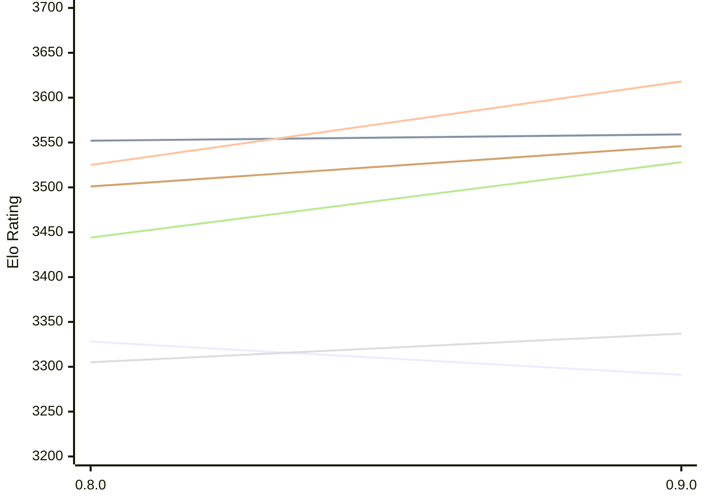
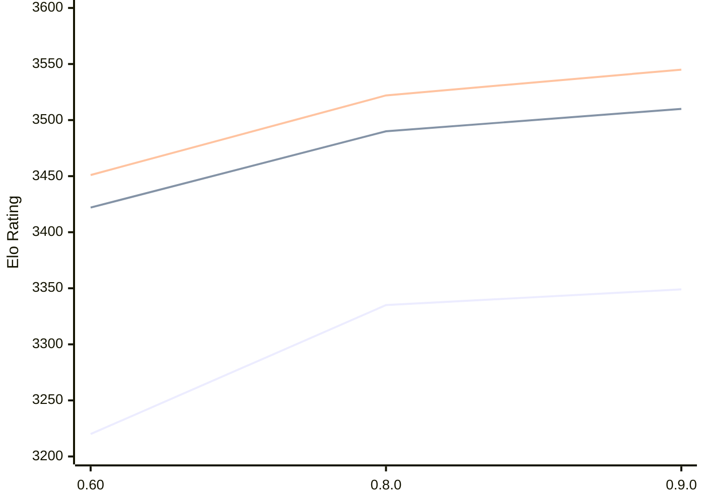

# Engine: Motor

Author: Martin Novák

Home: https://github.com/martinnovaak/motor

## Elo Ratings E1 (Ultra 7 265T (1.50 GHz) - E-Core)

| Version | Published | STC 8.0+0.08s  | LTC 60.0+0.60s | VLTC 2m24s+1.12s | Comment |
| --- | --- | --- | --- | --- | --- |
| 0.9.0 | 2025-06-02 | 3291(-37) | 3559(+7) | 3618(+93) |  |
| 0.8.0 | 2024-10-28 | 3328 | 3552 | 3525 |  |
 | | | cElo (∆ prev) | cElo (∆ prev) | cElo (∆ prev) | 

## Elo Ratings P1 (Ultra 7 265T (1.50 GHz) - P-Core)

| Version | Published | STC 8.0+0.08s  | LTC 60.0+0.60s | VLTC 2m24s+1.12s | Comment |
| --- | --- | --- | --- | --- | --- |
| 0.9.0 | 2025-06-02 | 3337(+32) | 3528(+84) | 3546(+45) |  |
| 0.8.0 | 2024-10-28 | 3305 | 3444 | 3501 |  |
 | | | cElo (∆ prev) | cElo (∆ prev) | cElo (∆ prev) | 

## Elo Ratings T1 (i5-7500T 2.70GHz)

| Version | Published | STC 8.0+0.08s  | LTC 60.0+0.60s | VLTC 2m24s+1.12s | Comment |
| --- | --- | --- | --- | --- | --- |
| 0.9.0 | 2025-06-02 | 3349(+14) | 3510(+20) | 3545(+23) |  |
| 0.8.0 | 2024-10-28 | 3335(+115) | 3490(+68) | 3522(+71) |  |
| 0.60 | 2024-06-30 | 3220 | 3422 | 3451 |  |
 | | | cElo (∆ prev) | cElo (∆ prev) | cElo (∆ prev) | 

<a href="https://github.com/computer-chess-index/cci/issues/new?template=submit-version.yml&title=[VERSION]+Motor+<version>&body=###%20Engine%20name%0AMotor%0A%0A###%20Version%0A0.9.0" target="_blank">Submit new version</a>

 Test Conditions:

GUI/CLI: <a href=https://github.com/cutechess/cutechess target="_blank">Cute-Chess</a> 
Elo Calculation: <a href=https://www.remi-coulom.fr/Bayesian-Elo/ target="_blank">Bayesian-Elo</a> 
CPU for P1: Intel(R) Core(TM) Ultra 7 265T (1.50 GHz) - P-Core 
CPU for E1: Intel(R) Core(TM) Ultra 7 265T (1.50 GHz) - E-Core 
CPU for T1: Intel(R) Core(TM) i5-7500T 2.70GHz 
Opening book: 8_moves_v3 
\* STC: 8.0+0.08s, LTC: 60.0+0.60s, VLTC: 2m24s+1.12s

 Lists:
Ratings: <a href=https://github.com/computer-chess-index/cci/blob/main/lists/CCIRatings.csv target="_blank">Complete list</a>

Generated: 2026-11-24 05:40:35

## Ratings Verlauf E1 / P1

## Ratings Verlauf T1

## Detailed Evaluation Results

| Version | Time Control | Variant | Elo  | Range +/- | Matches | Score | Average Opponent Elo | Draws |
| --- | --- |--- | --- | --- | --- | --- | --- | --- |
| 0.9.0 | VLTC (2m24s+1.12s) | T1 | 3545 | 21 | 530 | 49% | 3549 | 89% |
|  |  | P1 | 3546 | 36 | 184 | 51% | 3537 | 78% |
|  |  | E1 | 3618 | 30 | 254 | 49% | 3622 | 85% |
|  | LTC (60.0+0.60s) | T1 | 3510 | 22 | 500 | 50% | 3509 | 83% |
|  |  | P1 | 3528 | 35 | 192 | 51% | 3526 | 81% |
|  |  | E1 | 3559 | 27 | 320 | 47% | 3582 | 78% |
|  | STC (8.0+0.08s) | T1 | 3349 | 20 | 644 | 50% | 3347 | 72% |
|  |  | P1 | 3337 | 29 | 288 | 48% | 3348 | 77% |
|  |  | E1 | 3291 | 24 | 432 | 47% | 3313 | 66% |
| --- | --- |--- | --- | --- | --- | --- | --- | --- |
| 0.8.0 | VLTC (2m24s+1.12s) | T1 | 3522 | 13 | 1468 | 51% | 3518 | 86% |
|  |  | P1 | 3501 | 94 | 36 | 71% | 3181 | 58% |
|  |  | E1 | 3525 | 64 | 86 | 70% | 3171 | 50% |
|  | LTC (60.0+0.60s) | P1 | 3444 | 98 | 36 | 74% | 3123 | 47% |
|  |  | E1 | 3552 | 54 | 104 | 66% | 3249 | 62% |
|  |  | T1 | 3490 | 13 | 1484 | 50% | 3488 | 83% |
|  | STC (8.0+0.08s) | P1 | 3305 | 66 | 60 | 61% | 3204 | 72% |
|  |  | E1 | 3328 | 55 | 92 | 45% | 3348 | 55% |
|  |  | T1 | 3335 | 13 | 1460 | 49% | 3340 | 71% |
| --- | --- |--- | --- | --- | --- | --- | --- | --- |
| 0.60 | VLTC (2m24s+1.12s) | T1 | 3451 | 28 | 304 | 50% | 3452 | 80% |
|  | LTC (60.0+0.60s) | T1 | 3422 | 28 | 316 | 52% | 3406 | 74% |
|  | STC (8.0+0.08s) | T1 | 3220 | 29 | 352 | 56% | 3086 | 59% |