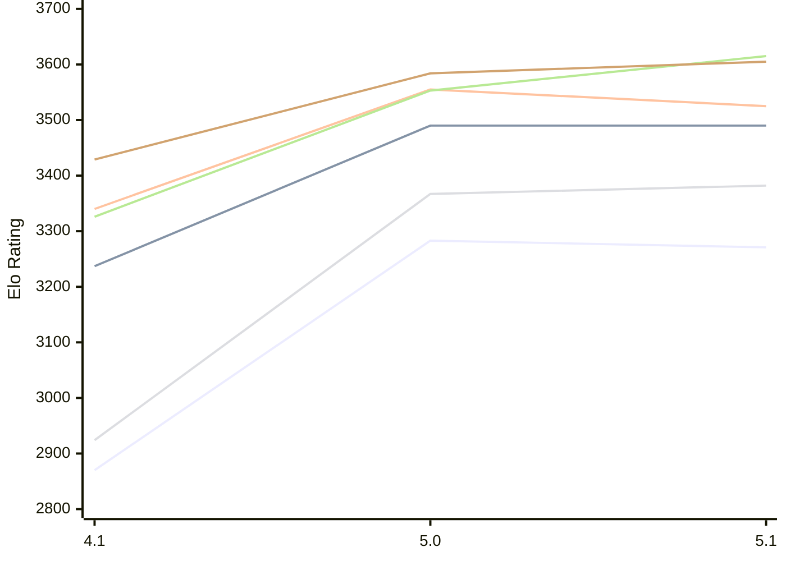

# Engine: NarcNext

Author: Madushan Bhashana Dissanayake

Home: https://github.com/Madushan996/NARC-NEXT

## Elo Ratings E1 (Ultra 7 265T (1.50 GHz) - E-Core)

| Version | Published | STC 8.0+0.08s  | LTC 60.0+0.60s | VLTC 2m24s+1.12s | Comment |
| --- | --- | --- | --- | --- | --- |
| 5.1 | 2026-11-05 | 3271(-12) | 3490(0) | 3525(-30) |  |
| 5.0 | 2026-11-02 | 3283(+413) | 3490(+253) | 3555(+215) |  |
| 4.1 | 2026-08-06 | 2870 | 3237 | 3340 |  |
 | | | cElo (∆ prev) | cElo (∆ prev) | cElo (∆ prev) | 

## Elo Ratings P1 (Ultra 7 265T (1.50 GHz) - P-Core)

| Version | Published | STC 8.0+0.08s  | LTC 60.0+0.60s | VLTC 2m24s+1.12s | Comment |
| --- | --- | --- | --- | --- | --- |
| 5.1 | 2026-11-05 | 3382(+15) | 3615(+62) | 3605(+21) |  |
| 5.0 | 2026-11-02 | 3367(+443) | 3553(+227) | 3584(+155) |  |
| 4.1 | 2026-08-06 | 2924 | 3326 | 3429 |  |
 | | | cElo (∆ prev) | cElo (∆ prev) | cElo (∆ prev) | 

## Elo Ratings T1 (i5-7500T 2.70GHz)

| Version | Published | STC 8.0+0.08s  | LTC 60.0+0.60s | VLTC 2m24s+1.12s | Comment |
| --- | --- | --- | --- | --- | --- |
| 4.1 | 2026-08-06 | 2871 | 3163 | 3281 |  |
 | | | cElo (∆ prev) | cElo (∆ prev) | cElo (∆ prev) | 

<a href="https://github.com/computer-chess-index/cci/issues/new?template=submit-version.yml&title=[VERSION]+NarcNext+<version>&body=###%20Engine%20name%0ANarcNext%0A%0A###%20Version%0A4.1" target="_blank">Submit new version</a>

 Test Conditions:

GUI/CLI: <a href=https://github.com/cutechess/cutechess target="_blank">Cute-Chess</a> 
Elo Calculation: <a href=https://www.remi-coulom.fr/Bayesian-Elo/ target="_blank">Bayesian-Elo</a> 
CPU for P1: Intel(R) Core(TM) Ultra 7 265T (1.50 GHz) - P-Core 
CPU for E1: Intel(R) Core(TM) Ultra 7 265T (1.50 GHz) - E-Core 
CPU for T1: Intel(R) Core(TM) i5-7500T 2.70GHz 
Opening book: 8_moves_v3 
\* STC: 8.0+0.08s, LTC: 60.0+0.60s, VLTC: 2m24s+1.12s

 Lists:
Ratings: <a href=https://github.com/computer-chess-index/cci/blob/main/lists/CCIRatings.csv target="_blank">Complete list</a>

Generated: 2026-11-11 05:40:16

## Ratings Verlauf E1 / P1

## Detailed Evaluation Results

| Version | Time Control | Variant | Elo  | Range +/- | Matches | Score | Average Opponent Elo | Draws |
| --- | --- |--- | --- | --- | --- | --- | --- | --- |
| 5.1 | VLTC (2m24s+1.12s) | E1 | 3525 | 34 | 214 | 50% | 3525 | 77% |
|  |  | P1 | 3605 | 49 | 98 | 50% | 3603 | 82% |
|  | LTC (60.0+0.60s) | E1 | 3490 | 33 | 226 | 51% | 3487 | 71% |
|  |  | P1 | 3615 | 44 | 128 | 50% | 3617 | 73% |
|  | STC (8.0+0.08s) | E1 | 3271 | 32 | 266 | 52% | 3255 | 62% |
|  |  | P1 | 3382 | 43 | 140 | 49% | 3394 | 64% |
| --- | --- |--- | --- | --- | --- | --- | --- | --- |
| 5.0 | VLTC (2m24s+1.12s) | P1 | 3584 | 44 | 130 | 52% | 3569 | 72% |
|  |  | E1 | 3555 | 34 | 224 | 54% | 3524 | 71% |
|  | LTC (60.0+0.60s) | P1 | 3553 | 34 | 214 | 57% | 3505 | 75% |
|  |  | E1 | 3490 | 31 | 264 | 54% | 3457 | 69% |
|  | STC (8.0+0.08s) | P1 | 3367 | 48 | 122 | 55% | 3324 | 58% |
|  |  | E1 | 3283 | 32 | 272 | 53% | 3248 | 57% |
| --- | --- |--- | --- | --- | --- | --- | --- | --- |
| 4.1 | VLTC (2m24s+1.12s) | P1 | 3429 | 31 | 276 | 48% | 3443 | 57% |
|  |  | E1 | 3340 | 27 | 378 | 47% | 3362 | 58% |
|  |  | T1 | 3281 | 30 | 308 | 51% | 3270 | 55% |
|  | LTC (60.0+0.60s) | P1 | 3326 | 35 | 226 | 49% | 3335 | 56% |
|  |  | E1 | 3237 | 28 | 372 | 48% | 3251 | 47% |
|  |  | T1 | 3163 | 30 | 318 | 52% | 3150 | 54% |
|  | STC (8.0+0.08s) | P1 | 2924 | 37 | 236 | 46% | 2969 | 38% |
|  |  | E1 | 2870 | 29 | 386 | 45% | 2917 | 37% |
|  |  | T1 | 2871 | 28 | 392 | 50% | 2870 | 42% |