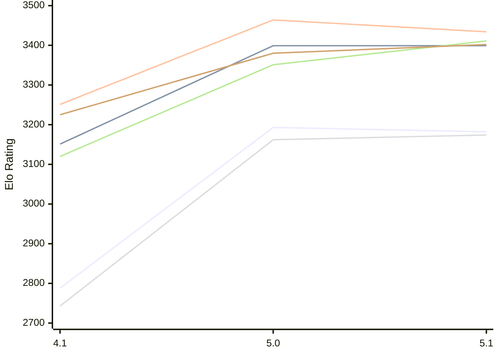

# Engine: NarcNext

Author: Madushan Bhashana Dissanayake

Home: https://github.com/Madushan996/NARC-NEXT

## Elo Ratings E1 (Ultra 7 265T (1.50 GHz) - E-Core)

| Version | Published | STC 8.0+0.08s  | LTC 60.0+0.60s | VLTC 2m24s+1.12s | Comment |
| --- | --- | --- | --- | --- | --- |
| 5.1 | 2026-11-05 | 3182(-11) | 3399(0) | 3434(-30) |  |
| 5.0 | 2026-11-02 | 3193(+405) | 3399(+248) | 3464(+213) |  |
| 4.1 | 2026-08-06 | 2788 | 3151 | 3251 |  |
 | | | cElo (∆ prev) | cElo (∆ prev) | cElo (∆ prev) | 

## Elo Ratings P1 (Ultra 7 265T (1.50 GHz) - P-Core)

| Version | Published | STC 8.0+0.08s  | LTC 60.0+0.60s | VLTC 2m24s+1.12s | Comment |
| --- | --- | --- | --- | --- | --- |
| 5.1 | 2026-11-05 | 3174(+12) | 3411(+60) | 3402(+22) |  |
| 5.0 | 2026-11-02 | 3162(+419) | 3351(+231) | 3380(+155) |  |
| 4.1 | 2026-08-06 | 2743 | 3120 | 3225 |  |
 | | | cElo (∆ prev) | cElo (∆ prev) | cElo (∆ prev) | 

## Elo Ratings T1 (i5-7500T 2.70GHz)

| Version | Published | STC 8.0+0.08s  | LTC 60.0+0.60s | VLTC 2m24s+1.12s | Comment |
| --- | --- | --- | --- | --- | --- |
| 4.1 | 2026-08-06 | 2871 | 3163 | 3281 |  |
 | | | cElo (∆ prev) | cElo (∆ prev) | cElo (∆ prev) | 

<a href="https://github.com/computer-chess-index/cci/issues/new?template=submit-version.yml&title=[VERSION]+NarcNext+<version>&body=###%20Engine%20name%0ANarcNext%0A%0A###%20Version%0A4.1" target="_blank">Submit new version</a>

 Test Conditions:

GUI/CLI: <a href=https://github.com/cutechess/cutechess target="_blank">Cute-Chess</a> 
Elo Calculation: <a href=https://www.remi-coulom.fr/Bayesian-Elo/ target="_blank">Bayesian-Elo</a> 
CPU for P1: Intel(R) Core(TM) Ultra 7 265T (1.50 GHz) - P-Core 
CPU for E1: Intel(R) Core(TM) Ultra 7 265T (1.50 GHz) - E-Core 
CPU for T1: Intel(R) Core(TM) i5-7500T 2.70GHz 
Opening book: 8_moves_v3 
\* STC: 8.0+0.08s, LTC: 60.0+0.60s, VLTC: 2m24s+1.12s

 Lists:
Ratings: <a href=https://github.com/computer-chess-index/cci/blob/main/lists/CCIRatings.csv target="_blank">Complete list</a>

Generated: 2026-11-15 05:40:27

## Ratings Verlauf E1 / P1

## Detailed Evaluation Results

| Version | Time Control | Variant | Elo  | Range +/- | Matches | Score | Average Opponent Elo | Draws |
| --- | --- |--- | --- | --- | --- | --- | --- | --- |
| 5.1 | VLTC (2m24s+1.12s) | P1 | 3402 | 46 | 110 | 50% | 3399 | 83% |
|  |  | E1 | 3434 | 33 | 218 | 50% | 3434 | 77% |
|  | LTC (60.0+0.60s) | P1 | 3411 | 44 | 128 | 50% | 3413 | 73% |
|  |  | E1 | 3399 | 33 | 226 | 51% | 3395 | 71% |
|  | STC (8.0+0.08s) | P1 | 3174 | 41 | 156 | 48% | 3193 | 62% |
|  |  | E1 | 3182 | 30 | 286 | 51% | 3174 | 63% |
| --- | --- |--- | --- | --- | --- | --- | --- | --- |
| 5.0 | VLTC (2m24s+1.12s) | P1 | 3380 | 44 | 130 | 52% | 3366 | 72% |
|  |  | E1 | 3464 | 33 | 236 | 54% | 3436 | 72% |
|  | LTC (60.0+0.60s) | P1 | 3351 | 34 | 218 | 57% | 3301 | 75% |
|  |  | E1 | 3399 | 31 | 268 | 54% | 3368 | 69% |
|  | STC (8.0+0.08s) | P1 | 3162 | 47 | 122 | 55% | 3120 | 58% |
|  |  | E1 | 3193 | 31 | 296 | 53% | 3141 | 57% |
| --- | --- |--- | --- | --- | --- | --- | --- | --- |
| 4.1 | VLTC (2m24s+1.12s) | E1 | 3251 | 27 | 378 | 47% | 3272 | 58% |
|  |  | T1 | 3281 | 30 | 308 | 51% | 3270 | 55% |
|  |  | P1 | 3225 | 31 | 276 | 48% | 3239 | 57% |
|  | LTC (60.0+0.60s) | E1 | 3151 | 28 | 372 | 48% | 3163 | 47% |
|  |  | T1 | 3163 | 30 | 318 | 52% | 3150 | 54% |
|  |  | P1 | 3120 | 35 | 226 | 49% | 3128 | 56% |
|  | STC (8.0+0.08s) | T1 | 2871 | 28 | 392 | 50% | 2870 | 42% |
|  |  | P1 | 2743 | 37 | 236 | 46% | 2786 | 38% |
|  |  | E1 | 2788 | 29 | 386 | 45% | 2835 | 37% |