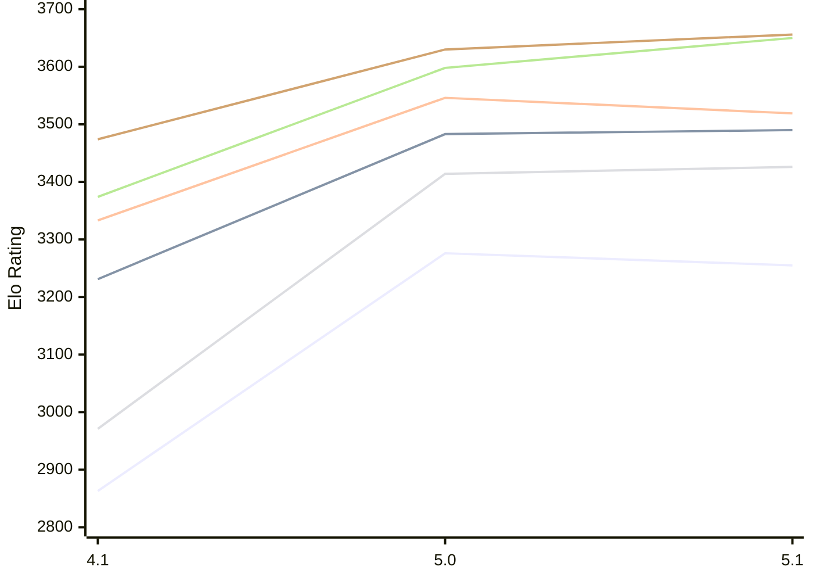

# Engine: NarcNext

Author: Madushan Bhashana Dissanayake

Home: https://github.com/Madushan996/NARC-NEXT

## Elo Ratings E1 (Ultra 7 265T (1.50 GHz) - E-Core)

| Version | Published | STC 8.0+0.08s  | LTC 60.0+0.60s | VLTC 2m24s+1.12s | Comment |
| --- | --- | --- | --- | --- | --- |
| 5.1 | 2026-11-05 | 3255(-21) | 3490(+7) | 3519(-27) |  |
| 5.0 | 2026-11-02 | 3276(+413) | 3483(+252) | 3546(+213) |  |
| 4.1 | 2026-08-06 | 2863 | 3231 | 3333 |  |
 | | | cElo (∆ prev) | cElo (∆ prev) | cElo (∆ prev) | 

## Elo Ratings P1 (Ultra 7 265T (1.50 GHz) - P-Core)

| Version | Published | STC 8.0+0.08s  | LTC 60.0+0.60s | VLTC 2m24s+1.12s | Comment |
| --- | --- | --- | --- | --- | --- |
| 5.1 | 2026-11-05 | 3426(+12) | 3650(+52) | 3656(+26) |  |
| 5.0 | 2026-11-02 | 3414(+443) | 3598(+224) | 3630(+156) |  |
| 4.1 | 2026-08-06 | 2971 | 3374 | 3474 |  |
 | | | cElo (∆ prev) | cElo (∆ prev) | cElo (∆ prev) | 

## Elo Ratings T1 (i5-7500T 2.70GHz)

| Version | Published | STC 8.0+0.08s  | LTC 60.0+0.60s | VLTC 2m24s+1.12s | Comment |
| --- | --- | --- | --- | --- | --- |
| 4.1 | 2026-08-06 | 2871 | 3163 | 3281 |  |
 | | | cElo (∆ prev) | cElo (∆ prev) | cElo (∆ prev) | 

<a href="https://github.com/computer-chess-index/cci/issues/new?template=submit-version.yml&title=[VERSION]+NarcNext+<version>&body=###%20Engine%20name%0ANarcNext%0A%0A###%20Version%0A4.1" target="_blank">Submit new version</a>

 Test Conditions:

GUI/CLI: <a href=https://github.com/cutechess/cutechess target="_blank">Cute-Chess</a> 
Elo Calculation: <a href=https://www.remi-coulom.fr/Bayesian-Elo/ target="_blank">Bayesian-Elo</a> 
CPU for P1: Intel(R) Core(TM) Ultra 7 265T (1.50 GHz) - P-Core 
CPU for E1: Intel(R) Core(TM) Ultra 7 265T (1.50 GHz) - E-Core 
CPU for T1: Intel(R) Core(TM) i5-7500T 2.70GHz 
Opening book: 8_moves_v3 
\* STC: 8.0+0.08s, LTC: 60.0+0.60s, VLTC: 2m24s+1.12s

 Lists:
Ratings: <a href=https://github.com/computer-chess-index/cci/blob/main/lists/CCIRatings.csv target="_blank">Complete list</a>

Generated: 2026-11-06 05:40:04

## Ratings Verlauf E1 / P1

## Detailed Evaluation Results

| Version | Time Control | Variant | Elo  | Range +/- | Matches | Score | Average Opponent Elo | Draws |
| --- | --- |--- | --- | --- | --- | --- | --- | --- |
| 5.1 | VLTC (2m24s+1.12s) | P1 | 3656 | 76 | 40 | 51% | 3645 | 83% |
|  |  | E1 | 3519 | 46 | 112 | 51% | 3513 | 79% |
|  | LTC (60.0+0.60s) | E1 | 3490 | 46 | 118 | 53% | 3472 | 68% |
|  |  | P1 | 3650 | 78 | 40 | 48% | 3669 | 70% |
|  | STC (8.0+0.08s) | E1 | 3255 | 39 | 170 | 53% | 3237 | 63% |
|  |  | P1 | 3426 | 56 | 80 | 48% | 3444 | 66% |
| --- | --- |--- | --- | --- | --- | --- | --- | --- |
| 5.0 | VLTC (2m24s+1.12s) | P1 | 3630 | 44 | 130 | 52% | 3614 | 72% |
|  |  | E1 | 3546 | 34 | 224 | 54% | 3515 | 71% |
|  | LTC (60.0+0.60s) | P1 | 3598 | 34 | 210 | 57% | 3549 | 76% |
|  |  | E1 | 3483 | 31 | 264 | 54% | 3452 | 69% |
|  | STC (8.0+0.08s) | P1 | 3414 | 47 | 122 | 55% | 3372 | 58% |
|  |  | E1 | 3276 | 32 | 272 | 53% | 3241 | 57% |
| --- | --- |--- | --- | --- | --- | --- | --- | --- |
| 4.1 | VLTC (2m24s+1.12s) | T1 | 3281 | 30 | 308 | 51% | 3270 | 55% |
|  |  | P1 | 3474 | 31 | 276 | 48% | 3487 | 57% |
|  |  | E1 | 3333 | 27 | 378 | 47% | 3355 | 58% |
|  | LTC (60.0+0.60s) | P1 | 3374 | 35 | 226 | 49% | 3380 | 56% |
|  |  | E1 | 3231 | 28 | 372 | 48% | 3244 | 47% |
|  |  | T1 | 3163 | 30 | 318 | 52% | 3150 | 54% |
|  | STC (8.0+0.08s) | P1 | 2971 | 37 | 236 | 46% | 3016 | 38% |
|  |  | E1 | 2863 | 29 | 386 | 45% | 2911 | 37% |
|  |  | T1 | 2871 | 28 | 392 | 50% | 2870 | 42% |