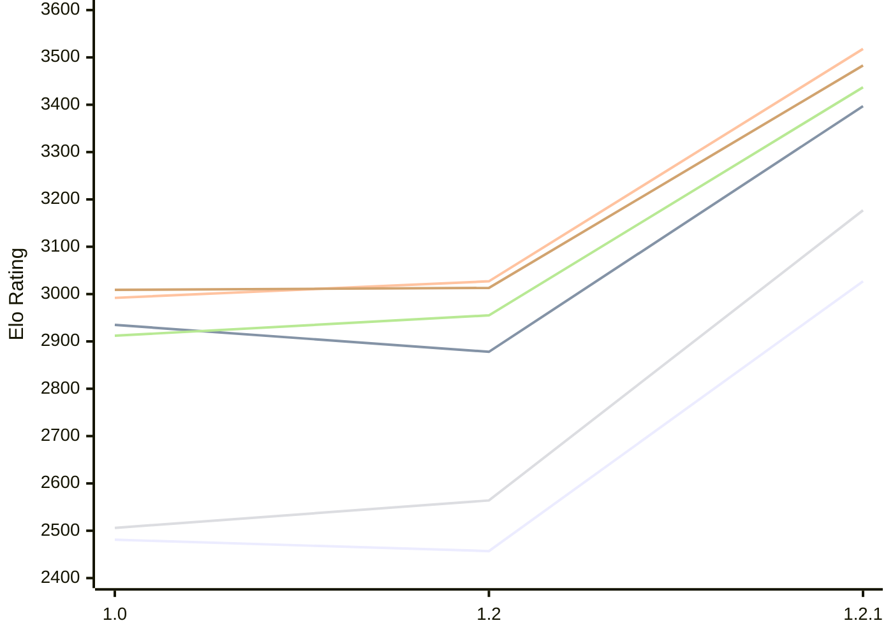

# Engine: Onechess

Author: Julien Orlandini

Home: https://github.com/ovnice-dev/onechess

## Elo Ratings E1 (Ultra 7 265T (1.50 GHz) - E-Core)

| Version | Published | STC 8.0+0.08s  | LTC 60.0+0.60s | VLTC 2m24s+1.12s | Comment |
| --- | --- | --- | --- | --- | --- |
| 1.2.1 | 2026-11-25 | 3027(+570) | 3397(+519) | 3518(+491) |  |
| 1.2 | 2026-11-22 | 2457(-24) | 2878(-57) | 3027(+35) |  |
| 1.0 | 2026-11-15 | 2481 | 2935 | 2992 |  |
 | | | cElo (∆ prev) | cElo (∆ prev) | cElo (∆ prev) | 

## Elo Ratings P1 (Ultra 7 265T (1.50 GHz) - P-Core)

| Version | Published | STC 8.0+0.08s  | LTC 60.0+0.60s | VLTC 2m24s+1.12s | Comment |
| --- | --- | --- | --- | --- | --- |
| 1.2.1 | 2026-11-25 | 3177(+613) | 3437(+482) | 3483(+470) |  |
| 1.2 | 2026-11-22 | 2564(+58) | 2955(+43) | 3013(+4) |  |
| 1.0 | 2026-11-15 | 2506 | 2912 | 3009 |  |
 | | | cElo (∆ prev) | cElo (∆ prev) | cElo (∆ prev) | 

## Elo Ratings T1 (i5-7500T 2.70GHz)

| Version | Published | STC 8.0+0.08s  | LTC 60.0+0.60s | VLTC 2m24s+1.12s | Comment |
| --- | --- | --- | --- | --- | --- |
| 1.0 | 2026-11-15 | 2506 | 2912 | 3009 |  |
 | | | cElo (∆ prev) | cElo (∆ prev) | cElo (∆ prev) | 

<a href="https://github.com/computer-chess-index/cci/issues/new?template=submit-version.yml&title=[VERSION]+Onechess+<version>&body=###%20Engine%20name%0AOnechess%0A%0A###%20Version%0A1.2.1" target="_blank">Submit new version</a>

 Test Conditions:

GUI/CLI: <a href=https://github.com/cutechess/cutechess target="_blank">Cute-Chess</a> 
Elo Calculation: <a href=https://www.remi-coulom.fr/Bayesian-Elo/ target="_blank">Bayesian-Elo</a> 
CPU for P1: Intel(R) Core(TM) Ultra 7 265T (1.50 GHz) - P-Core 
CPU for E1: Intel(R) Core(TM) Ultra 7 265T (1.50 GHz) - E-Core 
CPU for T1: Intel(R) Core(TM) i5-7500T 2.70GHz 
Opening book: 8_moves_v3 
\* STC: 8.0+0.08s, LTC: 60.0+0.60s, VLTC: 2m24s+1.12s

 Lists:
Ratings: <a href=https://github.com/computer-chess-index/cci/blob/main/lists/CCIRatings.csv target="_blank">Complete list</a>

Generated: 2026-11-27 05:41:05

## Ratings Verlauf E1 / P1

## Detailed Evaluation Results

| Version | Time Control | Variant | Elo  | Range +/- | Matches | Score | Average Opponent Elo | Draws |
| --- | --- |--- | --- | --- | --- | --- | --- | --- |
| 1.2.1 | VLTC (2m24s+1.12s) | E1 | 3518 | 30 | 318 | 57% | 3456 | 57% |
|  |  | P1 | 3483 | 34 | 224 | 56% | 3434 | 63% |
|  | LTC (60.0+0.60s) | P1 | 3437 | 33 | 248 | 55% | 3390 | 58% |
|  |  | E1 | 3397 | 26 | 444 | 59% | 3309 | 45% |
|  | STC (8.0+0.08s) | P1 | 3177 | 32 | 340 | 60% | 3039 | 32% |
|  |  | E1 | 3027 | 36 | 328 | 64% | 2846 | 17% |
| --- | --- |--- | --- | --- | --- | --- | --- | --- |
| 1.2 | VLTC (2m24s+1.12s) | P1 | 3013 | 49 | 130 | 47% | 3035 | 38% |
|  |  | E1 | 3027 | 43 | 168 | 54% | 2993 | 39% |
|  | LTC (60.0+0.60s) | P1 | 2955 | 74 | 60 | 49% | 2965 | 25% |
|  |  | E1 | 2878 | 25 | 520 | 57% | 2811 | 30% |
|  | STC (8.0+0.08s) | P1 | 2564 | 55 | 116 | 51% | 2553 | 20% |
|  |  | E1 | 2457 | 32 | 354 | 56% | 2394 | 23% |
| --- | --- |--- | --- | --- | --- | --- | --- | --- |
| 1.0 | VLTC (2m24s+1.12s) | E1 | 2992 | 32 | 316 | 46% | 3021 | 32% |
|  |  | P1 | 3009 | 45 | 154 | 50% | 3001 | 40% |
|  | LTC (60.0+0.60s) | E1 | 2935 | 36 | 268 | 51% | 2912 | 29% |
|  |  | P1 | 2912 | 40 | 212 | 49% | 2901 | 31% |
|  | STC (8.0+0.08s) | P1 | 2506 | 40 | 216 | 48% | 2526 | 21% |
|  |  | E1 | 2481 | 37 | 260 | 50% | 2489 | 19% |