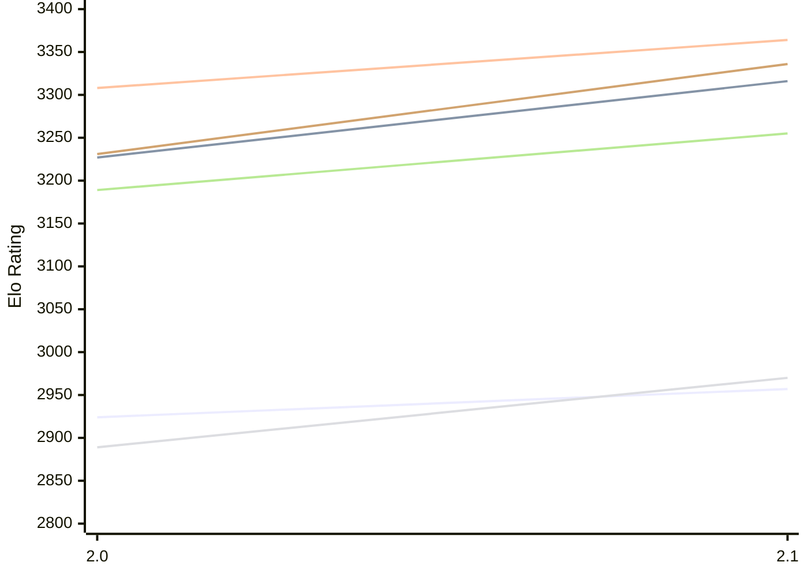
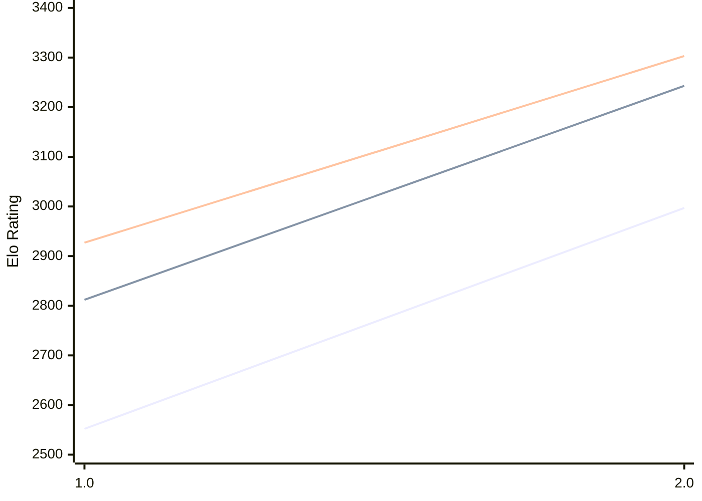

# Engine: Onslaught

Author: Kai Chung

Home: https://github.com/kachhy/Onslaught

## Elo Ratings E1 (Ultra 7 265T (1.50 GHz) - E-Core)

| Version | Published | STC 8.0+0.08s  | LTC 60.0+0.60s | VLTC 2m24s+1.12s | Comment |
| --- | --- | --- | --- | --- | --- |
| 2.1 | 2026-10-23 | 2957(+33) | 3316(+89) | 3364(+56) |  |
| 2.0 | 2026-09-12 | 2924 | 3227 | 3308 |  |
 | | | cElo (∆ prev) | cElo (∆ prev) | cElo (∆ prev) | 

## Elo Ratings P1 (Ultra 7 265T (1.50 GHz) - P-Core)

| Version | Published | STC 8.0+0.08s  | LTC 60.0+0.60s | VLTC 2m24s+1.12s | Comment |
| --- | --- | --- | --- | --- | --- |
| 2.1 | 2026-10-23 | 2970(+81) | 3255(+66) | 3336(+105) |  |
| 2.0 | 2026-09-12 | 2889 | 3189 | 3231 |  |
 | | | cElo (∆ prev) | cElo (∆ prev) | cElo (∆ prev) | 

## Elo Ratings T1 (i5-7500T 2.70GHz)

| Version | Published | STC 8.0+0.08s  | LTC 60.0+0.60s | VLTC 2m24s+1.12s | Comment |
| --- | --- | --- | --- | --- | --- |
| 2.0 | 2026-09-12 | 2997(+445) | 3243(+431) | 3303(+376) |  |
| 1.0 | 2026-06-02 | 2552 | 2812 | 2927 |  |
 | | | cElo (∆ prev) | cElo (∆ prev) | cElo (∆ prev) | 

<a href="https://github.com/computer-chess-index/cci/issues/new?template=submit-version.yml&title=[VERSION]+Onslaught+<version>&body=###%20Engine%20name%0AOnslaught%0A%0A###%20Version%0A2.0" target="_blank">Submit new version</a>

 Test Conditions:

GUI/CLI: <a href=https://github.com/cutechess/cutechess target="_blank">Cute-Chess</a> 
Elo Calculation: <a href=https://www.remi-coulom.fr/Bayesian-Elo/ target="_blank">Bayesian-Elo</a> 
CPU for P1: Intel(R) Core(TM) Ultra 7 265T (1.50 GHz) - P-Core 
CPU for E1: Intel(R) Core(TM) Ultra 7 265T (1.50 GHz) - E-Core 
CPU for T1: Intel(R) Core(TM) i5-7500T 2.70GHz 
Opening book: 8_moves_v3 
\* STC: 8.0+0.08s, LTC: 60.0+0.60s, VLTC: 2m24s+1.12s

 Lists:
Ratings: <a href=https://github.com/computer-chess-index/cci/blob/main/lists/CCIRatings.csv target="_blank">Complete list</a>

Generated: 2026-11-17 05:40:50

## Ratings Verlauf E1 / P1

## Ratings Verlauf T1

## Detailed Evaluation Results

| Version | Time Control | Variant | Elo  | Range +/- | Matches | Score | Average Opponent Elo | Draws |
| --- | --- |--- | --- | --- | --- | --- | --- | --- |
| 2.1 | VLTC (2m24s+1.12s) | P1 | 3336 | 34 | 224 | 49% | 3341 | 69% |
|  |  | E1 | 3364 | 29 | 312 | 50% | 3368 | 69% |
|  | LTC (60.0+0.60s) | P1 | 3255 | 28 | 324 | 46% | 3285 | 65% |
|  |  | E1 | 3316 | 31 | 266 | 51% | 3306 | 71% |
|  | STC (8.0+0.08s) | P1 | 2970 | 35 | 238 | 47% | 2993 | 49% |
|  |  | E1 | 2957 | 28 | 388 | 53% | 2931 | 41% |
| --- | --- |--- | --- | --- | --- | --- | --- | --- |
| 2.0 | VLTC (2m24s+1.12s) | T1 | 3303 | 32 | 264 | 53% | 3282 | 65% |
|  |  | P1 | 3231 | 31 | 272 | 46% | 3259 | 60% |
|  |  | E1 | 3308 | 27 | 366 | 48% | 3324 | 63% |
|  | LTC (60.0+0.60s) | T1 | 3243 | 29 | 314 | 53% | 3220 | 61% |
|  |  | P1 | 3189 | 33 | 248 | 51% | 3164 | 56% |
|  |  | E1 | 3227 | 27 | 384 | 47% | 3254 | 54% |
|  | STC (8.0+0.08s) | T1 | 2997 | 36 | 232 | 51% | 2986 | 45% |
|  |  | P1 | 2889 | 31 | 324 | 48% | 2908 | 42% |
|  |  | E1 | 2924 | 30 | 326 | 44% | 2971 | 48% |
| --- | --- |--- | --- | --- | --- | --- | --- | --- |
| 1.0 | VLTC (2m24s+1.12s) | T1 | 2927 | 29 | 364 | 51% | 2920 | 45% |
|  | LTC (60.0+0.60s) | T1 | 2812 | 31 | 324 | 51% | 2797 | 43% |
|  | STC (8.0+0.08s) | T1 | 2552 | 30 | 372 | 50% | 2547 | 33% |