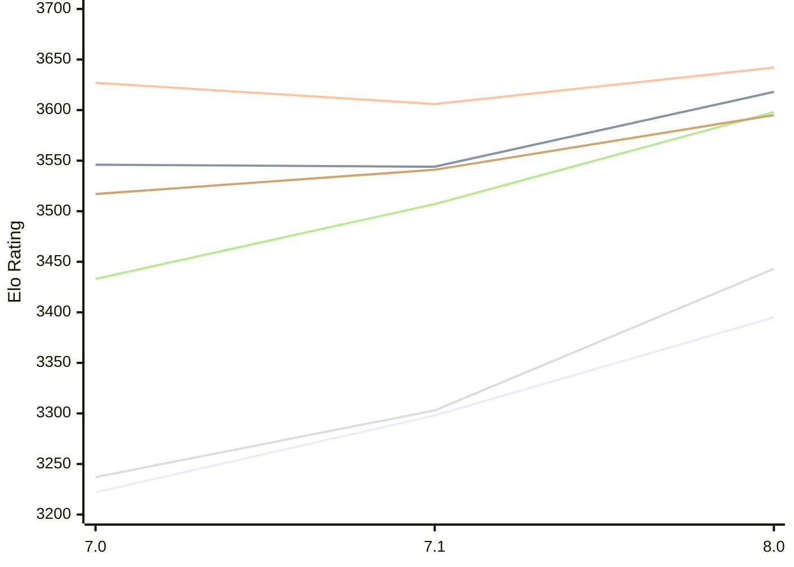
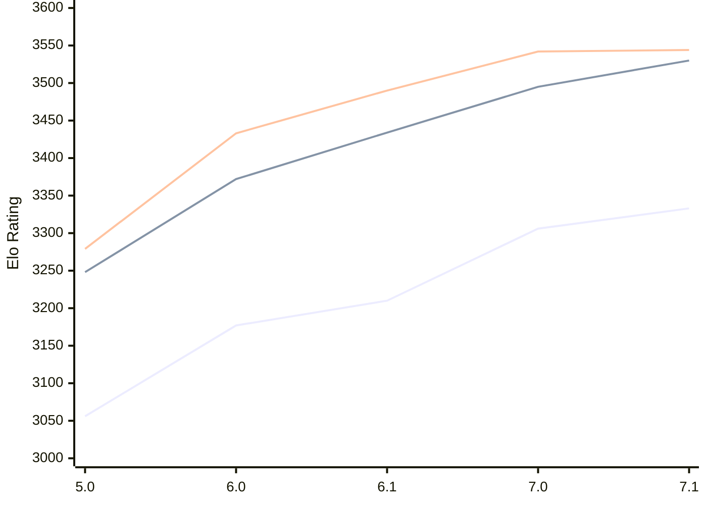

# Engine: PZChessBot

Author: Kevin Lu

Home: https://github.com/kevlu8/PZChessBot

## Elo Ratings E1 (Ultra 7 265T (1.50 GHz) - E-Core)

| Version | Published | STC 8.0+0.08s  | LTC 60.0+0.60s | VLTC 2m24s+1.12s | Comment |
| --- | --- | --- | --- | --- | --- |
| 8.0 | 2026-11-20 | 3395(+97) | 3618(+74) | 3642(+36) |  |
| 7.1 | 2026-06-27 | 3298(+76) | 3544(-2) | 3606(-21) |  |
| 7.0 | 2026-05-07 | 3222 | 3546 | 3627 |  |
 | | | cElo (∆ prev) | cElo (∆ prev) | cElo (∆ prev) | 

## Elo Ratings P1 (Ultra 7 265T (1.50 GHz) - P-Core)

| Version | Published | STC 8.0+0.08s  | LTC 60.0+0.60s | VLTC 2m24s+1.12s | Comment |
| --- | --- | --- | --- | --- | --- |
| 8.0 | 2026-11-20 | 3443(+140) | 3598(+91) | 3595(+54) |  |
| 7.1 | 2026-06-27 | 3303(+66) | 3507(+74) | 3541(+24) |  |
| 7.0 | 2026-05-07 | 3237 | 3433 | 3517 |  |
 | | | cElo (∆ prev) | cElo (∆ prev) | cElo (∆ prev) | 

## Elo Ratings T1 (i5-7500T 2.70GHz)

| Version | Published | STC 8.0+0.08s  | LTC 60.0+0.60s | VLTC 2m24s+1.12s | Comment |
| --- | --- | --- | --- | --- | --- |
| 7.1 | 2026-06-27 | 3333(+27) | 3530(+35) | 3544(+2) |  |
| 7.0 | 2026-05-07 | 3306(+96) | 3495(+61) | 3542(+52) |  |
| 6.1 | 2026-02-01 | 3210(+33) | 3434(+62) | 3490(+57) |  |
| 6.0 | 2026-01-01 | 3177(+121) | 3372(+124) | 3433(+154) |  |
| 5.0 | 2025-10-19 | 3056 | 3248 | 3279 |  |
 | | | cElo (∆ prev) | cElo (∆ prev) | cElo (∆ prev) | 

<a href="https://github.com/computer-chess-index/cci/issues/new?template=submit-version.yml&title=[VERSION]+PZChessBot+<version>&body=###%20Engine%20name%0APZChessBot%0A%0A###%20Version%0A7.1" target="_blank">Submit new version</a>

 Test Conditions:

GUI/CLI: <a href=https://github.com/cutechess/cutechess target="_blank">Cute-Chess</a> 
Elo Calculation: <a href=https://www.remi-coulom.fr/Bayesian-Elo/ target="_blank">Bayesian-Elo</a> 
CPU for P1: Intel(R) Core(TM) Ultra 7 265T (1.50 GHz) - P-Core 
CPU for E1: Intel(R) Core(TM) Ultra 7 265T (1.50 GHz) - E-Core 
CPU for T1: Intel(R) Core(TM) i5-7500T 2.70GHz 
Opening book: 8_moves_v3 
\* STC: 8.0+0.08s, LTC: 60.0+0.60s, VLTC: 2m24s+1.12s

 Lists:
Ratings: <a href=https://github.com/computer-chess-index/cci/blob/main/lists/CCIRatings.csv target="_blank">Complete list</a>

Generated: 2026-11-22 05:41:36

## Ratings Verlauf E1 / P1

## Ratings Verlauf T1

## Detailed Evaluation Results

| Version | Time Control | Variant | Elo  | Range +/- | Matches | Score | Average Opponent Elo | Draws |
| --- | --- |--- | --- | --- | --- | --- | --- | --- |
| 8.0 | VLTC (2m24s+1.12s) | E1 | 3642 | 36 | 180 | 51% | 3636 | 84% |
|  |  | P1 | 3595 | 104 | 20 | 50% | 3594 | 90% |
|  | LTC (60.0+0.60s) | E1 | 3618 | 41 | 140 | 54% | 3594 | 84% |
|  |  | P1 | 3598 | 49 | 96 | 47% | 3617 | 88% |
|  | STC (8.0+0.08s) | P1 | 3443 | 99 | 24 | 50% | 3441 | 75% |
|  |  | E1 | 3395 | 36 | 188 | 51% | 3386 | 73% |
| --- | --- |--- | --- | --- | --- | --- | --- | --- |
| 7.1 | VLTC (2m24s+1.12s) | T1 | 3544 | 30 | 250 | 51% | 3538 | 85% |
|  |  | P1 | 3541 | 33 | 232 | 57% | 3480 | 80% |
|  |  | E1 | 3606 | 28 | 340 | 59% | 3483 | 76% |
|  | LTC (60.0+0.60s) | T1 | 3530 | 29 | 284 | 50% | 3532 | 84% |
|  |  | P1 | 3507 | 32 | 240 | 55% | 3426 | 77% |
|  |  | E1 | 3544 | 30 | 296 | 55% | 3453 | 71% |
|  | STC (8.0+0.08s) | T1 | 3333 | 26 | 362 | 50% | 3332 | 71% |
|  |  | P1 | 3303 | 30 | 284 | 49% | 3306 | 69% |
|  |  | E1 | 3298 | 24 | 450 | 46% | 3326 | 67% |
| --- | --- |--- | --- | --- | --- | --- | --- | --- |
| 7.0 | VLTC (2m24s+1.12s) | T1 | 3542 | 25 | 362 | 50% | 3542 | 84% |
|  |  | P1 | 3517 | 118 | 20 | 73% | 3333 | 55% |
|  |  | E1 | 3627 | 62 | 72 | 58% | 3529 | 60% |
|  | LTC (60.0+0.60s) | T1 | 3495 | 25 | 388 | 51% | 3490 | 84% |
|  |  | P1 | 3433 | 97 | 40 | 74% | 3092 | 43% |
|  |  | E1 | 3546 | 68 | 56 | 54% | 3507 | 63% |
|  | STC (8.0+0.08s) | T1 | 3306 | 28 | 340 | 50% | 3308 | 66% |
|  |  | P1 | 3237 | 78 | 56 | 60% | 3000 | 45% |
|  |  | E1 | 3222 | 60 | 80 | 46% | 3201 | 56% |
| --- | --- |--- | --- | --- | --- | --- | --- | --- |
| 6.1 | VLTC (2m24s+1.12s) | T1 | 3490 | 21 | 520 | 50% | 3488 | 80% |
|  | LTC (60.0+0.60s) | T1 | 3434 | 23 | 464 | 50% | 3433 | 76% |
|  | STC (8.0+0.08s) | T1 | 3210 | 25 | 456 | 51% | 3202 | 56% |
| --- | --- |--- | --- | --- | --- | --- | --- | --- |
| 6.0 | VLTC (2m24s+1.12s) | T1 | 3433 | 28 | 312 | 50% | 3429 | 73% |
|  | LTC (60.0+0.60s) | T1 | 3372 | 31 | 268 | 50% | 3372 | 69% |
|  | STC (8.0+0.08s) | T1 | 3177 | 32 | 264 | 49% | 3185 | 58% |
| --- | --- |--- | --- | --- | --- | --- | --- | --- |
| 5.0 | VLTC (2m24s+1.12s) | T1 | 3279 | 32 | 254 | 50% | 3268 | 65% |
|  | LTC (60.0+0.60s) | T1 | 3248 | 38 | 184 | 53% | 3202 | 64% |
|  | STC (8.0+0.08s) | T1 | 3056 | 35 | 236 | 55% | 2973 | 52% |