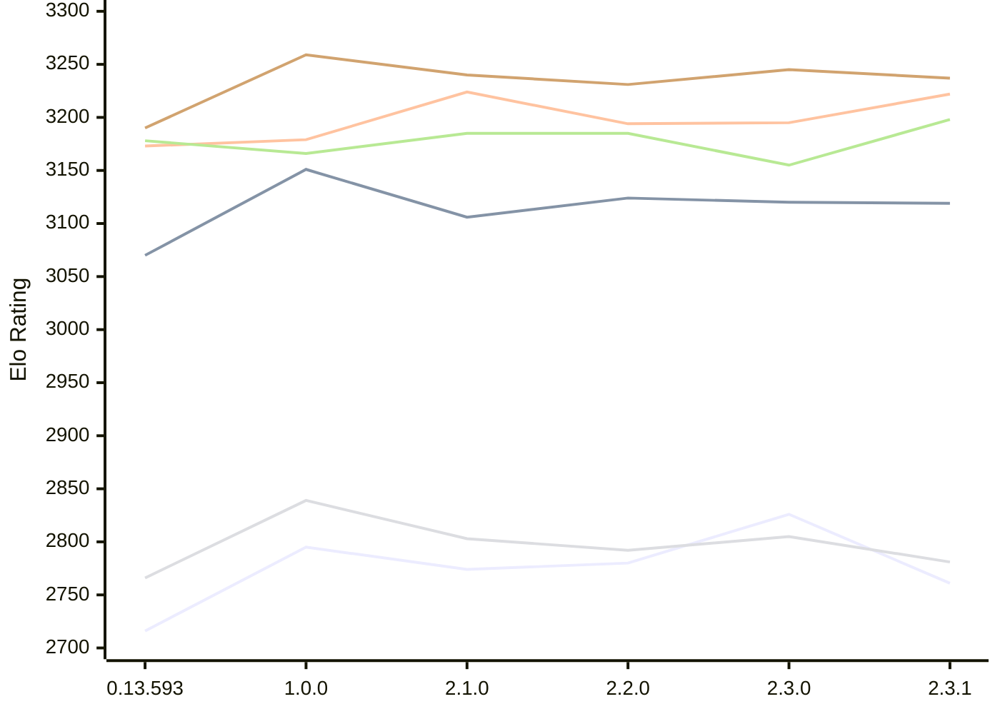

# Engine: Pawnstar

Author: Jonny Reckless

Home: https://github.com/jonny-reckless/pawnstar

## Elo Ratings E1 (Ultra 7 265T (1.50 GHz) - E-Core)

| Version | Published | STC 8.0+0.08s  | LTC 60.0+0.60s | VLTC 2m24s+1.12s | Comment |
| --- | --- | --- | --- | --- | --- |
| 2.3.1 | 2026-11-09 | 2761(-65) | 3119(-1) | 3222(+27) |  |
| 2.3.0 | 2026-11-08 | 2826(+46) | 3120(-4) | 3195(+1) |  |
| 2.2.0 | 2026-11-07 | 2780(+6) | 3124(+18) | 3194(-30) |  |
| 2.1.0 | 2026-10-31 | 2774(-21) | 3106(-45) | 3224(+45) |  |
| 1.0.0 | 2026-10-15 | 2795(+79) | 3151(+81) | 3179(+6) |  |
| 0.13.593 | 2026-06-30 | 2716 | 3070 | 3173 |  |
 | | | cElo (∆ prev) | cElo (∆ prev) | cElo (∆ prev) | 

## Elo Ratings P1 (Ultra 7 265T (1.50 GHz) - P-Core)

| Version | Published | STC 8.0+0.08s  | LTC 60.0+0.60s | VLTC 2m24s+1.12s | Comment |
| --- | --- | --- | --- | --- | --- |
| 2.3.1 | 2026-11-09 | 2781(-24) | 3198(+43) | 3237(-8) |  |
| 2.3.0 | 2026-11-08 | 2805(+13) | 3155(-30) | 3245(+14) |  |
| 2.2.0 | 2026-11-07 | 2792(-11) | 3185(0) | 3231(-9) |  |
| 2.1.0 | 2026-10-31 | 2803(-36) | 3185(+19) | 3240(-19) |  |
| 1.0.0 | 2026-10-15 | 2839(+73) | 3166(-12) | 3259(+69) |  |
| 0.13.593 | 2026-06-30 | 2766 | 3178 | 3190 |  |
 | | | cElo (∆ prev) | cElo (∆ prev) | cElo (∆ prev) | 

## Elo Ratings T1 (i5-7500T 2.70GHz)

| Version | Published | STC 8.0+0.08s  | LTC 60.0+0.60s | VLTC 2m24s+1.12s | Comment |
| --- | --- | --- | --- | --- | --- |
| 0.13.593 | 2026-06-30 | 2831 | 3125 | 3200 |  |
 | | | cElo (∆ prev) | cElo (∆ prev) | cElo (∆ prev) | 

<a href="https://github.com/computer-chess-index/cci/issues/new?template=submit-version.yml&title=[VERSION]+Pawnstar+<version>&body=###%20Engine%20name%0APawnstar%0A%0A###%20Version%0A0.13.593" target="_blank">Submit new version</a>

 Test Conditions:

GUI/CLI: <a href=https://github.com/cutechess/cutechess target="_blank">Cute-Chess</a> 
Elo Calculation: <a href=https://www.remi-coulom.fr/Bayesian-Elo/ target="_blank">Bayesian-Elo</a> 
CPU for P1: Intel(R) Core(TM) Ultra 7 265T (1.50 GHz) - P-Core 
CPU for E1: Intel(R) Core(TM) Ultra 7 265T (1.50 GHz) - E-Core 
CPU for T1: Intel(R) Core(TM) i5-7500T 2.70GHz 
Opening book: 8_moves_v3 
\* STC: 8.0+0.08s, LTC: 60.0+0.60s, VLTC: 2m24s+1.12s

 Lists:
Ratings: <a href=https://github.com/computer-chess-index/cci/blob/main/lists/CCIRatings.csv target="_blank">Complete list</a>

Generated: 2026-11-13 05:40:59

## Ratings Verlauf E1 / P1

## Detailed Evaluation Results

| Version | Time Control | Variant | Elo  | Range +/- | Matches | Score | Average Opponent Elo | Draws |
| --- | --- |--- | --- | --- | --- | --- | --- | --- |
| 2.3.1 | VLTC (2m24s+1.12s) | P1 | 3237 | 39 | 176 | 50% | 3237 | 60% |
|  |  | E1 | 3222 | 30 | 288 | 51% | 3214 | 65% |
|  | LTC (60.0+0.60s) | P1 | 3198 | 44 | 136 | 49% | 3205 | 60% |
|  |  | E1 | 3119 | 30 | 296 | 52% | 3101 | 56% |
|  | STC (8.0+0.08s) | P1 | 2781 | 50 | 128 | 50% | 2786 | 34% |
|  |  | E1 | 2761 | 32 | 306 | 47% | 2784 | 36% |
| --- | --- |--- | --- | --- | --- | --- | --- | --- |
| 2.3.0 | VLTC (2m24s+1.12s) | P1 | 3245 | 44 | 136 | 50% | 3248 | 60% |
|  |  | E1 | 3195 | 37 | 196 | 49% | 3201 | 63% |
|  | LTC (60.0+0.60s) | P1 | 3155 | 38 | 182 | 52% | 3139 | 59% |
|  |  | E1 | 3120 | 33 | 252 | 46% | 3152 | 57% |
|  | STC (8.0+0.08s) | P1 | 2805 | 35 | 246 | 45% | 2847 | 39% |
|  |  | E1 | 2826 | 32 | 296 | 46% | 2855 | 42% |
| --- | --- |--- | --- | --- | --- | --- | --- | --- |
| 2.2.0 | VLTC (2m24s+1.12s) | P1 | 3231 | 38 | 178 | 53% | 3212 | 63% |
|  |  | E1 | 3194 | 32 | 262 | 51% | 3189 | 57% |
|  | LTC (60.0+0.60s) | P1 | 3185 | 48 | 116 | 48% | 3200 | 60% |
|  |  | E1 | 3124 | 32 | 280 | 53% | 3102 | 53% |
|  | STC (8.0+0.08s) | P1 | 2792 | 50 | 126 | 51% | 2780 | 36% |
|  |  | E1 | 2780 | 32 | 292 | 53% | 2753 | 43% |
| --- | --- |--- | --- | --- | --- | --- | --- | --- |
| 2.1.0 | VLTC (2m24s+1.12s) | E1 | 3224 | 28 | 340 | 53% | 3201 | 64% |
|  |  | P1 | 3240 | 34 | 232 | 47% | 3259 | 64% |
|  | LTC (60.0+0.60s) | E1 | 3106 | 29 | 344 | 54% | 3077 | 51% |
|  |  | P1 | 3185 | 41 | 152 | 49% | 3191 | 63% |
|  | STC (8.0+0.08s) | P1 | 2803 | 38 | 212 | 45% | 2849 | 40% |
|  |  | E1 | 2774 | 37 | 228 | 49% | 2784 | 40% |
| --- | --- |--- | --- | --- | --- | --- | --- | --- |
| 1.0.0 | VLTC (2m24s+1.12s) | P1 | 3259 | 40 | 160 | 50% | 3263 | 66% |
|  |  | E1 | 3179 | 34 | 232 | 50% | 3178 | 62% |
|  | LTC (60.0+0.60s) | P1 | 3166 | 39 | 180 | 50% | 3163 | 58% |
|  |  | E1 | 3151 | 32 | 276 | 51% | 3143 | 53% |
|  | STC (8.0+0.08s) | P1 | 2839 | 39 | 198 | 52% | 2820 | 45% |
|  |  | E1 | 2795 | 28 | 394 | 47% | 2820 | 40% |
| --- | --- |--- | --- | --- | --- | --- | --- | --- |
| 0.13.593 | VLTC (2m24s+1.12s) | E1 | 3173 | 30 | 312 | 47% | 3193 | 51% |
|  |  | T1 | 3200 | 26 | 432 | 50% | 3189 | 53% |
|  |  | P1 | 3190 | 35 | 220 | 46% | 3221 | 56% |
|  | LTC (60.0+0.60s) | E1 | 3070 | 31 | 300 | 48% | 3087 | 53% |
|  |  | T1 | 3125 | 26 | 450 | 52% | 3089 | 48% |
|  |  | P1 | 3178 | 34 | 248 | 52% | 3159 | 49% |
|  | STC (8.0+0.08s) | E1 | 2716 | 30 | 382 | 46% | 2754 | 31% |
|  |  | T1 | 2831 | 28 | 436 | 49% | 2822 | 32% |
|  |  | P1 | 2766 | 41 | 192 | 46% | 2805 | 35% |