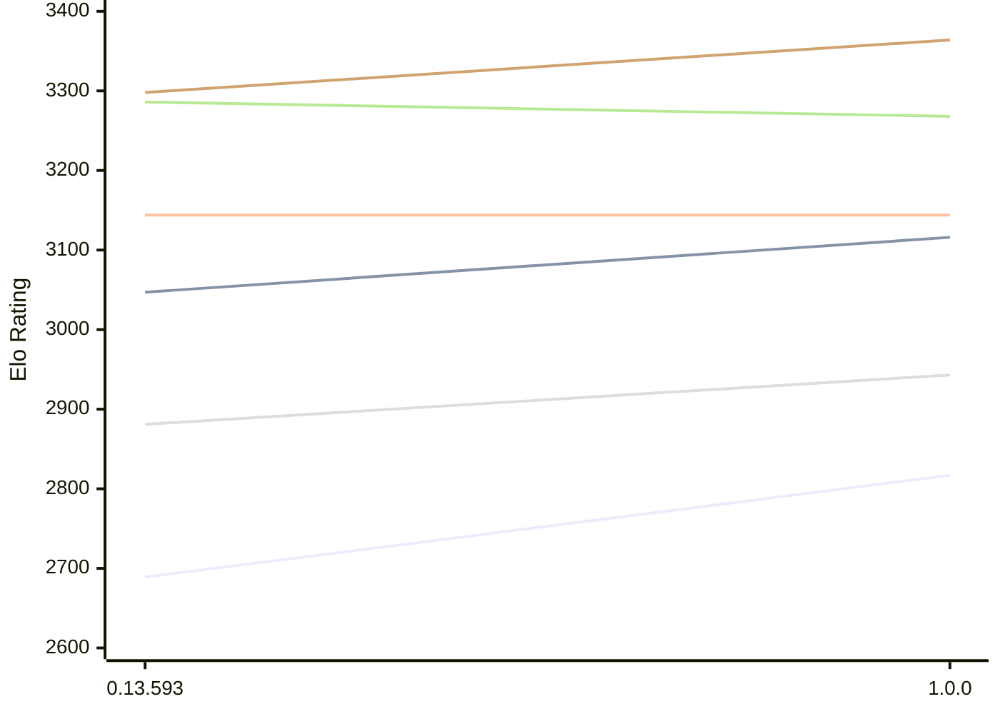

# Engine: Pawnstar

Author: Jonny Reckless

Home: https://github.com/jonny-reckless/pawnstar

## Elo Ratings E1 (Ultra 7 265T (1.50 GHz) - E-Core)

| Version | Published | STC 8.0+0.08s  | LTC 60.0+0.60s | VLTC 2m24s+1.12s | Comment |
| --- | --- | --- | --- | --- | --- |
| 1.0.0 | 2026-10-15 | 2817(+128) | 3116(+69) | 3144(0) |  |
| 0.13.593 | 2026-06-30 | 2689 | 3047 | 3144 |  |
 | | | cElo (∆ prev) | cElo (∆ prev) | cElo (∆ prev) | 

## Elo Ratings P1 (Ultra 7 265T (1.50 GHz) - P-Core)

| Version | Published | STC 8.0+0.08s  | LTC 60.0+0.60s | VLTC 2m24s+1.12s | Comment |
| --- | --- | --- | --- | --- | --- |
| 1.0.0 | 2026-10-15 | 2943(+62) | 3268(-18) | 3364(+66) |  |
| 0.13.593 | 2026-06-30 | 2881 | 3286 | 3298 |  |
 | | | cElo (∆ prev) | cElo (∆ prev) | cElo (∆ prev) | 

## Elo Ratings T1 (i5-7500T 2.70GHz)

| Version | Published | STC 8.0+0.08s  | LTC 60.0+0.60s | VLTC 2m24s+1.12s | Comment |
| --- | --- | --- | --- | --- | --- |
| 0.13.593 | 2026-06-30 | 2831 | 3125 | 3200 |  |
 | | | cElo (∆ prev) | cElo (∆ prev) | cElo (∆ prev) | 

<a href="https://github.com/computer-chess-index/cci/issues/new?template=submit-version.yml&title=[VERSION]+Pawnstar+<version>&body=###%20Engine%20name%0APawnstar%0A%0A###%20Version%0A0.13.593" target="_blank">Submit new version</a>

 Test Conditions:

GUI/CLI: <a href=https://github.com/cutechess/cutechess target="_blank">Cute-Chess</a> 
Elo Calculation: <a href=https://www.remi-coulom.fr/Bayesian-Elo/ target="_blank">Bayesian-Elo</a> 
CPU for P1: Intel(R) Core(TM) Ultra 7 265T (1.50 GHz) - P-Core 
CPU for E1: Intel(R) Core(TM) Ultra 7 265T (1.50 GHz) - E-Core 
CPU for T1: Intel(R) Core(TM) i5-7500T 2.70GHz 
Opening book: 8_moves_v3 
\* STC: 8.0+0.08s, LTC: 60.0+0.60s, VLTC: 2m24s+1.12s

 Lists:
Ratings: <a href=https://github.com/computer-chess-index/cci/blob/main/lists/CCIRatings.csv target="_blank">Complete list</a>

Generated: 2026-10-18 04:41:04

## Ratings Verlauf E1 / P1

## Detailed Evaluation Results

| Version | Time Control | Variant | Elo  | Range +/- | Matches | Score | Average Opponent Elo | Draws |
| --- | --- |--- | --- | --- | --- | --- | --- | --- |
| 1.0.0 | VLTC (2m24s+1.12s) | P1 | 3364 | 50 | 100 | 50% | 3368 | 69% |
|  |  | E1 | 3144 | 39 | 172 | 49% | 3154 | 62% |
|  | LTC (60.0+0.60s) | P1 | 3268 | 49 | 112 | 50% | 3263 | 60% |
|  |  | E1 | 3116 | 38 | 188 | 51% | 3109 | 53% |
|  | STC (8.0+0.08s) | P1 | 2943 | 48 | 128 | 52% | 2920 | 45% |
|  |  | E1 | 2817 | 41 | 188 | 50% | 2819 | 38% |
| --- | --- |--- | --- | --- | --- | --- | --- | --- |
| 0.13.593 | VLTC (2m24s+1.12s) | T1 | 3200 | 26 | 432 | 50% | 3189 | 53% |
|  |  | P1 | 3298 | 35 | 220 | 46% | 3329 | 56% |
|  |  | E1 | 3144 | 30 | 312 | 47% | 3166 | 51% |
|  | LTC (60.0+0.60s) | T1 | 3125 | 26 | 450 | 52% | 3089 | 48% |
|  |  | P1 | 3286 | 34 | 248 | 52% | 3267 | 49% |
|  |  | E1 | 3047 | 31 | 300 | 48% | 3065 | 53% |
|  | STC (8.0+0.08s) | T1 | 2831 | 28 | 436 | 49% | 2822 | 32% |
|  |  | P1 | 2881 | 41 | 192 | 46% | 2919 | 35% |
|  |  | E1 | 2689 | 30 | 382 | 46% | 2727 | 31% |