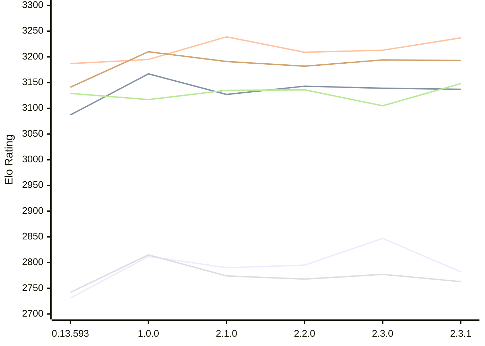

# Engine: Pawnstar

Author: Jonny Reckless

Home: https://github.com/jonny-reckless/pawnstar

## Elo Ratings E1 (Ultra 7 265T (1.50 GHz) - E-Core)

| Version | Published | STC 8.0+0.08s  | LTC 60.0+0.60s | VLTC 2m24s+1.12s | Comment |
| --- | --- | --- | --- | --- | --- |
| 2.3.1 | 2026-11-09 | 2782(-65) | 3137(-2) | 3237(+24) |  |
| 2.3.0 | 2026-11-08 | 2847(+52) | 3139(-4) | 3213(+4) |  |
| 2.2.0 | 2026-11-07 | 2795(+5) | 3143(+16) | 3209(-30) |  |
| 2.1.0 | 2026-10-31 | 2790(-22) | 3127(-40) | 3239(+44) |  |
| 1.0.0 | 2026-10-15 | 2812(+81) | 3167(+80) | 3195(+8) |  |
| 0.13.593 | 2026-06-30 | 2731 | 3087 | 3187 |  |
 | | | cElo (∆ prev) | cElo (∆ prev) | cElo (∆ prev) | 

## Elo Ratings P1 (Ultra 7 265T (1.50 GHz) - P-Core)

| Version | Published | STC 8.0+0.08s  | LTC 60.0+0.60s | VLTC 2m24s+1.12s | Comment |
| --- | --- | --- | --- | --- | --- |
| 2.3.1 | 2026-11-09 | 2763(-14) | 3148(+43) | 3193(-1) |  |
| 2.3.0 | 2026-11-08 | 2777(+9) | 3105(-31) | 3194(+12) |  |
| 2.2.0 | 2026-11-07 | 2768(-6) | 3136(+1) | 3182(-9) |  |
| 2.1.0 | 2026-10-31 | 2774(-41) | 3135(+18) | 3191(-19) |  |
| 1.0.0 | 2026-10-15 | 2815(+73) | 3117(-12) | 3210(+69) |  |
| 0.13.593 | 2026-06-30 | 2742 | 3129 | 3141 |  |
 | | | cElo (∆ prev) | cElo (∆ prev) | cElo (∆ prev) | 

## Elo Ratings T1 (i5-7500T 2.70GHz)

| Version | Published | STC 8.0+0.08s  | LTC 60.0+0.60s | VLTC 2m24s+1.12s | Comment |
| --- | --- | --- | --- | --- | --- |
| 0.13.593 | 2026-06-30 | 2831 | 3125 | 3200 |  |
 | | | cElo (∆ prev) | cElo (∆ prev) | cElo (∆ prev) | 

<a href="https://github.com/computer-chess-index/cci/issues/new?template=submit-version.yml&title=[VERSION]+Pawnstar+<version>&body=###%20Engine%20name%0APawnstar%0A%0A###%20Version%0A0.13.593" target="_blank">Submit new version</a>

 Test Conditions:

GUI/CLI: <a href=https://github.com/cutechess/cutechess target="_blank">Cute-Chess</a> 
Elo Calculation: <a href=https://www.remi-coulom.fr/Bayesian-Elo/ target="_blank">Bayesian-Elo</a> 
CPU for P1: Intel(R) Core(TM) Ultra 7 265T (1.50 GHz) - P-Core 
CPU for E1: Intel(R) Core(TM) Ultra 7 265T (1.50 GHz) - E-Core 
CPU for T1: Intel(R) Core(TM) i5-7500T 2.70GHz 
Opening book: 8_moves_v3 
\* STC: 8.0+0.08s, LTC: 60.0+0.60s, VLTC: 2m24s+1.12s

 Lists:
Ratings: <a href=https://github.com/computer-chess-index/cci/blob/main/lists/CCIRatings.csv target="_blank">Complete list</a>

Generated: 2026-11-15 05:40:52

## Ratings Verlauf E1 / P1

## Detailed Evaluation Results

| Version | Time Control | Variant | Elo  | Range +/- | Matches | Score | Average Opponent Elo | Draws |
| --- | --- |--- | --- | --- | --- | --- | --- | --- |
| 2.3.1 | VLTC (2m24s+1.12s) | P1 | 3193 | 38 | 184 | 49% | 3200 | 60% |
|  |  | E1 | 3237 | 30 | 292 | 51% | 3228 | 65% |
|  | LTC (60.0+0.60s) | P1 | 3148 | 44 | 140 | 49% | 3158 | 60% |
|  |  | E1 | 3137 | 30 | 300 | 52% | 3121 | 56% |
|  | STC (8.0+0.08s) | P1 | 2763 | 48 | 140 | 49% | 2774 | 34% |
|  |  | E1 | 2782 | 32 | 314 | 47% | 2803 | 36% |
| --- | --- |--- | --- | --- | --- | --- | --- | --- |
| 2.3.0 | VLTC (2m24s+1.12s) | P1 | 3194 | 44 | 140 | 49% | 3204 | 59% |
|  |  | E1 | 3213 | 36 | 208 | 49% | 3222 | 62% |
|  | LTC (60.0+0.60s) | P1 | 3105 | 38 | 186 | 52% | 3089 | 58% |
|  |  | E1 | 3139 | 32 | 260 | 46% | 3171 | 58% |
|  | STC (8.0+0.08s) | E1 | 2847 | 32 | 300 | 47% | 2873 | 42% |
|  |  | P1 | 2777 | 35 | 254 | 45% | 2819 | 41% |
| --- | --- |--- | --- | --- | --- | --- | --- | --- |
| 2.2.0 | VLTC (2m24s+1.12s) | P1 | 3182 | 38 | 178 | 53% | 3162 | 63% |
|  |  | E1 | 3209 | 32 | 262 | 51% | 3205 | 57% |
|  | LTC (60.0+0.60s) | P1 | 3136 | 48 | 116 | 48% | 3150 | 60% |
|  |  | E1 | 3143 | 32 | 280 | 53% | 3121 | 53% |
|  | STC (8.0+0.08s) | P1 | 2768 | 50 | 126 | 51% | 2757 | 36% |
|  |  | E1 | 2795 | 32 | 292 | 53% | 2768 | 43% |
| --- | --- |--- | --- | --- | --- | --- | --- | --- |
| 2.1.0 | VLTC (2m24s+1.12s) | E1 | 3239 | 28 | 340 | 53% | 3216 | 64% |
|  |  | P1 | 3191 | 34 | 232 | 47% | 3210 | 64% |
|  | LTC (60.0+0.60s) | P1 | 3135 | 41 | 152 | 49% | 3141 | 63% |
|  |  | E1 | 3127 | 29 | 344 | 54% | 3097 | 51% |
|  | STC (8.0+0.08s) | P1 | 2774 | 38 | 212 | 45% | 2820 | 40% |
|  |  | E1 | 2790 | 37 | 228 | 49% | 2800 | 40% |
| --- | --- |--- | --- | --- | --- | --- | --- | --- |
| 1.0.0 | VLTC (2m24s+1.12s) | P1 | 3210 | 40 | 160 | 50% | 3214 | 66% |
|  |  | E1 | 3195 | 34 | 232 | 50% | 3193 | 62% |
|  | LTC (60.0+0.60s) | P1 | 3117 | 39 | 180 | 50% | 3113 | 58% |
|  |  | E1 | 3167 | 32 | 276 | 51% | 3160 | 53% |
|  | STC (8.0+0.08s) | P1 | 2815 | 39 | 198 | 52% | 2796 | 45% |
|  |  | E1 | 2812 | 28 | 394 | 47% | 2838 | 40% |
| --- | --- |--- | --- | --- | --- | --- | --- | --- |
| 0.13.593 | VLTC (2m24s+1.12s) | E1 | 3187 | 30 | 312 | 47% | 3208 | 51% |
|  |  | T1 | 3200 | 26 | 432 | 50% | 3189 | 53% |
|  |  | P1 | 3141 | 35 | 220 | 46% | 3171 | 56% |
|  | LTC (60.0+0.60s) | E1 | 3087 | 31 | 300 | 48% | 3106 | 53% |
|  |  | T1 | 3125 | 26 | 450 | 52% | 3089 | 48% |
|  |  | P1 | 3129 | 34 | 248 | 52% | 3109 | 49% |
|  | STC (8.0+0.08s) | T1 | 2831 | 28 | 436 | 49% | 2822 | 32% |
|  |  | P1 | 2742 | 41 | 192 | 46% | 2780 | 35% |
|  |  | E1 | 2731 | 30 | 382 | 46% | 2769 | 31% |