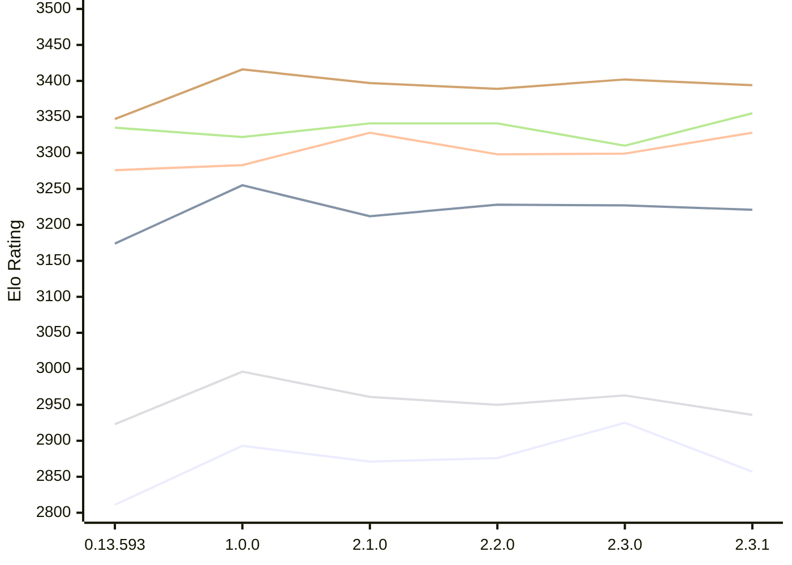

# Engine: Pawnstar

Author: Jonny Reckless

Home: https://github.com/jonny-reckless/pawnstar

## Elo Ratings E1 (Ultra 7 265T (1.50 GHz) - E-Core)

| Version | Published | STC 8.0+0.08s  | LTC 60.0+0.60s | VLTC 2m24s+1.12s | Comment |
| --- | --- | --- | --- | --- | --- |
| 2.3.1 | 2026-11-09 | 2857(-68) | 3221(-6) | 3328(+29) |  |
| 2.3.0 | 2026-11-08 | 2925(+49) | 3227(-1) | 3299(+1) |  |
| 2.2.0 | 2026-11-07 | 2876(+5) | 3228(+16) | 3298(-30) |  |
| 2.1.0 | 2026-10-31 | 2871(-22) | 3212(-43) | 3328(+45) |  |
| 1.0.0 | 2026-10-15 | 2893(+82) | 3255(+81) | 3283(+7) |  |
| 0.13.593 | 2026-06-30 | 2811 | 3174 | 3276 |  |
 | | | cElo (∆ prev) | cElo (∆ prev) | cElo (∆ prev) | 

## Elo Ratings P1 (Ultra 7 265T (1.50 GHz) - P-Core)

| Version | Published | STC 8.0+0.08s  | LTC 60.0+0.60s | VLTC 2m24s+1.12s | Comment |
| --- | --- | --- | --- | --- | --- |
| 2.3.1 | 2026-11-09 | 2936(-27) | 3355(+45) | 3394(-8) |  |
| 2.3.0 | 2026-11-08 | 2963(+13) | 3310(-31) | 3402(+13) |  |
| 2.2.0 | 2026-11-07 | 2950(-11) | 3341(0) | 3389(-8) |  |
| 2.1.0 | 2026-10-31 | 2961(-35) | 3341(+19) | 3397(-19) |  |
| 1.0.0 | 2026-10-15 | 2996(+73) | 3322(-13) | 3416(+69) |  |
| 0.13.593 | 2026-06-30 | 2923 | 3335 | 3347 |  |
 | | | cElo (∆ prev) | cElo (∆ prev) | cElo (∆ prev) | 

## Elo Ratings T1 (i5-7500T 2.70GHz)

| Version | Published | STC 8.0+0.08s  | LTC 60.0+0.60s | VLTC 2m24s+1.12s | Comment |
| --- | --- | --- | --- | --- | --- |
| 0.13.593 | 2026-06-30 | 2831 | 3125 | 3200 |  |
 | | | cElo (∆ prev) | cElo (∆ prev) | cElo (∆ prev) | 

<a href="https://github.com/computer-chess-index/cci/issues/new?template=submit-version.yml&title=[VERSION]+Pawnstar+<version>&body=###%20Engine%20name%0APawnstar%0A%0A###%20Version%0A0.13.593" target="_blank">Submit new version</a>

 Test Conditions:

GUI/CLI: <a href=https://github.com/cutechess/cutechess target="_blank">Cute-Chess</a> 
Elo Calculation: <a href=https://www.remi-coulom.fr/Bayesian-Elo/ target="_blank">Bayesian-Elo</a> 
CPU for P1: Intel(R) Core(TM) Ultra 7 265T (1.50 GHz) - P-Core 
CPU for E1: Intel(R) Core(TM) Ultra 7 265T (1.50 GHz) - E-Core 
CPU for T1: Intel(R) Core(TM) i5-7500T 2.70GHz 
Opening book: 8_moves_v3 
\* STC: 8.0+0.08s, LTC: 60.0+0.60s, VLTC: 2m24s+1.12s

 Lists:
Ratings: <a href=https://github.com/computer-chess-index/cci/blob/main/lists/CCIRatings.csv target="_blank">Complete list</a>

Generated: 2026-11-11 05:40:39

## Ratings Verlauf E1 / P1

## Detailed Evaluation Results

| Version | Time Control | Variant | Elo  | Range +/- | Matches | Score | Average Opponent Elo | Draws |
| --- | --- |--- | --- | --- | --- | --- | --- | --- |
| 2.3.1 | VLTC (2m24s+1.12s) | E1 | 3328 | 30 | 288 | 51% | 3318 | 65% |
|  |  | P1 | 3394 | 39 | 176 | 50% | 3394 | 60% |
|  | LTC (60.0+0.60s) | E1 | 3221 | 32 | 268 | 52% | 3201 | 56% |
|  |  | P1 | 3355 | 44 | 136 | 49% | 3362 | 60% |
|  | STC (8.0+0.08s) | E1 | 2857 | 33 | 282 | 47% | 2882 | 38% |
|  |  | P1 | 2936 | 54 | 108 | 51% | 2923 | 34% |
| --- | --- |--- | --- | --- | --- | --- | --- | --- |
| 2.3.0 | VLTC (2m24s+1.12s) | P1 | 3402 | 44 | 136 | 50% | 3405 | 60% |
|  |  | E1 | 3299 | 37 | 196 | 49% | 3305 | 63% |
|  | LTC (60.0+0.60s) | P1 | 3310 | 38 | 182 | 52% | 3295 | 59% |
|  |  | E1 | 3227 | 33 | 244 | 46% | 3254 | 57% |
|  | STC (8.0+0.08s) | P1 | 2963 | 35 | 246 | 45% | 3005 | 39% |
|  |  | E1 | 2925 | 32 | 292 | 46% | 2955 | 42% |
| --- | --- |--- | --- | --- | --- | --- | --- | --- |
| 2.2.0 | VLTC (2m24s+1.12s) | P1 | 3389 | 38 | 178 | 53% | 3368 | 63% |
|  |  | E1 | 3298 | 32 | 262 | 51% | 3294 | 57% |
|  | LTC (60.0+0.60s) | P1 | 3341 | 48 | 116 | 48% | 3356 | 60% |
|  |  | E1 | 3228 | 32 | 280 | 53% | 3206 | 53% |
|  | STC (8.0+0.08s) | P1 | 2950 | 50 | 126 | 51% | 2938 | 36% |
|  |  | E1 | 2876 | 32 | 292 | 53% | 2849 | 43% |
| --- | --- |--- | --- | --- | --- | --- | --- | --- |
| 2.1.0 | VLTC (2m24s+1.12s) | P1 | 3397 | 34 | 232 | 47% | 3416 | 64% |
|  |  | E1 | 3328 | 28 | 340 | 53% | 3305 | 64% |
|  | LTC (60.0+0.60s) | P1 | 3341 | 41 | 152 | 49% | 3347 | 63% |
|  |  | E1 | 3212 | 29 | 344 | 54% | 3182 | 51% |
|  | STC (8.0+0.08s) | E1 | 2871 | 37 | 228 | 49% | 2880 | 40% |
|  |  | P1 | 2961 | 38 | 212 | 45% | 3005 | 40% |
| --- | --- |--- | --- | --- | --- | --- | --- | --- |
| 1.0.0 | VLTC (2m24s+1.12s) | P1 | 3416 | 40 | 160 | 50% | 3418 | 66% |
|  |  | E1 | 3283 | 34 | 232 | 50% | 3282 | 62% |
|  | LTC (60.0+0.60s) | P1 | 3322 | 39 | 180 | 50% | 3320 | 58% |
|  |  | E1 | 3255 | 32 | 276 | 51% | 3248 | 53% |
|  | STC (8.0+0.08s) | P1 | 2996 | 39 | 198 | 52% | 2978 | 45% |
|  |  | E1 | 2893 | 28 | 394 | 47% | 2919 | 40% |
| --- | --- |--- | --- | --- | --- | --- | --- | --- |
| 0.13.593 | VLTC (2m24s+1.12s) | P1 | 3347 | 35 | 220 | 46% | 3378 | 56% |
|  |  | E1 | 3276 | 30 | 312 | 47% | 3297 | 51% |
|  |  | T1 | 3200 | 26 | 432 | 50% | 3189 | 53% |
|  | LTC (60.0+0.60s) | P1 | 3335 | 34 | 248 | 52% | 3316 | 49% |
|  |  | E1 | 3174 | 31 | 300 | 48% | 3193 | 53% |
|  |  | T1 | 3125 | 26 | 450 | 52% | 3089 | 48% |
|  | STC (8.0+0.08s) | P1 | 2923 | 41 | 192 | 46% | 2961 | 35% |
|  |  | E1 | 2811 | 30 | 382 | 46% | 2849 | 31% |
|  |  | T1 | 2831 | 28 | 436 | 49% | 2822 | 32% |