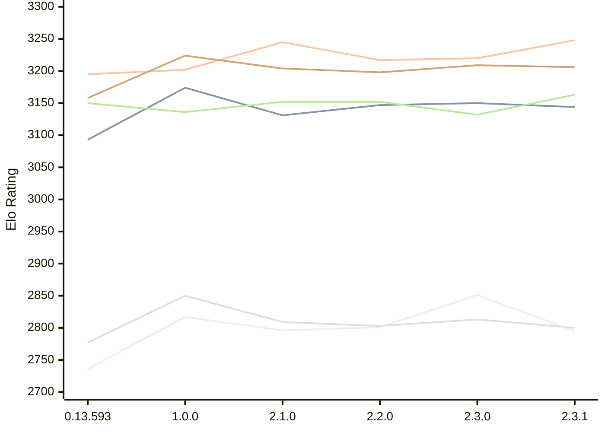

# Engine: Pawnstar

Author: Jonny Reckless

Home: https://github.com/jonny-reckless/pawnstar

## Elo Ratings E1 (Ultra 7 265T (1.50 GHz) - E-Core)

| Version | Published | STC 8.0+0.08s  | LTC 60.0+0.60s | VLTC 2m24s+1.12s | Comment |
| --- | --- | --- | --- | --- | --- |
| 2.3.1 | 2026-11-09 | 2795(-56) | 3144(-6) | 3248(+28) |  |
| 2.3.0 | 2026-11-08 | 2851(+50) | 3150(+3) | 3220(+3) |  |
| 2.2.0 | 2026-11-07 | 2801(+5) | 3147(+16) | 3217(-28) |  |
| 2.1.0 | 2026-10-31 | 2796(-21) | 3131(-43) | 3245(+43) |  |
| 1.0.0 | 2026-10-15 | 2817(+81) | 3174(+81) | 3202(+7) |  |
| 0.13.593 | 2026-06-30 | 2736 | 3093 | 3195 |  |
 | | | cElo (∆ prev) | cElo (∆ prev) | cElo (∆ prev) | 

## Elo Ratings P1 (Ultra 7 265T (1.50 GHz) - P-Core)

| Version | Published | STC 8.0+0.08s  | LTC 60.0+0.60s | VLTC 2m24s+1.12s | Comment |
| --- | --- | --- | --- | --- | --- |
| 2.3.1 | 2026-11-09 | 2800(-13) | 3163(+31) | 3206(-3) |  |
| 2.3.0 | 2026-11-08 | 2813(+10) | 3132(-20) | 3209(+11) |  |
| 2.2.0 | 2026-11-07 | 2803(-6) | 3152(0) | 3198(-6) |  |
| 2.1.0 | 2026-10-31 | 2809(-41) | 3152(+16) | 3204(-20) |  |
| 1.0.0 | 2026-10-15 | 2850(+73) | 3136(-14) | 3224(+66) |  |
| 0.13.593 | 2026-06-30 | 2777 | 3150 | 3158 |  |
 | | | cElo (∆ prev) | cElo (∆ prev) | cElo (∆ prev) | 

## Elo Ratings T1 (i5-7500T 2.70GHz)

| Version | Published | STC 8.0+0.08s  | LTC 60.0+0.60s | VLTC 2m24s+1.12s | Comment |
| --- | --- | --- | --- | --- | --- |
| 0.13.593 | 2026-06-30 | 2831 | 3125 | 3200 |  |
 | | | cElo (∆ prev) | cElo (∆ prev) | cElo (∆ prev) | 

<a href="https://github.com/computer-chess-index/cci/issues/new?template=submit-version.yml&title=[VERSION]+Pawnstar+<version>&body=###%20Engine%20name%0APawnstar%0A%0A###%20Version%0A0.13.593" target="_blank">Submit new version</a>

 Test Conditions:

GUI/CLI: <a href=https://github.com/cutechess/cutechess target="_blank">Cute-Chess</a> 
Elo Calculation: <a href=https://www.remi-coulom.fr/Bayesian-Elo/ target="_blank">Bayesian-Elo</a> 
CPU for P1: Intel(R) Core(TM) Ultra 7 265T (1.50 GHz) - P-Core 
CPU for E1: Intel(R) Core(TM) Ultra 7 265T (1.50 GHz) - E-Core 
CPU for T1: Intel(R) Core(TM) i5-7500T 2.70GHz 
Opening book: 8_moves_v3 
\* STC: 8.0+0.08s, LTC: 60.0+0.60s, VLTC: 2m24s+1.12s

 Lists:
Ratings: <a href=https://github.com/computer-chess-index/cci/blob/main/lists/CCIRatings.csv target="_blank">Complete list</a>

Generated: 2026-11-22 05:40:56

## Ratings Verlauf E1 / P1

## Detailed Evaluation Results

| Version | Time Control | Variant | Elo  | Range +/- | Matches | Score | Average Opponent Elo | Draws |
| --- | --- |--- | --- | --- | --- | --- | --- | --- |
| 2.3.1 | VLTC (2m24s+1.12s) | P1 | 3206 | 35 | 216 | 49% | 3217 | 59% |
|  |  | E1 | 3248 | 29 | 308 | 51% | 3236 | 65% |
|  | LTC (60.0+0.60s) | P1 | 3163 | 40 | 168 | 49% | 3174 | 59% |
|  |  | E1 | 3144 | 29 | 320 | 52% | 3128 | 56% |
|  | STC (8.0+0.08s) | E1 | 2795 | 30 | 370 | 46% | 2826 | 35% |
|  |  | P1 | 2800 | 43 | 168 | 49% | 2811 | 37% |
| --- | --- |--- | --- | --- | --- | --- | --- | --- |
| 2.3.0 | VLTC (2m24s+1.12s) | P1 | 3209 | 43 | 144 | 48% | 3224 | 59% |
|  |  | E1 | 3220 | 35 | 212 | 49% | 3231 | 62% |
|  | LTC (60.0+0.60s) | P1 | 3132 | 37 | 198 | 52% | 3113 | 58% |
|  |  | E1 | 3150 | 31 | 278 | 47% | 3175 | 58% |
|  | STC (8.0+0.08s) | P1 | 2813 | 33 | 274 | 45% | 2851 | 41% |
|  |  | E1 | 2851 | 31 | 316 | 47% | 2876 | 41% |
| --- | --- |--- | --- | --- | --- | --- | --- | --- |
| 2.2.0 | VLTC (2m24s+1.12s) | E1 | 3217 | 32 | 262 | 51% | 3212 | 57% |
|  |  | P1 | 3198 | 38 | 178 | 53% | 3178 | 63% |
|  | LTC (60.0+0.60s) | P1 | 3152 | 48 | 116 | 48% | 3166 | 60% |
|  |  | E1 | 3147 | 32 | 280 | 53% | 3127 | 53% |
|  | STC (8.0+0.08s) | P1 | 2803 | 50 | 126 | 51% | 2792 | 36% |
|  |  | E1 | 2801 | 32 | 292 | 53% | 2774 | 43% |
| --- | --- |--- | --- | --- | --- | --- | --- | --- |
| 2.1.0 | VLTC (2m24s+1.12s) | P1 | 3204 | 34 | 232 | 47% | 3224 | 64% |
|  |  | E1 | 3245 | 28 | 340 | 53% | 3222 | 64% |
|  | LTC (60.0+0.60s) | P1 | 3152 | 41 | 152 | 49% | 3158 | 63% |
|  |  | E1 | 3131 | 29 | 344 | 54% | 3101 | 51% |
|  | STC (8.0+0.08s) | P1 | 2809 | 38 | 212 | 45% | 2855 | 40% |
|  |  | E1 | 2796 | 37 | 228 | 49% | 2804 | 40% |
| --- | --- |--- | --- | --- | --- | --- | --- | --- |
| 1.0.0 | VLTC (2m24s+1.12s) | P1 | 3224 | 40 | 160 | 50% | 3227 | 66% |
|  |  | E1 | 3202 | 34 | 232 | 50% | 3200 | 62% |
|  | LTC (60.0+0.60s) | P1 | 3136 | 39 | 180 | 50% | 3133 | 58% |
|  |  | E1 | 3174 | 32 | 276 | 51% | 3167 | 53% |
|  | STC (8.0+0.08s) | P1 | 2850 | 39 | 198 | 52% | 2831 | 45% |
|  |  | E1 | 2817 | 28 | 394 | 47% | 2843 | 40% |
| --- | --- |--- | --- | --- | --- | --- | --- | --- |
| 0.13.593 | VLTC (2m24s+1.12s) | T1 | 3200 | 26 | 432 | 50% | 3189 | 53% |
|  |  | P1 | 3158 | 35 | 220 | 46% | 3187 | 56% |
|  |  | E1 | 3195 | 30 | 312 | 47% | 3216 | 51% |
|  | LTC (60.0+0.60s) | T1 | 3125 | 26 | 450 | 52% | 3089 | 48% |
|  |  | P1 | 3150 | 34 | 248 | 52% | 3129 | 49% |
|  |  | E1 | 3093 | 31 | 300 | 48% | 3112 | 53% |
|  | STC (8.0+0.08s) | P1 | 2777 | 41 | 192 | 46% | 2813 | 35% |
|  |  | E1 | 2736 | 30 | 382 | 46% | 2774 | 31% |
|  |  | T1 | 2831 | 28 | 436 | 49% | 2822 | 32% |