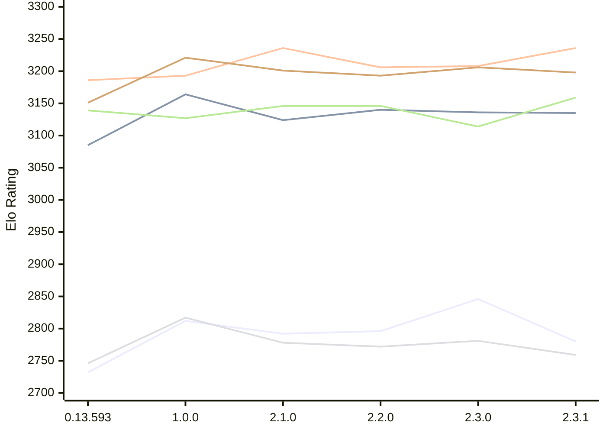

# Engine: Pawnstar

Author: Jonny Reckless

Home: https://github.com/jonny-reckless/pawnstar

## Elo Ratings E1 (Ultra 7 265T (1.50 GHz) - E-Core)

| Version | Published | STC 8.0+0.08s  | LTC 60.0+0.60s | VLTC 2m24s+1.12s | Comment |
| --- | --- | --- | --- | --- | --- |
| 2.3.1 | 2026-11-09 | 2780(-66) | 3135(-1) | 3236(+28) |  |
| 2.3.0 | 2026-11-08 | 2846(+50) | 3136(-4) | 3208(+2) |  |
| 2.2.0 | 2026-11-07 | 2796(+4) | 3140(+16) | 3206(-30) |  |
| 2.1.0 | 2026-10-31 | 2792(-20) | 3124(-40) | 3236(+43) |  |
| 1.0.0 | 2026-10-15 | 2812(+80) | 3164(+79) | 3193(+7) |  |
| 0.13.593 | 2026-06-30 | 2732 | 3085 | 3186 |  |
 | | | cElo (∆ prev) | cElo (∆ prev) | cElo (∆ prev) | 

## Elo Ratings P1 (Ultra 7 265T (1.50 GHz) - P-Core)

| Version | Published | STC 8.0+0.08s  | LTC 60.0+0.60s | VLTC 2m24s+1.12s | Comment |
| --- | --- | --- | --- | --- | --- |
| 2.3.1 | 2026-11-09 | 2759(-22) | 3159(+45) | 3198(-8) |  |
| 2.3.0 | 2026-11-08 | 2781(+9) | 3114(-32) | 3206(+13) |  |
| 2.2.0 | 2026-11-07 | 2772(-6) | 3146(0) | 3193(-8) |  |
| 2.1.0 | 2026-10-31 | 2778(-39) | 3146(+19) | 3201(-20) |  |
| 1.0.0 | 2026-10-15 | 2817(+71) | 3127(-12) | 3221(+70) |  |
| 0.13.593 | 2026-06-30 | 2746 | 3139 | 3151 |  |
 | | | cElo (∆ prev) | cElo (∆ prev) | cElo (∆ prev) | 

## Elo Ratings T1 (i5-7500T 2.70GHz)

| Version | Published | STC 8.0+0.08s  | LTC 60.0+0.60s | VLTC 2m24s+1.12s | Comment |
| --- | --- | --- | --- | --- | --- |
| 0.13.593 | 2026-06-30 | 2831 | 3125 | 3200 |  |
 | | | cElo (∆ prev) | cElo (∆ prev) | cElo (∆ prev) | 

<a href="https://github.com/computer-chess-index/cci/issues/new?template=submit-version.yml&title=[VERSION]+Pawnstar+<version>&body=###%20Engine%20name%0APawnstar%0A%0A###%20Version%0A0.13.593" target="_blank">Submit new version</a>

 Test Conditions:

GUI/CLI: <a href=https://github.com/cutechess/cutechess target="_blank">Cute-Chess</a> 
Elo Calculation: <a href=https://www.remi-coulom.fr/Bayesian-Elo/ target="_blank">Bayesian-Elo</a> 
CPU for P1: Intel(R) Core(TM) Ultra 7 265T (1.50 GHz) - P-Core 
CPU for E1: Intel(R) Core(TM) Ultra 7 265T (1.50 GHz) - E-Core 
CPU for T1: Intel(R) Core(TM) i5-7500T 2.70GHz 
Opening book: 8_moves_v3 
\* STC: 8.0+0.08s, LTC: 60.0+0.60s, VLTC: 2m24s+1.12s

 Lists:
Ratings: <a href=https://github.com/computer-chess-index/cci/blob/main/lists/CCIRatings.csv target="_blank">Complete list</a>

Generated: 2026-11-14 05:40:35

## Ratings Verlauf E1 / P1

## Detailed Evaluation Results

| Version | Time Control | Variant | Elo  | Range +/- | Matches | Score | Average Opponent Elo | Draws |
| --- | --- |--- | --- | --- | --- | --- | --- | --- |
| 2.3.1 | VLTC (2m24s+1.12s) | E1 | 3236 | 30 | 292 | 51% | 3227 | 65% |
|  |  | P1 | 3198 | 39 | 176 | 50% | 3200 | 60% |
|  | LTC (60.0+0.60s) | E1 | 3135 | 30 | 296 | 52% | 3117 | 56% |
|  |  | P1 | 3159 | 44 | 140 | 49% | 3167 | 60% |
|  | STC (8.0+0.08s) | E1 | 2780 | 32 | 306 | 47% | 2805 | 36% |
|  |  | P1 | 2759 | 49 | 132 | 48% | 2777 | 33% |
| --- | --- |--- | --- | --- | --- | --- | --- | --- |
| 2.3.0 | VLTC (2m24s+1.12s) | P1 | 3206 | 44 | 136 | 50% | 3210 | 60% |
|  |  | E1 | 3208 | 36 | 204 | 48% | 3220 | 62% |
|  | LTC (60.0+0.60s) | P1 | 3114 | 38 | 182 | 52% | 3098 | 59% |
|  |  | E1 | 3136 | 33 | 256 | 46% | 3168 | 58% |
|  | STC (8.0+0.08s) | P1 | 2781 | 35 | 246 | 45% | 2823 | 39% |
|  |  | E1 | 2846 | 32 | 300 | 47% | 2873 | 42% |
| --- | --- |--- | --- | --- | --- | --- | --- | --- |
| 2.2.0 | VLTC (2m24s+1.12s) | P1 | 3193 | 38 | 178 | 53% | 3173 | 63% |
|  |  | E1 | 3206 | 32 | 262 | 51% | 3202 | 57% |
|  | LTC (60.0+0.60s) | P1 | 3146 | 48 | 116 | 48% | 3160 | 60% |
|  |  | E1 | 3140 | 32 | 280 | 53% | 3119 | 53% |
|  | STC (8.0+0.08s) | P1 | 2772 | 50 | 126 | 51% | 2759 | 36% |
|  |  | E1 | 2796 | 32 | 292 | 53% | 2769 | 43% |
| --- | --- |--- | --- | --- | --- | --- | --- | --- |
| 2.1.0 | VLTC (2m24s+1.12s) | P1 | 3201 | 34 | 232 | 47% | 3221 | 64% |
|  |  | E1 | 3236 | 28 | 340 | 53% | 3213 | 64% |
|  | LTC (60.0+0.60s) | P1 | 3146 | 41 | 152 | 49% | 3151 | 63% |
|  |  | E1 | 3124 | 29 | 344 | 54% | 3094 | 51% |
|  | STC (8.0+0.08s) | E1 | 2792 | 37 | 228 | 49% | 2800 | 40% |
|  |  | P1 | 2778 | 38 | 212 | 45% | 2823 | 40% |
| --- | --- |--- | --- | --- | --- | --- | --- | --- |
| 1.0.0 | VLTC (2m24s+1.12s) | P1 | 3221 | 40 | 160 | 50% | 3224 | 66% |
|  |  | E1 | 3193 | 34 | 232 | 50% | 3190 | 62% |
|  | LTC (60.0+0.60s) | P1 | 3127 | 39 | 180 | 50% | 3123 | 58% |
|  |  | E1 | 3164 | 32 | 276 | 51% | 3158 | 53% |
|  | STC (8.0+0.08s) | P1 | 2817 | 39 | 198 | 52% | 2799 | 45% |
|  |  | E1 | 2812 | 28 | 394 | 47% | 2838 | 40% |
| --- | --- |--- | --- | --- | --- | --- | --- | --- |
| 0.13.593 | VLTC (2m24s+1.12s) | P1 | 3151 | 35 | 220 | 46% | 3182 | 56% |
|  |  | E1 | 3186 | 30 | 312 | 47% | 3206 | 51% |
|  |  | T1 | 3200 | 26 | 432 | 50% | 3189 | 53% |
|  | LTC (60.0+0.60s) | P1 | 3139 | 34 | 248 | 52% | 3119 | 49% |
|  |  | E1 | 3085 | 31 | 300 | 48% | 3104 | 53% |
|  |  | T1 | 3125 | 26 | 450 | 52% | 3089 | 48% |
|  | STC (8.0+0.08s) | P1 | 2746 | 41 | 192 | 46% | 2784 | 35% |
|  |  | E1 | 2732 | 30 | 382 | 46% | 2770 | 31% |
|  |  | T1 | 2831 | 28 | 436 | 49% | 2822 | 32% |