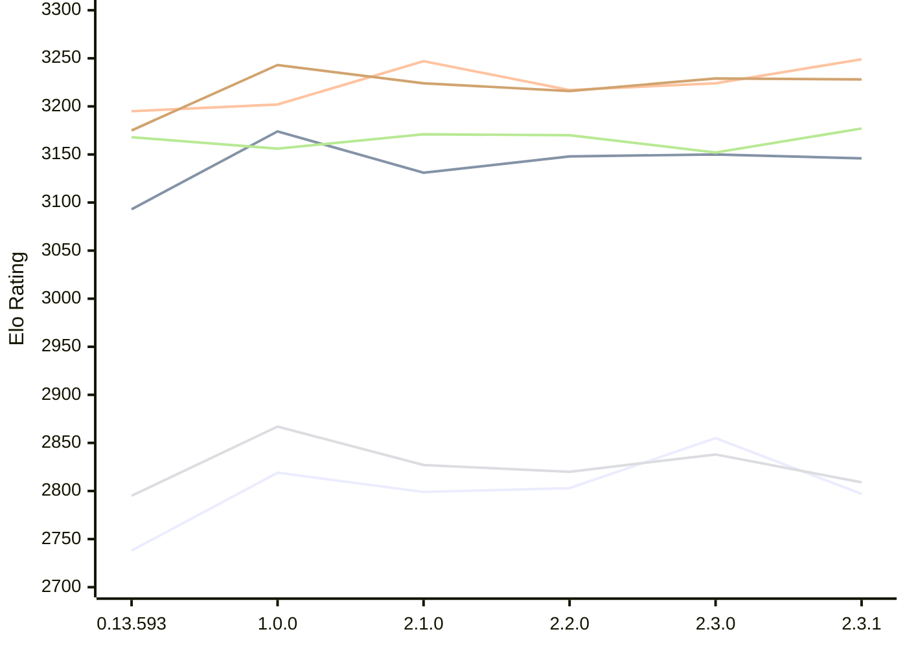

# Engine: Pawnstar

Author: Jonny Reckless

Home: https://github.com/jonny-reckless/pawnstar

## Elo Ratings E1 (Ultra 7 265T (1.50 GHz) - E-Core)

| Version | Published | STC 8.0+0.08s  | LTC 60.0+0.60s | VLTC 2m24s+1.12s | Comment |
| --- | --- | --- | --- | --- | --- |
| 2.3.1 | 2026-11-09 | 2797(-58) | 3146(-4) | 3249(+25) |  |
| 2.3.0 | 2026-11-08 | 2855(+52) | 3150(+2) | 3224(+7) |  |
| 2.2.0 | 2026-11-07 | 2803(+4) | 3148(+17) | 3217(-30) |  |
| 2.1.0 | 2026-10-31 | 2799(-20) | 3131(-43) | 3247(+45) |  |
| 1.0.0 | 2026-10-15 | 2819(+81) | 3174(+81) | 3202(+7) |  |
| 0.13.593 | 2026-06-30 | 2738 | 3093 | 3195 |  |
 | | | cElo (∆ prev) | cElo (∆ prev) | cElo (∆ prev) | 

## Elo Ratings P1 (Ultra 7 265T (1.50 GHz) - P-Core)

| Version | Published | STC 8.0+0.08s  | LTC 60.0+0.60s | VLTC 2m24s+1.12s | Comment |
| --- | --- | --- | --- | --- | --- |
| 2.3.1 | 2026-11-09 | 2809(-29) | 3177(+25) | 3228(-1) |  |
| 2.3.0 | 2026-11-08 | 2838(+18) | 3152(-18) | 3229(+13) |  |
| 2.2.0 | 2026-11-07 | 2820(-7) | 3170(-1) | 3216(-8) |  |
| 2.1.0 | 2026-10-31 | 2827(-40) | 3171(+15) | 3224(-19) |  |
| 1.0.0 | 2026-10-15 | 2867(+72) | 3156(-12) | 3243(+68) |  |
| 0.13.593 | 2026-06-30 | 2795 | 3168 | 3175 |  |
 | | | cElo (∆ prev) | cElo (∆ prev) | cElo (∆ prev) | 

## Elo Ratings T1 (i5-7500T 2.70GHz)

| Version | Published | STC 8.0+0.08s  | LTC 60.0+0.60s | VLTC 2m24s+1.12s | Comment |
| --- | --- | --- | --- | --- | --- |
| 0.13.593 | 2026-06-30 | 2831 | 3125 | 3200 |  |
 | | | cElo (∆ prev) | cElo (∆ prev) | cElo (∆ prev) | 

<a href="https://github.com/computer-chess-index/cci/issues/new?template=submit-version.yml&title=[VERSION]+Pawnstar+<version>&body=###%20Engine%20name%0APawnstar%0A%0A###%20Version%0A0.13.593" target="_blank">Submit new version</a>

 Test Conditions:

GUI/CLI: <a href=https://github.com/cutechess/cutechess target="_blank">Cute-Chess</a> 
Elo Calculation: <a href=https://www.remi-coulom.fr/Bayesian-Elo/ target="_blank">Bayesian-Elo</a> 
CPU for P1: Intel(R) Core(TM) Ultra 7 265T (1.50 GHz) - P-Core 
CPU for E1: Intel(R) Core(TM) Ultra 7 265T (1.50 GHz) - E-Core 
CPU for T1: Intel(R) Core(TM) i5-7500T 2.70GHz 
Opening book: 8_moves_v3 
\* STC: 8.0+0.08s, LTC: 60.0+0.60s, VLTC: 2m24s+1.12s

 Lists:
Ratings: <a href=https://github.com/computer-chess-index/cci/blob/main/lists/CCIRatings.csv target="_blank">Complete list</a>

Generated: 2026-11-25 05:41:12

## Ratings Verlauf E1 / P1

## Detailed Evaluation Results

| Version | Time Control | Variant | Elo  | Range +/- | Matches | Score | Average Opponent Elo | Draws |
| --- | --- |--- | --- | --- | --- | --- | --- | --- |
| 2.3.1 | VLTC (2m24s+1.12s) | P1 | 3228 | 35 | 216 | 49% | 3237 | 59% |
|  |  | E1 | 3249 | 29 | 308 | 51% | 3237 | 65% |
|  | LTC (60.0+0.60s) | P1 | 3177 | 38 | 184 | 48% | 3191 | 59% |
|  |  | E1 | 3146 | 29 | 328 | 52% | 3128 | 57% |
|  | STC (8.0+0.08s) | P1 | 2809 | 41 | 188 | 49% | 2826 | 38% |
|  |  | E1 | 2797 | 29 | 394 | 47% | 2824 | 36% |
| --- | --- |--- | --- | --- | --- | --- | --- | --- |
| 2.3.0 | VLTC (2m24s+1.12s) | P1 | 3229 | 43 | 144 | 48% | 3244 | 59% |
|  |  | E1 | 3224 | 35 | 216 | 49% | 3232 | 62% |
|  | LTC (60.0+0.60s) | P1 | 3152 | 37 | 198 | 52% | 3133 | 58% |
|  |  | E1 | 3150 | 31 | 290 | 47% | 3175 | 58% |
|  | STC (8.0+0.08s) | P1 | 2838 | 33 | 286 | 46% | 2869 | 41% |
|  |  | E1 | 2855 | 31 | 324 | 48% | 2876 | 40% |
| --- | --- |--- | --- | --- | --- | --- | --- | --- |
| 2.2.0 | VLTC (2m24s+1.12s) | E1 | 3217 | 32 | 262 | 51% | 3213 | 57% |
|  |  | P1 | 3216 | 38 | 178 | 53% | 3197 | 63% |
|  | LTC (60.0+0.60s) | E1 | 3148 | 32 | 280 | 53% | 3127 | 53% |
|  |  | P1 | 3170 | 48 | 116 | 48% | 3185 | 60% |
|  | STC (8.0+0.08s) | E1 | 2803 | 32 | 292 | 53% | 2776 | 43% |
|  |  | P1 | 2820 | 50 | 126 | 51% | 2809 | 36% |
| --- | --- |--- | --- | --- | --- | --- | --- | --- |
| 2.1.0 | VLTC (2m24s+1.12s) | P1 | 3224 | 34 | 232 | 47% | 3243 | 64% |
|  |  | E1 | 3247 | 28 | 340 | 53% | 3224 | 64% |
|  | LTC (60.0+0.60s) | P1 | 3171 | 41 | 152 | 49% | 3178 | 63% |
|  |  | E1 | 3131 | 29 | 344 | 54% | 3101 | 51% |
|  | STC (8.0+0.08s) | P1 | 2827 | 38 | 212 | 45% | 2873 | 40% |
|  |  | E1 | 2799 | 37 | 228 | 49% | 2807 | 40% |
| --- | --- |--- | --- | --- | --- | --- | --- | --- |
| 1.0.0 | VLTC (2m24s+1.12s) | E1 | 3202 | 34 | 232 | 50% | 3200 | 62% |
|  |  | P1 | 3243 | 40 | 160 | 50% | 3245 | 66% |
|  | LTC (60.0+0.60s) | P1 | 3156 | 39 | 180 | 50% | 3154 | 58% |
|  |  | E1 | 3174 | 32 | 276 | 51% | 3167 | 53% |
|  | STC (8.0+0.08s) | P1 | 2867 | 39 | 198 | 52% | 2849 | 45% |
|  |  | E1 | 2819 | 28 | 394 | 47% | 2844 | 40% |
| --- | --- |--- | --- | --- | --- | --- | --- | --- |
| 0.13.593 | VLTC (2m24s+1.12s) | T1 | 3200 | 26 | 432 | 50% | 3189 | 53% |
|  |  | P1 | 3175 | 35 | 220 | 46% | 3206 | 56% |
|  |  | E1 | 3195 | 30 | 312 | 47% | 3216 | 51% |
|  | LTC (60.0+0.60s) | T1 | 3125 | 26 | 450 | 52% | 3089 | 48% |
|  |  | P1 | 3168 | 34 | 248 | 52% | 3150 | 49% |
|  |  | E1 | 3093 | 31 | 300 | 48% | 3112 | 53% |
|  | STC (8.0+0.08s) | T1 | 2831 | 28 | 436 | 49% | 2822 | 32% |
|  |  | P1 | 2795 | 41 | 192 | 46% | 2831 | 35% |
|  |  | E1 | 2738 | 30 | 382 | 46% | 2776 | 31% |