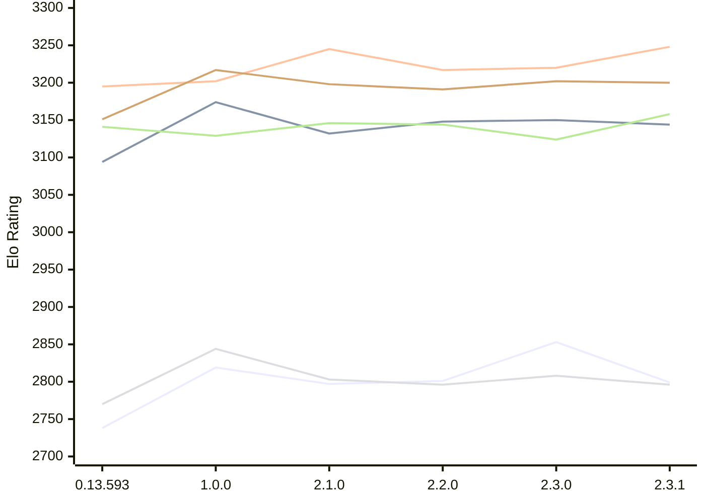

# Engine: Pawnstar

Author: Jonny Reckless

Home: https://github.com/jonny-reckless/pawnstar

## Elo Ratings E1 (Ultra 7 265T (1.50 GHz) - E-Core)

| Version | Published | STC 8.0+0.08s  | LTC 60.0+0.60s | VLTC 2m24s+1.12s | Comment |
| --- | --- | --- | --- | --- | --- |
| 2.3.1 | 2026-11-09 | 2799(-54) | 3144(-6) | 3248(+28) |  |
| 2.3.0 | 2026-11-08 | 2853(+52) | 3150(+2) | 3220(+3) |  |
| 2.2.0 | 2026-11-07 | 2801(+4) | 3148(+16) | 3217(-28) |  |
| 2.1.0 | 2026-10-31 | 2797(-22) | 3132(-42) | 3245(+43) |  |
| 1.0.0 | 2026-10-15 | 2819(+81) | 3174(+80) | 3202(+7) |  |
| 0.13.593 | 2026-06-30 | 2738 | 3094 | 3195 |  |
 | | | cElo (∆ prev) | cElo (∆ prev) | cElo (∆ prev) | 

## Elo Ratings P1 (Ultra 7 265T (1.50 GHz) - P-Core)

| Version | Published | STC 8.0+0.08s  | LTC 60.0+0.60s | VLTC 2m24s+1.12s | Comment |
| --- | --- | --- | --- | --- | --- |
| 2.3.1 | 2026-11-09 | 2796(-12) | 3158(+34) | 3200(-2) |  |
| 2.3.0 | 2026-11-08 | 2808(+12) | 3124(-20) | 3202(+11) |  |
| 2.2.0 | 2026-11-07 | 2796(-7) | 3144(-2) | 3191(-7) |  |
| 2.1.0 | 2026-10-31 | 2803(-41) | 3146(+17) | 3198(-19) |  |
| 1.0.0 | 2026-10-15 | 2844(+74) | 3129(-12) | 3217(+66) |  |
| 0.13.593 | 2026-06-30 | 2770 | 3141 | 3151 |  |
 | | | cElo (∆ prev) | cElo (∆ prev) | cElo (∆ prev) | 

## Elo Ratings T1 (i5-7500T 2.70GHz)

| Version | Published | STC 8.0+0.08s  | LTC 60.0+0.60s | VLTC 2m24s+1.12s | Comment |
| --- | --- | --- | --- | --- | --- |
| 0.13.593 | 2026-06-30 | 2831 | 3125 | 3200 |  |
 | | | cElo (∆ prev) | cElo (∆ prev) | cElo (∆ prev) | 

<a href="https://github.com/computer-chess-index/cci/issues/new?template=submit-version.yml&title=[VERSION]+Pawnstar+<version>&body=###%20Engine%20name%0APawnstar%0A%0A###%20Version%0A0.13.593" target="_blank">Submit new version</a>

 Test Conditions:

GUI/CLI: <a href=https://github.com/cutechess/cutechess target="_blank">Cute-Chess</a> 
Elo Calculation: <a href=https://www.remi-coulom.fr/Bayesian-Elo/ target="_blank">Bayesian-Elo</a> 
CPU for P1: Intel(R) Core(TM) Ultra 7 265T (1.50 GHz) - P-Core 
CPU for E1: Intel(R) Core(TM) Ultra 7 265T (1.50 GHz) - E-Core 
CPU for T1: Intel(R) Core(TM) i5-7500T 2.70GHz 
Opening book: 8_moves_v3 
\* STC: 8.0+0.08s, LTC: 60.0+0.60s, VLTC: 2m24s+1.12s

 Lists:
Ratings: <a href=https://github.com/computer-chess-index/cci/blob/main/lists/CCIRatings.csv target="_blank">Complete list</a>

Generated: 2026-11-20 05:40:53

## Ratings Verlauf E1 / P1

## Detailed Evaluation Results

| Version | Time Control | Variant | Elo  | Range +/- | Matches | Score | Average Opponent Elo | Draws |
| --- | --- |--- | --- | --- | --- | --- | --- | --- |
| 2.3.1 | VLTC (2m24s+1.12s) | P1 | 3200 | 36 | 212 | 49% | 3209 | 59% |
|  |  | E1 | 3248 | 29 | 308 | 51% | 3237 | 65% |
|  | LTC (60.0+0.60s) | P1 | 3158 | 43 | 148 | 48% | 3168 | 59% |
|  |  | E1 | 3144 | 29 | 320 | 52% | 3128 | 56% |
|  | STC (8.0+0.08s) | P1 | 2796 | 44 | 164 | 50% | 2804 | 36% |
|  |  | E1 | 2799 | 31 | 350 | 47% | 2827 | 35% |
| --- | --- |--- | --- | --- | --- | --- | --- | --- |
| 2.3.0 | VLTC (2m24s+1.12s) | P1 | 3202 | 43 | 144 | 48% | 3214 | 59% |
|  |  | E1 | 3220 | 35 | 212 | 49% | 3231 | 62% |
|  | LTC (60.0+0.60s) | E1 | 3150 | 31 | 278 | 47% | 3175 | 58% |
|  |  | P1 | 3124 | 37 | 198 | 52% | 3105 | 58% |
|  | STC (8.0+0.08s) | E1 | 2853 | 31 | 316 | 47% | 2878 | 41% |
|  |  | P1 | 2808 | 34 | 270 | 45% | 2846 | 41% |
| --- | --- |--- | --- | --- | --- | --- | --- | --- |
| 2.2.0 | VLTC (2m24s+1.12s) | P1 | 3191 | 38 | 178 | 53% | 3171 | 63% |
|  |  | E1 | 3217 | 32 | 262 | 51% | 3212 | 57% |
|  | LTC (60.0+0.60s) | P1 | 3144 | 48 | 116 | 48% | 3159 | 60% |
|  |  | E1 | 3148 | 32 | 280 | 53% | 3127 | 53% |
|  | STC (8.0+0.08s) | P1 | 2796 | 50 | 126 | 51% | 2785 | 36% |
|  |  | E1 | 2801 | 32 | 292 | 53% | 2774 | 43% |
| --- | --- |--- | --- | --- | --- | --- | --- | --- |
| 2.1.0 | VLTC (2m24s+1.12s) | P1 | 3198 | 34 | 232 | 47% | 3217 | 64% |
|  |  | E1 | 3245 | 28 | 340 | 53% | 3222 | 64% |
|  | LTC (60.0+0.60s) | P1 | 3146 | 41 | 152 | 49% | 3151 | 63% |
|  |  | E1 | 3132 | 29 | 344 | 54% | 3102 | 51% |
|  | STC (8.0+0.08s) | P1 | 2803 | 38 | 212 | 45% | 2849 | 40% |
|  |  | E1 | 2797 | 37 | 228 | 49% | 2805 | 40% |
| --- | --- |--- | --- | --- | --- | --- | --- | --- |
| 1.0.0 | VLTC (2m24s+1.12s) | P1 | 3217 | 40 | 160 | 50% | 3220 | 66% |
|  |  | E1 | 3202 | 34 | 232 | 50% | 3200 | 62% |
|  | LTC (60.0+0.60s) | P1 | 3129 | 39 | 180 | 50% | 3127 | 58% |
|  |  | E1 | 3174 | 32 | 276 | 51% | 3167 | 53% |
|  | STC (8.0+0.08s) | P1 | 2844 | 39 | 198 | 52% | 2826 | 45% |
|  |  | E1 | 2819 | 28 | 394 | 47% | 2844 | 40% |
| --- | --- |--- | --- | --- | --- | --- | --- | --- |
| 0.13.593 | VLTC (2m24s+1.12s) | E1 | 3195 | 30 | 312 | 47% | 3216 | 51% |
|  |  | T1 | 3200 | 26 | 432 | 50% | 3189 | 53% |
|  |  | P1 | 3151 | 35 | 220 | 46% | 3181 | 56% |
|  | LTC (60.0+0.60s) | T1 | 3125 | 26 | 450 | 52% | 3089 | 48% |
|  |  | P1 | 3141 | 34 | 248 | 52% | 3123 | 49% |
|  |  | E1 | 3094 | 31 | 300 | 48% | 3112 | 53% |
|  | STC (8.0+0.08s) | T1 | 2831 | 28 | 436 | 49% | 2822 | 32% |
|  |  | P1 | 2770 | 41 | 192 | 46% | 2808 | 35% |
|  |  | E1 | 2738 | 30 | 382 | 46% | 2776 | 31% |