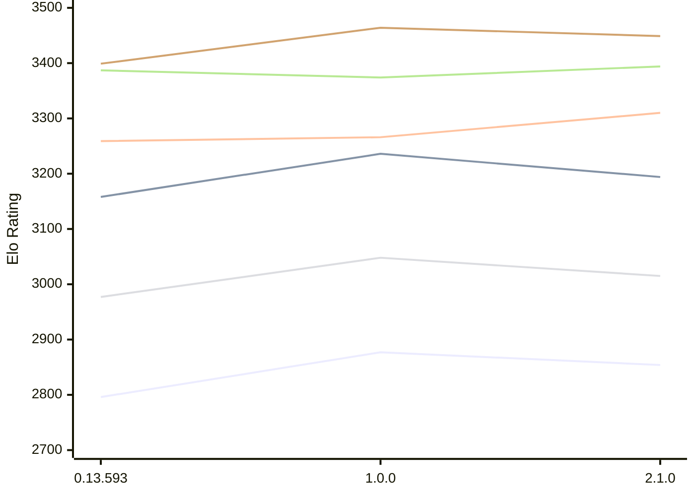

# Engine: Pawnstar

Author: Jonny Reckless

Home: https://github.com/jonny-reckless/pawnstar

## Elo Ratings E1 (Ultra 7 265T (1.50 GHz) - E-Core)

| Version | Published | STC 8.0+0.08s  | LTC 60.0+0.60s | VLTC 2m24s+1.12s | Comment |
| --- | --- | --- | --- | --- | --- |
| 2.1.0 | 2026-10-31 | 2854(-23) | 3194(-42) | 3310(+44) |  |
| 1.0.0 | 2026-10-15 | 2877(+81) | 3236(+78) | 3266(+7) |  |
| 0.13.593 | 2026-06-30 | 2796 | 3158 | 3259 |  |
 | | | cElo (∆ prev) | cElo (∆ prev) | cElo (∆ prev) | 

## Elo Ratings P1 (Ultra 7 265T (1.50 GHz) - P-Core)

| Version | Published | STC 8.0+0.08s  | LTC 60.0+0.60s | VLTC 2m24s+1.12s | Comment |
| --- | --- | --- | --- | --- | --- |
| 2.1.0 | 2026-10-31 | 3015(-33) | 3394(+20) | 3449(-15) |  |
| 1.0.0 | 2026-10-15 | 3048(+71) | 3374(-13) | 3464(+65) |  |
| 0.13.593 | 2026-06-30 | 2977 | 3387 | 3399 |  |
 | | | cElo (∆ prev) | cElo (∆ prev) | cElo (∆ prev) | 

## Elo Ratings T1 (i5-7500T 2.70GHz)

| Version | Published | STC 8.0+0.08s  | LTC 60.0+0.60s | VLTC 2m24s+1.12s | Comment |
| --- | --- | --- | --- | --- | --- |
| 0.13.593 | 2026-06-30 | 2831 | 3125 | 3200 |  |
 | | | cElo (∆ prev) | cElo (∆ prev) | cElo (∆ prev) | 

<a href="https://github.com/computer-chess-index/cci/issues/new?template=submit-version.yml&title=[VERSION]+Pawnstar+<version>&body=###%20Engine%20name%0APawnstar%0A%0A###%20Version%0A0.13.593" target="_blank">Submit new version</a>

 Test Conditions:

GUI/CLI: <a href=https://github.com/cutechess/cutechess target="_blank">Cute-Chess</a> 
Elo Calculation: <a href=https://www.remi-coulom.fr/Bayesian-Elo/ target="_blank">Bayesian-Elo</a> 
CPU for P1: Intel(R) Core(TM) Ultra 7 265T (1.50 GHz) - P-Core 
CPU for E1: Intel(R) Core(TM) Ultra 7 265T (1.50 GHz) - E-Core 
CPU for T1: Intel(R) Core(TM) i5-7500T 2.70GHz 
Opening book: 8_moves_v3 
\* STC: 8.0+0.08s, LTC: 60.0+0.60s, VLTC: 2m24s+1.12s

 Lists:
Ratings: <a href=https://github.com/computer-chess-index/cci/blob/main/lists/CCIRatings.csv target="_blank">Complete list</a>

Generated: 2026-11-05 05:40:40

## Ratings Verlauf E1 / P1

## Detailed Evaluation Results

| Version | Time Control | Variant | Elo  | Range +/- | Matches | Score | Average Opponent Elo | Draws |
| --- | --- |--- | --- | --- | --- | --- | --- | --- |
| 2.1.0 | VLTC (2m24s+1.12s) | E1 | 3310 | 28 | 328 | 53% | 3286 | 63% |
|  |  | P1 | 3449 | 36 | 196 | 47% | 3470 | 65% |
|  | LTC (60.0+0.60s) | E1 | 3194 | 29 | 332 | 54% | 3163 | 51% |
|  |  | P1 | 3394 | 42 | 148 | 49% | 3399 | 62% |
|  | STC (8.0+0.08s) | E1 | 2854 | 37 | 220 | 49% | 2865 | 39% |
|  |  | P1 | 3015 | 38 | 212 | 45% | 3059 | 40% |
| --- | --- |--- | --- | --- | --- | --- | --- | --- |
| 1.0.0 | VLTC (2m24s+1.12s) | P1 | 3464 | 40 | 160 | 50% | 3468 | 66% |
|  |  | E1 | 3266 | 34 | 232 | 50% | 3264 | 62% |
|  | LTC (60.0+0.60s) | P1 | 3374 | 39 | 180 | 50% | 3371 | 58% |
|  |  | E1 | 3236 | 32 | 276 | 51% | 3229 | 53% |
|  | STC (8.0+0.08s) | P1 | 3048 | 39 | 198 | 52% | 3029 | 45% |
|  |  | E1 | 2877 | 28 | 394 | 47% | 2903 | 40% |
| --- | --- |--- | --- | --- | --- | --- | --- | --- |
| 0.13.593 | VLTC (2m24s+1.12s) | P1 | 3399 | 35 | 220 | 46% | 3430 | 56% |
|  |  | E1 | 3259 | 30 | 312 | 47% | 3279 | 51% |
|  |  | T1 | 3200 | 26 | 432 | 50% | 3189 | 53% |
|  | LTC (60.0+0.60s) | E1 | 3158 | 31 | 300 | 48% | 3175 | 53% |
|  |  | T1 | 3125 | 26 | 450 | 52% | 3089 | 48% |
|  |  | P1 | 3387 | 34 | 248 | 52% | 3368 | 49% |
|  | STC (8.0+0.08s) | E1 | 2796 | 30 | 382 | 46% | 2834 | 31% |
|  |  | T1 | 2831 | 28 | 436 | 49% | 2822 | 32% |
|  |  | P1 | 2977 | 41 | 192 | 46% | 3015 | 35% |