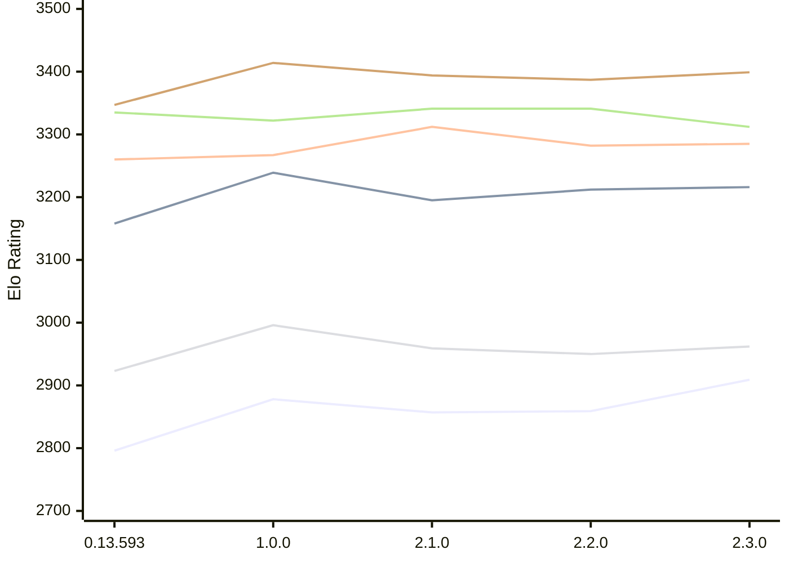

# Engine: Pawnstar

Author: Jonny Reckless

Home: https://github.com/jonny-reckless/pawnstar

## Elo Ratings E1 (Ultra 7 265T (1.50 GHz) - E-Core)

| Version | Published | STC 8.0+0.08s  | LTC 60.0+0.60s | VLTC 2m24s+1.12s | Comment |
| --- | --- | --- | --- | --- | --- |
| 2.3.0 | 2026-11-08 | 2909(+50) | 3216(+4) | 3285(+3) |  |
| 2.2.0 | 2026-11-07 | 2859(+2) | 3212(+17) | 3282(-30) |  |
| 2.1.0 | 2026-10-31 | 2857(-21) | 3195(-44) | 3312(+45) |  |
| 1.0.0 | 2026-10-15 | 2878(+82) | 3239(+81) | 3267(+7) |  |
| 0.13.593 | 2026-06-30 | 2796 | 3158 | 3260 |  |
 | | | cElo (∆ prev) | cElo (∆ prev) | cElo (∆ prev) | 

## Elo Ratings P1 (Ultra 7 265T (1.50 GHz) - P-Core)

| Version | Published | STC 8.0+0.08s  | LTC 60.0+0.60s | VLTC 2m24s+1.12s | Comment |
| --- | --- | --- | --- | --- | --- |
| 2.3.0 | 2026-11-08 | 2962(+12) | 3312(-29) | 3399(+12) |  |
| 2.2.0 | 2026-11-07 | 2950(-9) | 3341(0) | 3387(-7) |  |
| 2.1.0 | 2026-10-31 | 2959(-37) | 3341(+19) | 3394(-20) |  |
| 1.0.0 | 2026-10-15 | 2996(+73) | 3322(-13) | 3414(+67) |  |
| 0.13.593 | 2026-06-30 | 2923 | 3335 | 3347 |  |
 | | | cElo (∆ prev) | cElo (∆ prev) | cElo (∆ prev) | 

## Elo Ratings T1 (i5-7500T 2.70GHz)

| Version | Published | STC 8.0+0.08s  | LTC 60.0+0.60s | VLTC 2m24s+1.12s | Comment |
| --- | --- | --- | --- | --- | --- |
| 0.13.593 | 2026-06-30 | 2831 | 3125 | 3200 |  |
 | | | cElo (∆ prev) | cElo (∆ prev) | cElo (∆ prev) | 

<a href="https://github.com/computer-chess-index/cci/issues/new?template=submit-version.yml&title=[VERSION]+Pawnstar+<version>&body=###%20Engine%20name%0APawnstar%0A%0A###%20Version%0A0.13.593" target="_blank">Submit new version</a>

 Test Conditions:

GUI/CLI: <a href=https://github.com/cutechess/cutechess target="_blank">Cute-Chess</a> 
Elo Calculation: <a href=https://www.remi-coulom.fr/Bayesian-Elo/ target="_blank">Bayesian-Elo</a> 
CPU for P1: Intel(R) Core(TM) Ultra 7 265T (1.50 GHz) - P-Core 
CPU for E1: Intel(R) Core(TM) Ultra 7 265T (1.50 GHz) - E-Core 
CPU for T1: Intel(R) Core(TM) i5-7500T 2.70GHz 
Opening book: 8_moves_v3 
\* STC: 8.0+0.08s, LTC: 60.0+0.60s, VLTC: 2m24s+1.12s

 Lists:
Ratings: <a href=https://github.com/computer-chess-index/cci/blob/main/lists/CCIRatings.csv target="_blank">Complete list</a>

Generated: 2026-11-10 05:40:38

## Ratings Verlauf E1 / P1

## Detailed Evaluation Results

| Version | Time Control | Variant | Elo  | Range +/- | Matches | Score | Average Opponent Elo | Draws |
| --- | --- |--- | --- | --- | --- | --- | --- | --- |
| 2.3.0 | VLTC (2m24s+1.12s) | P1 | 3399 | 44 | 136 | 50% | 3403 | 60% |
|  |  | E1 | 3285 | 37 | 188 | 49% | 3289 | 64% |
|  | LTC (60.0+0.60s) | P1 | 3312 | 39 | 178 | 52% | 3294 | 58% |
|  |  | E1 | 3216 | 34 | 232 | 47% | 3240 | 59% |
|  | STC (8.0+0.08s) | P1 | 2962 | 35 | 246 | 45% | 3004 | 39% |
|  |  | E1 | 2909 | 32 | 292 | 46% | 2939 | 42% |
| --- | --- |--- | --- | --- | --- | --- | --- | --- |
| 2.2.0 | VLTC (2m24s+1.12s) | P1 | 3387 | 38 | 178 | 53% | 3367 | 63% |
|  |  | E1 | 3282 | 32 | 262 | 51% | 3278 | 57% |
|  | LTC (60.0+0.60s) | P1 | 3341 | 48 | 116 | 48% | 3356 | 60% |
|  |  | E1 | 3212 | 32 | 280 | 53% | 3190 | 53% |
|  | STC (8.0+0.08s) | P1 | 2950 | 50 | 126 | 51% | 2939 | 36% |
|  |  | E1 | 2859 | 32 | 292 | 53% | 2832 | 43% |
| --- | --- |--- | --- | --- | --- | --- | --- | --- |
| 2.1.0 | VLTC (2m24s+1.12s) | P1 | 3394 | 34 | 232 | 47% | 3414 | 64% |
|  |  | E1 | 3312 | 28 | 340 | 53% | 3289 | 64% |
|  | LTC (60.0+0.60s) | P1 | 3341 | 41 | 152 | 49% | 3347 | 63% |
|  |  | E1 | 3195 | 29 | 344 | 54% | 3166 | 51% |
|  | STC (8.0+0.08s) | P1 | 2959 | 38 | 212 | 45% | 3005 | 40% |
|  |  | E1 | 2857 | 37 | 228 | 49% | 2865 | 40% |
| --- | --- |--- | --- | --- | --- | --- | --- | --- |
| 1.0.0 | VLTC (2m24s+1.12s) | P1 | 3414 | 40 | 160 | 50% | 3417 | 66% |
|  |  | E1 | 3267 | 34 | 232 | 50% | 3266 | 62% |
|  | LTC (60.0+0.60s) | P1 | 3322 | 39 | 180 | 50% | 3318 | 58% |
|  |  | E1 | 3239 | 32 | 276 | 51% | 3231 | 53% |
|  | STC (8.0+0.08s) | P1 | 2996 | 39 | 198 | 52% | 2977 | 45% |
|  |  | E1 | 2878 | 28 | 394 | 47% | 2903 | 40% |
| --- | --- |--- | --- | --- | --- | --- | --- | --- |
| 0.13.593 | VLTC (2m24s+1.12s) | T1 | 3200 | 26 | 432 | 50% | 3189 | 53% |
|  |  | P1 | 3347 | 35 | 220 | 46% | 3376 | 56% |
|  |  | E1 | 3260 | 30 | 312 | 47% | 3281 | 51% |
|  | LTC (60.0+0.60s) | P1 | 3335 | 34 | 248 | 52% | 3316 | 49% |
|  |  | E1 | 3158 | 31 | 300 | 48% | 3177 | 53% |
|  |  | T1 | 3125 | 26 | 450 | 52% | 3089 | 48% |
|  | STC (8.0+0.08s) | P1 | 2923 | 41 | 192 | 46% | 2961 | 35% |
|  |  | E1 | 2796 | 30 | 382 | 46% | 2834 | 31% |
|  |  | T1 | 2831 | 28 | 436 | 49% | 2822 | 32% |