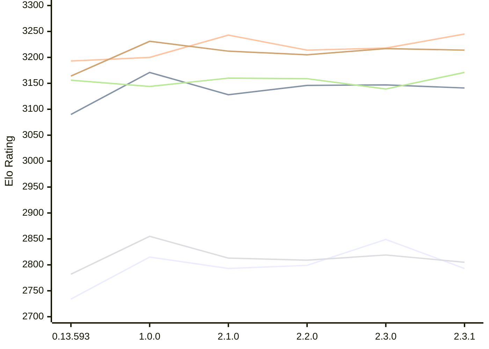

# Engine: Pawnstar

Author: Jonny Reckless

Home: https://github.com/jonny-reckless/pawnstar

## Elo Ratings E1 (Ultra 7 265T (1.50 GHz) - E-Core)

| Version | Published | STC 8.0+0.08s  | LTC 60.0+0.60s | VLTC 2m24s+1.12s | Comment |
| --- | --- | --- | --- | --- | --- |
| 2.3.1 | 2026-11-09 | 2793(-56) | 3141(-6) | 3245(+27) |  |
| 2.3.0 | 2026-11-08 | 2849(+50) | 3147(+1) | 3218(+4) |  |
| 2.2.0 | 2026-11-07 | 2799(+6) | 3146(+18) | 3214(-29) |  |
| 2.1.0 | 2026-10-31 | 2793(-22) | 3128(-43) | 3243(+43) |  |
| 1.0.0 | 2026-10-15 | 2815(+81) | 3171(+81) | 3200(+7) |  |
| 0.13.593 | 2026-06-30 | 2734 | 3090 | 3193 |  |
 | | | cElo (∆ prev) | cElo (∆ prev) | cElo (∆ prev) | 

## Elo Ratings P1 (Ultra 7 265T (1.50 GHz) - P-Core)

| Version | Published | STC 8.0+0.08s  | LTC 60.0+0.60s | VLTC 2m24s+1.12s | Comment |
| --- | --- | --- | --- | --- | --- |
| 2.3.1 | 2026-11-09 | 2805(-14) | 3171(+32) | 3214(-3) |  |
| 2.3.0 | 2026-11-08 | 2819(+10) | 3139(-20) | 3217(+12) |  |
| 2.2.0 | 2026-11-07 | 2809(-4) | 3159(-1) | 3205(-7) |  |
| 2.1.0 | 2026-10-31 | 2813(-42) | 3160(+16) | 3212(-19) |  |
| 1.0.0 | 2026-10-15 | 2855(+73) | 3144(-12) | 3231(+67) |  |
| 0.13.593 | 2026-06-30 | 2782 | 3156 | 3164 |  |
 | | | cElo (∆ prev) | cElo (∆ prev) | cElo (∆ prev) | 

## Elo Ratings T1 (i5-7500T 2.70GHz)

| Version | Published | STC 8.0+0.08s  | LTC 60.0+0.60s | VLTC 2m24s+1.12s | Comment |
| --- | --- | --- | --- | --- | --- |
| 0.13.593 | 2026-06-30 | 2831 | 3125 | 3200 |  |
 | | | cElo (∆ prev) | cElo (∆ prev) | cElo (∆ prev) | 

<a href="https://github.com/computer-chess-index/cci/issues/new?template=submit-version.yml&title=[VERSION]+Pawnstar+<version>&body=###%20Engine%20name%0APawnstar%0A%0A###%20Version%0A0.13.593" target="_blank">Submit new version</a>

 Test Conditions:

GUI/CLI: <a href=https://github.com/cutechess/cutechess target="_blank">Cute-Chess</a> 
Elo Calculation: <a href=https://www.remi-coulom.fr/Bayesian-Elo/ target="_blank">Bayesian-Elo</a> 
CPU for P1: Intel(R) Core(TM) Ultra 7 265T (1.50 GHz) - P-Core 
CPU for E1: Intel(R) Core(TM) Ultra 7 265T (1.50 GHz) - E-Core 
CPU for T1: Intel(R) Core(TM) i5-7500T 2.70GHz 
Opening book: 8_moves_v3 
\* STC: 8.0+0.08s, LTC: 60.0+0.60s, VLTC: 2m24s+1.12s

 Lists:
Ratings: <a href=https://github.com/computer-chess-index/cci/blob/main/lists/CCIRatings.csv target="_blank">Complete list</a>

Generated: 2026-11-23 05:41:02

## Ratings Verlauf E1 / P1

## Detailed Evaluation Results

| Version | Time Control | Variant | Elo  | Range +/- | Matches | Score | Average Opponent Elo | Draws |
| --- | --- |--- | --- | --- | --- | --- | --- | --- |
| 2.3.1 | VLTC (2m24s+1.12s) | P1 | 3214 | 35 | 216 | 49% | 3224 | 59% |
|  |  | E1 | 3245 | 29 | 308 | 51% | 3235 | 65% |
|  | LTC (60.0+0.60s) | P1 | 3171 | 40 | 168 | 49% | 3181 | 59% |
|  |  | E1 | 3141 | 29 | 320 | 52% | 3125 | 56% |
|  | STC (8.0+0.08s) | P1 | 2805 | 43 | 168 | 49% | 2816 | 37% |
|  |  | E1 | 2793 | 30 | 378 | 47% | 2822 | 35% |
| --- | --- |--- | --- | --- | --- | --- | --- | --- |
| 2.3.0 | VLTC (2m24s+1.12s) | P1 | 3217 | 43 | 144 | 48% | 3231 | 59% |
|  |  | E1 | 3218 | 35 | 212 | 49% | 3228 | 62% |
|  | LTC (60.0+0.60s) | P1 | 3139 | 37 | 198 | 52% | 3120 | 58% |
|  |  | E1 | 3147 | 31 | 278 | 47% | 3174 | 58% |
|  | STC (8.0+0.08s) | P1 | 2819 | 33 | 274 | 45% | 2857 | 41% |
|  |  | E1 | 2849 | 31 | 316 | 47% | 2874 | 41% |
| --- | --- |--- | --- | --- | --- | --- | --- | --- |
| 2.2.0 | VLTC (2m24s+1.12s) | P1 | 3205 | 38 | 178 | 53% | 3186 | 63% |
|  |  | E1 | 3214 | 32 | 262 | 51% | 3209 | 57% |
|  | LTC (60.0+0.60s) | P1 | 3159 | 48 | 116 | 48% | 3174 | 60% |
|  |  | E1 | 3146 | 32 | 280 | 53% | 3124 | 53% |
|  | STC (8.0+0.08s) | P1 | 2809 | 50 | 126 | 51% | 2797 | 36% |
|  |  | E1 | 2799 | 32 | 292 | 53% | 2772 | 43% |
| --- | --- |--- | --- | --- | --- | --- | --- | --- |
| 2.1.0 | VLTC (2m24s+1.12s) | P1 | 3212 | 34 | 232 | 47% | 3231 | 64% |
|  |  | E1 | 3243 | 28 | 340 | 53% | 3221 | 64% |
|  | LTC (60.0+0.60s) | P1 | 3160 | 41 | 152 | 49% | 3166 | 63% |
|  |  | E1 | 3128 | 29 | 344 | 54% | 3098 | 51% |
|  | STC (8.0+0.08s) | P1 | 2813 | 38 | 212 | 45% | 2859 | 40% |
|  |  | E1 | 2793 | 37 | 228 | 49% | 2801 | 40% |
| --- | --- |--- | --- | --- | --- | --- | --- | --- |
| 1.0.0 | VLTC (2m24s+1.12s) | P1 | 3231 | 40 | 160 | 50% | 3235 | 66% |
|  |  | E1 | 3200 | 34 | 232 | 50% | 3197 | 62% |
|  | LTC (60.0+0.60s) | E1 | 3171 | 32 | 276 | 51% | 3164 | 53% |
|  |  | P1 | 3144 | 39 | 180 | 50% | 3140 | 58% |
|  | STC (8.0+0.08s) | E1 | 2815 | 28 | 394 | 47% | 2840 | 40% |
|  |  | P1 | 2855 | 39 | 198 | 52% | 2836 | 45% |
| --- | --- |--- | --- | --- | --- | --- | --- | --- |
| 0.13.593 | VLTC (2m24s+1.12s) | T1 | 3200 | 26 | 432 | 50% | 3189 | 53% |
|  |  | P1 | 3164 | 35 | 220 | 46% | 3194 | 56% |
|  |  | E1 | 3193 | 30 | 312 | 47% | 3213 | 51% |
|  | LTC (60.0+0.60s) | T1 | 3125 | 26 | 450 | 52% | 3089 | 48% |
|  |  | P1 | 3156 | 34 | 248 | 52% | 3137 | 49% |
|  |  | E1 | 3090 | 31 | 300 | 48% | 3109 | 53% |
|  | STC (8.0+0.08s) | T1 | 2831 | 28 | 436 | 49% | 2822 | 32% |
|  |  | P1 | 2782 | 41 | 192 | 46% | 2819 | 35% |
|  |  | E1 | 2734 | 30 | 382 | 46% | 2772 | 31% |