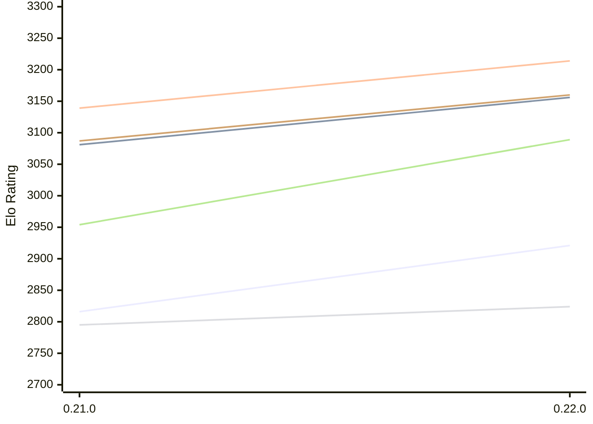
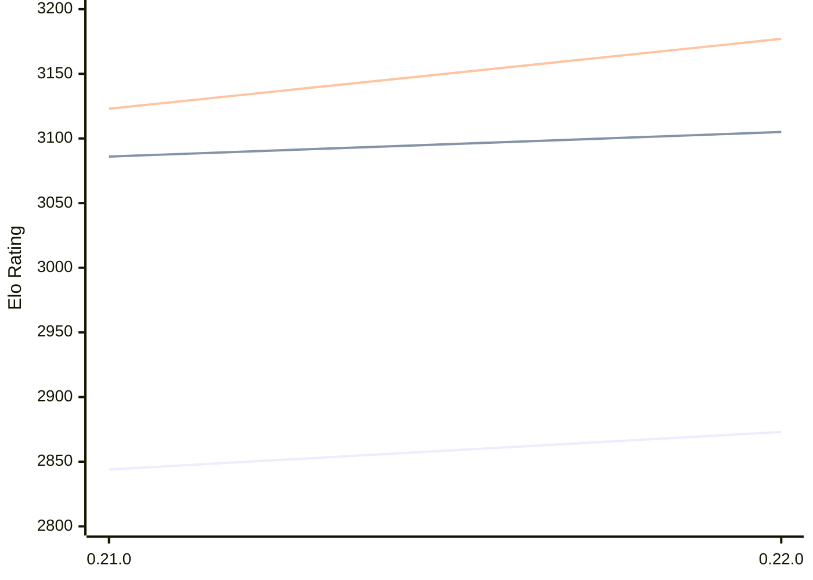

# Engine: Princhess

Author: Lana Samson

Home: https://github.com/princesslana/princhess

## Elo Ratings E1 (Ultra 7 265T (1.50 GHz) - E-Core)

| Version | Published | STC 8.0+0.08s  | LTC 60.0+0.60s | VLTC 2m24s+1.12s | Comment |
| --- | --- | --- | --- | --- | --- |
| 0.22.0 | 2026-08-16 | 2921(+105) | 3156(+75) | 3214(+75) |  |
| 0.21.0 | 2025-10-13 | 2816 | 3081 | 3139 |  |
 | | | cElo (∆ prev) | cElo (∆ prev) | cElo (∆ prev) | 

## Elo Ratings P1 (Ultra 7 265T (1.50 GHz) - P-Core)

| Version | Published | STC 8.0+0.08s  | LTC 60.0+0.60s | VLTC 2m24s+1.12s | Comment |
| --- | --- | --- | --- | --- | --- |
| 0.22.0 | 2026-08-16 | 2824(+29) | 3089(+135) | 3160(+73) |  |
| 0.21.0 | 2025-10-13 | 2795 | 2954 | 3087 |  |
 | | | cElo (∆ prev) | cElo (∆ prev) | cElo (∆ prev) | 

## Elo Ratings T1 (i5-7500T 2.70GHz)

| Version | Published | STC 8.0+0.08s  | LTC 60.0+0.60s | VLTC 2m24s+1.12s | Comment |
| --- | --- | --- | --- | --- | --- |
| 0.22.0 | 2026-08-16 | 2873(+29) | 3105(+19) | 3177(+54) |  |
| 0.21.0 | 2025-10-13 | 2844 | 3086 | 3123 |  |
 | | | cElo (∆ prev) | cElo (∆ prev) | cElo (∆ prev) | 

<a href="https://github.com/computer-chess-index/cci/issues/new?template=submit-version.yml&title=[VERSION]+Princhess+<version>&body=###%20Engine%20name%0APrinchess%0A%0A###%20Version%0A0.22.0" target="_blank">Submit new version</a>

 Test Conditions:

GUI/CLI: <a href=https://github.com/cutechess/cutechess target="_blank">Cute-Chess</a> 
Elo Calculation: <a href=https://www.remi-coulom.fr/Bayesian-Elo/ target="_blank">Bayesian-Elo</a> 
CPU for P1: Intel(R) Core(TM) Ultra 7 265T (1.50 GHz) - P-Core 
CPU for E1: Intel(R) Core(TM) Ultra 7 265T (1.50 GHz) - E-Core 
CPU for T1: Intel(R) Core(TM) i5-7500T 2.70GHz 
Opening book: 8_moves_v3 
\* STC: 8.0+0.08s, LTC: 60.0+0.60s, VLTC: 2m24s+1.12s

 Lists:
Ratings: <a href=https://github.com/computer-chess-index/cci/blob/main/lists/CCIRatings.csv target="_blank">Complete list</a>

Generated: 2026-11-16 05:41:15

## Ratings Verlauf E1 / P1

## Ratings Verlauf T1

## Detailed Evaluation Results

| Version | Time Control | Variant | Elo  | Range +/- | Matches | Score | Average Opponent Elo | Draws |
| --- | --- |--- | --- | --- | --- | --- | --- | --- |
| 0.22.0 | VLTC (2m24s+1.12s) | P1 | 3160 | 29 | 330 | 50% | 3158 | 57% |
|  |  | E1 | 3214 | 26 | 418 | 50% | 3214 | 53% |
|  |  | T1 | 3177 | 33 | 256 | 50% | 3174 | 56% |
|  | LTC (60.0+0.60s) | P1 | 3089 | 32 | 280 | 48% | 3108 | 51% |
|  |  | E1 | 3156 | 26 | 410 | 51% | 3147 | 51% |
|  |  | T1 | 3105 | 30 | 308 | 50% | 3106 | 54% |
|  | STC (8.0+0.08s) | P1 | 2824 | 32 | 296 | 49% | 2830 | 44% |
|  |  | E1 | 2921 | 28 | 398 | 50% | 2921 | 41% |
|  |  | T1 | 2873 | 32 | 296 | 49% | 2885 | 41% |
| --- | --- |--- | --- | --- | --- | --- | --- | --- |
| 0.21.0 | VLTC (2m24s+1.12s) | T1 | 3123 | 24 | 504 | 50% | 3124 | 51% |
|  |  | P1 | 3087 | 81 | 52 | 57% | 2955 | 37% |
|  |  | E1 | 3139 | 65 | 76 | 58% | 3023 | 39% |
|  | LTC (60.0+0.60s) | T1 | 3086 | 23 | 542 | 50% | 3082 | 50% |
|  |  | P1 | 2954 | 91 | 50 | 51% | 2840 | 18% |
|  |  | E1 | 3081 | 66 | 76 | 57% | 3011 | 39% |
|  | STC (8.0+0.08s) | T1 | 2844 | 21 | 728 | 51% | 2834 | 38% |
|  |  | P1 | 2795 | 77 | 56 | 57% | 2646 | 36% |
|  |  | E1 | 2816 | 64 | 88 | 50% | 2827 | 30% |