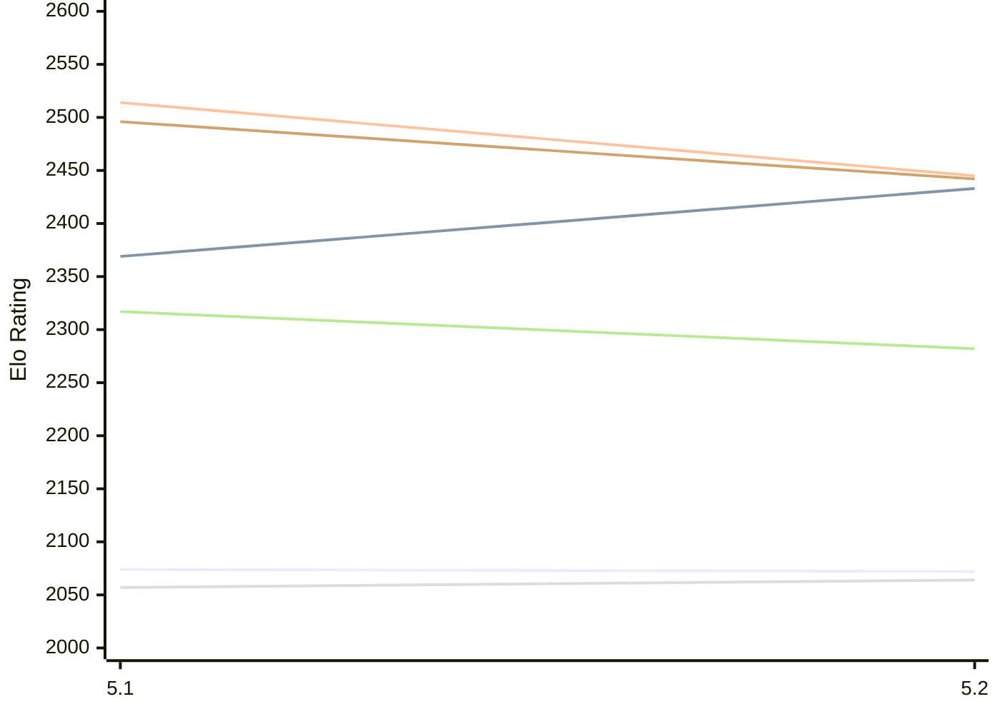
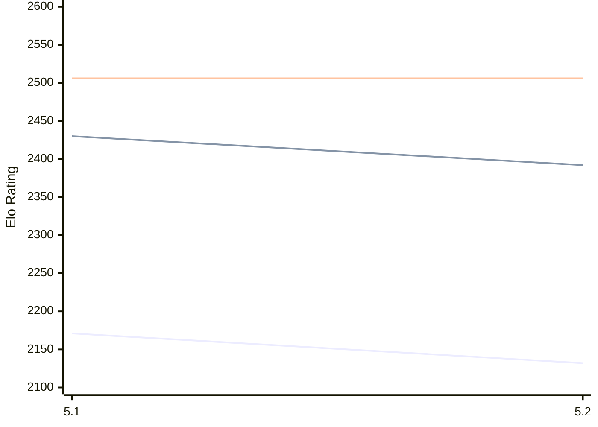

# Engine: Prophet

Author: James Swafford

Home: https://github.com/jswaff/prophet

## Elo Ratings E1 (Ultra 7 265T (1.50 GHz) - E-Core)

| Version | Published | STC 8.0+0.08s  | LTC 60.0+0.60s | VLTC 2m24s+1.12s | Comment |
| --- | --- | --- | --- | --- | --- |
| 5.2 | 2026-05-16 | 2072(-2) | 2433(+64) | 2445(-69) |  |
| 5.1 | 2025-09-16 | 2074 | 2369 | 2514 |  |
 | | | cElo (∆ prev) | cElo (∆ prev) | cElo (∆ prev) | 

## Elo Ratings P1 (Ultra 7 265T (1.50 GHz) - P-Core)

| Version | Published | STC 8.0+0.08s  | LTC 60.0+0.60s | VLTC 2m24s+1.12s | Comment |
| --- | --- | --- | --- | --- | --- |
| 5.2 | 2026-05-16 | 2064(+7) | 2282(-35) | 2442(-54) |  |
| 5.1 | 2025-09-16 | 2057 | 2317 | 2496 |  |
 | | | cElo (∆ prev) | cElo (∆ prev) | cElo (∆ prev) | 

## Elo Ratings T1 (i5-7500T 2.70GHz)

| Version | Published | STC 8.0+0.08s  | LTC 60.0+0.60s | VLTC 2m24s+1.12s | Comment |
| --- | --- | --- | --- | --- | --- |
| 5.2 | 2026-05-16 | 2132(-39) | 2392(-38) | 2506(0) |  |
| 5.1 | 2025-09-16 | 2171 | 2430 | 2506 |  |
 | | | cElo (∆ prev) | cElo (∆ prev) | cElo (∆ prev) | 

<a href="https://github.com/computer-chess-index/cci/issues/new?template=submit-version.yml&title=[VERSION]+Prophet+<version>&body=###%20Engine%20name%0AProphet%0A%0A###%20Version%0A5.2" target="_blank">Submit new version</a>

 Test Conditions:

GUI/CLI: <a href=https://github.com/cutechess/cutechess target="_blank">Cute-Chess</a> 
Elo Calculation: <a href=https://www.remi-coulom.fr/Bayesian-Elo/ target="_blank">Bayesian-Elo</a> 
CPU for P1: Intel(R) Core(TM) Ultra 7 265T (1.50 GHz) - P-Core 
CPU for E1: Intel(R) Core(TM) Ultra 7 265T (1.50 GHz) - E-Core 
CPU for T1: Intel(R) Core(TM) i5-7500T 2.70GHz 
Opening book: 8_moves_v3 
\* STC: 8.0+0.08s, LTC: 60.0+0.60s, VLTC: 2m24s+1.12s

 Lists:
Ratings: <a href=https://github.com/computer-chess-index/cci/blob/main/lists/CCIRatings.csv target="_blank">Complete list</a>

Generated: 2026-11-16 05:41:20

## Ratings Verlauf E1 / P1

## Ratings Verlauf T1

## Detailed Evaluation Results

| Version | Time Control | Variant | Elo  | Range +/- | Matches | Score | Average Opponent Elo | Draws |
| --- | --- |--- | --- | --- | --- | --- | --- | --- |
| 5.2 | VLTC (2m24s+1.12s) | P1 | 2442 | 39 | 242 | 50% | 2445 | 22% |
|  |  | E1 | 2445 | 36 | 266 | 49% | 2471 | 32% |
|  |  | T1 | 2506 | 28 | 438 | 49% | 2516 | 26% |
|  | LTC (60.0+0.60s) | P1 | 2282 | 34 | 324 | 55% | 2191 | 24% |
|  |  | E1 | 2433 | 32 | 338 | 47% | 2456 | 29% |
|  |  | T1 | 2392 | 28 | 432 | 49% | 2402 | 29% |
|  | STC (8.0+0.08s) | E1 | 2072 | 32 | 334 | 49% | 2091 | 24% |
|  |  | T1 | 2132 | 30 | 404 | 52% | 2113 | 22% |
|  |  | P1 | 2064 | 40 | 224 | 50% | 2091 | 22% |
| --- | --- |--- | --- | --- | --- | --- | --- | --- |
| 5.1 | VLTC (2m24s+1.12s) | T1 | 2506 | 30 | 380 | 48% | 2537 | 26% |
|  |  | P1 | 2496 | 91 | 52 | 50% | 2431 | 12% |
|  |  | E1 | 2514 | 64 | 86 | 43% | 2604 | 28% |
|  | LTC (60.0+0.60s) | T1 | 2430 | 28 | 416 | 49% | 2445 | 30% |
|  |  | P1 | 2317 | 89 | 56 | 42% | 2403 | 16% |
|  |  | E1 | 2369 | 63 | 94 | 52% | 2377 | 18% |
|  | STC (8.0+0.08s) | T1 | 2171 | 27 | 482 | 51% | 2165 | 28% |
|  |  | P1 | 2057 | 72 | 76 | 47% | 2140 | 16% |
|  |  | E1 | 2074 | 60 | 108 | 45% | 2182 | 26% |