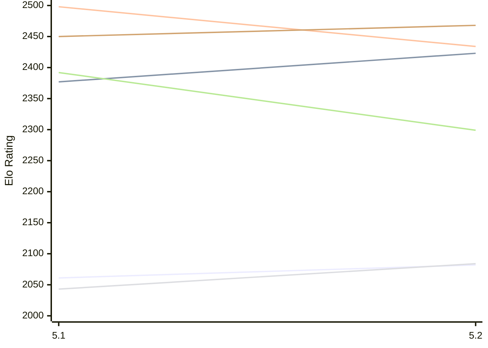
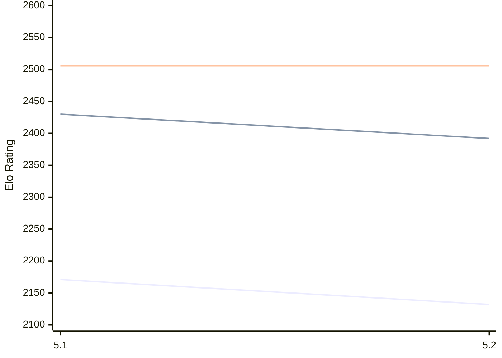

# Engine: Prophet

Author: James Swafford

Home: https://github.com/jswaff/prophet

## Elo Ratings E1 (Ultra 7 265T (1.50 GHz) - E-Core)

| Version | Published | STC 8.0+0.08s  | LTC 60.0+0.60s | VLTC 2m24s+1.12s | Comment |
| --- | --- | --- | --- | --- | --- |
| 5.2 | 2026-05-16 | 2082(+21) | 2423(+46) | 2434(-64) |  |
| 5.1 | 2025-09-16 | 2061 | 2377 | 2498 |  |
 | | | cElo (∆ prev) | cElo (∆ prev) | cElo (∆ prev) | 

## Elo Ratings P1 (Ultra 7 265T (1.50 GHz) - P-Core)

| Version | Published | STC 8.0+0.08s  | LTC 60.0+0.60s | VLTC 2m24s+1.12s | Comment |
| --- | --- | --- | --- | --- | --- |
| 5.2 | 2026-05-16 | 2084(+41) | 2299(-93) | 2468(+18) |  |
| 5.1 | 2025-09-16 | 2043 | 2392 | 2450 |  |
 | | | cElo (∆ prev) | cElo (∆ prev) | cElo (∆ prev) | 

## Elo Ratings T1 (i5-7500T 2.70GHz)

| Version | Published | STC 8.0+0.08s  | LTC 60.0+0.60s | VLTC 2m24s+1.12s | Comment |
| --- | --- | --- | --- | --- | --- |
| 5.2 | 2026-05-16 | 2132(-39) | 2392(-38) | 2506(0) |  |
| 5.1 | 2025-09-16 | 2171 | 2430 | 2506 |  |
 | | | cElo (∆ prev) | cElo (∆ prev) | cElo (∆ prev) | 

<a href="https://github.com/computer-chess-index/cci/issues/new?template=submit-version.yml&title=[VERSION]+Prophet+<version>&body=###%20Engine%20name%0AProphet%0A%0A###%20Version%0A5.2" target="_blank">Submit new version</a>

 Test Conditions:

GUI/CLI: <a href=https://github.com/cutechess/cutechess target="_blank">Cute-Chess</a> 
Elo Calculation: <a href=https://www.remi-coulom.fr/Bayesian-Elo/ target="_blank">Bayesian-Elo</a> 
CPU for P1: Intel(R) Core(TM) Ultra 7 265T (1.50 GHz) - P-Core 
CPU for E1: Intel(R) Core(TM) Ultra 7 265T (1.50 GHz) - E-Core 
CPU for T1: Intel(R) Core(TM) i5-7500T 2.70GHz 
Opening book: 8_moves_v3 
\* STC: 8.0+0.08s, LTC: 60.0+0.60s, VLTC: 2m24s+1.12s

 Lists:
Ratings: <a href=https://github.com/computer-chess-index/cci/blob/main/lists/CCIRatings.csv target="_blank">Complete list</a>

Generated: 2026-11-24 05:41:35

## Ratings Verlauf E1 / P1

## Ratings Verlauf T1

## Detailed Evaluation Results

| Version | Time Control | Variant | Elo  | Range +/- | Matches | Score | Average Opponent Elo | Draws |
| --- | --- |--- | --- | --- | --- | --- | --- | --- |
| 5.2 | VLTC (2m24s+1.12s) | T1 | 2506 | 28 | 438 | 49% | 2516 | 26% |
|  |  | P1 | 2468 | 37 | 274 | 49% | 2476 | 21% |
|  |  | E1 | 2434 | 34 | 286 | 48% | 2464 | 33% |
|  | LTC (60.0+0.60s) | T1 | 2392 | 28 | 432 | 49% | 2402 | 29% |
|  |  | P1 | 2299 | 34 | 340 | 55% | 2214 | 24% |
|  |  | E1 | 2423 | 31 | 370 | 46% | 2450 | 28% |
|  | STC (8.0+0.08s) | T1 | 2132 | 30 | 404 | 52% | 2113 | 22% |
|  |  | P1 | 2084 | 38 | 256 | 49% | 2118 | 22% |
|  |  | E1 | 2082 | 31 | 378 | 50% | 2086 | 23% |
| --- | --- |--- | --- | --- | --- | --- | --- | --- |
| 5.1 | VLTC (2m24s+1.12s) | T1 | 2506 | 30 | 380 | 48% | 2537 | 26% |
|  |  | P1 | 2450 | 67 | 88 | 47% | 2452 | 20% |
|  |  | E1 | 2498 | 55 | 114 | 43% | 2579 | 31% |
|  | LTC (60.0+0.60s) | T1 | 2430 | 28 | 416 | 49% | 2445 | 30% |
|  |  | P1 | 2392 | 64 | 96 | 49% | 2399 | 19% |
|  |  | E1 | 2377 | 56 | 118 | 52% | 2376 | 18% |
|  | STC (8.0+0.08s) | T1 | 2171 | 27 | 482 | 51% | 2165 | 28% |
|  |  | P1 | 2043 | 56 | 120 | 45% | 2129 | 18% |
|  |  | E1 | 2061 | 50 | 144 | 47% | 2141 | 29% |