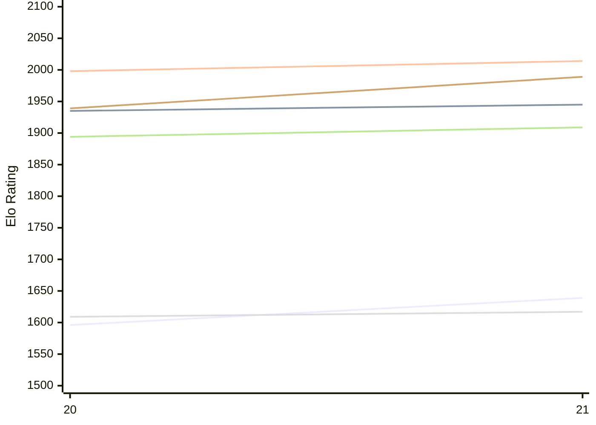
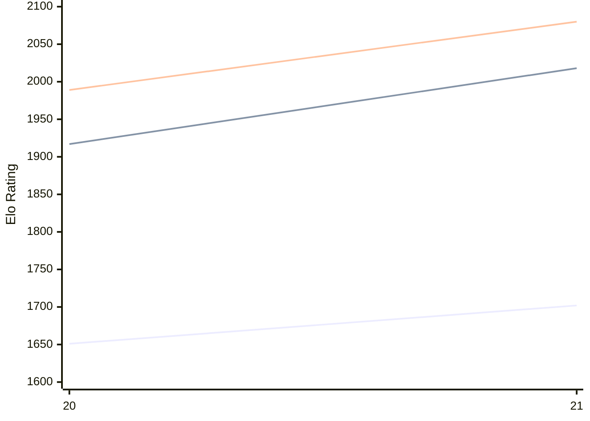

# Engine: PurplePanda

Author: Jakob Steininger

Home: https://github.com/Jakob256/PurplePanda

## Elo Ratings E1 (Ultra 7 265T (1.50 GHz) - E-Core)

| Version | Published | STC 8.0+0.08s  | LTC 60.0+0.60s | VLTC 2m24s+1.12s | Comment |
| --- | --- | --- | --- | --- | --- |
| 21 | 2026-07-12 | 1639(+43) | 1945(+10) | 2014(+16) |  |
| 20 | 2025-12-15 | 1596 | 1935 | 1998 |  |
 | | | cElo (∆ prev) | cElo (∆ prev) | cElo (∆ prev) | 

## Elo Ratings P1 (Ultra 7 265T (1.50 GHz) - P-Core)

| Version | Published | STC 8.0+0.08s  | LTC 60.0+0.60s | VLTC 2m24s+1.12s | Comment |
| --- | --- | --- | --- | --- | --- |
| 21 | 2026-07-12 | 1617(+8) | 1909(+15) | 1989(+50) |  |
| 20 | 2025-12-15 | 1609 | 1894 | 1939 |  |
 | | | cElo (∆ prev) | cElo (∆ prev) | cElo (∆ prev) | 

## Elo Ratings T1 (i5-7500T 2.70GHz)

| Version | Published | STC 8.0+0.08s  | LTC 60.0+0.60s | VLTC 2m24s+1.12s | Comment |
| --- | --- | --- | --- | --- | --- |
| 21 | 2026-07-12 | 1702(+51) | 2018(+101) | 2080(+91) |  |
| 20 | 2025-12-15 | 1651 | 1917 | 1989 |  |
 | | | cElo (∆ prev) | cElo (∆ prev) | cElo (∆ prev) | 

<a href="https://github.com/computer-chess-index/cci/issues/new?template=submit-version.yml&title=[VERSION]+PurplePanda+<version>&body=###%20Engine%20name%0APurplePanda%0A%0A###%20Version%0A21" target="_blank">Submit new version</a>

 Test Conditions:

GUI/CLI: <a href=https://github.com/cutechess/cutechess target="_blank">Cute-Chess</a> 
Elo Calculation: <a href=https://www.remi-coulom.fr/Bayesian-Elo/ target="_blank">Bayesian-Elo</a> 
CPU for P1: Intel(R) Core(TM) Ultra 7 265T (1.50 GHz) - P-Core 
CPU for E1: Intel(R) Core(TM) Ultra 7 265T (1.50 GHz) - E-Core 
CPU for T1: Intel(R) Core(TM) i5-7500T 2.70GHz 
Opening book: 8_moves_v3 
\* STC: 8.0+0.08s, LTC: 60.0+0.60s, VLTC: 2m24s+1.12s

 Lists:
Ratings: <a href=https://github.com/computer-chess-index/cci/blob/main/lists/CCIRatings.csv target="_blank">Complete list</a>

Generated: 2026-11-25 05:41:50

## Ratings Verlauf E1 / P1

## Ratings Verlauf T1

## Detailed Evaluation Results

| Version | Time Control | Variant | Elo  | Range +/- | Matches | Score | Average Opponent Elo | Draws |
| --- | --- |--- | --- | --- | --- | --- | --- | --- |
| 21 | VLTC (2m24s+1.12s) | T1 | 2080 | 34 | 322 | 47% | 2115 | 17% |
|  |  | P1 | 1989 | 37 | 266 | 47% | 2029 | 18% |
|  |  | E1 | 2014 | 32 | 398 | 47% | 2055 | 14% |
|  | LTC (60.0+0.60s) | T1 | 2018 | 34 | 312 | 50% | 2033 | 19% |
|  |  | P1 | 1909 | 41 | 216 | 47% | 1951 | 17% |
|  |  | E1 | 1945 | 34 | 326 | 49% | 1958 | 17% |
|  | STC (8.0+0.08s) | T1 | 1702 | 33 | 338 | 50% | 1698 | 16% |
|  |  | P1 | 1617 | 40 | 242 | 50% | 1624 | 13% |
|  |  | E1 | 1639 | 30 | 404 | 49% | 1648 | 17% |
| --- | --- |--- | --- | --- | --- | --- | --- | --- |
| 20 | VLTC (2m24s+1.12s) | P1 | 1939 | 55 | 132 | 54% | 1901 | 16% |
|  |  | E1 | 1998 | 51 | 144 | 44% | 2064 | 19% |
|  |  | T1 | 1989 | 25 | 566 | 48% | 2018 | 21% |
|  | LTC (60.0+0.60s) | P1 | 1894 | 60 | 104 | 48% | 1953 | 20% |
|  |  | E1 | 1935 | 53 | 142 | 46% | 2020 | 14% |
|  |  | T1 | 1917 | 25 | 580 | 50% | 1922 | 17% |
|  | STC (8.0+0.08s) | E1 | 1596 | 53 | 152 | 49% | 1661 | 11% |
|  |  | T1 | 1651 | 25 | 640 | 47% | 1679 | 16% |
|  |  | P1 | 1609 | 59 | 120 | 44% | 1742 | 15% |