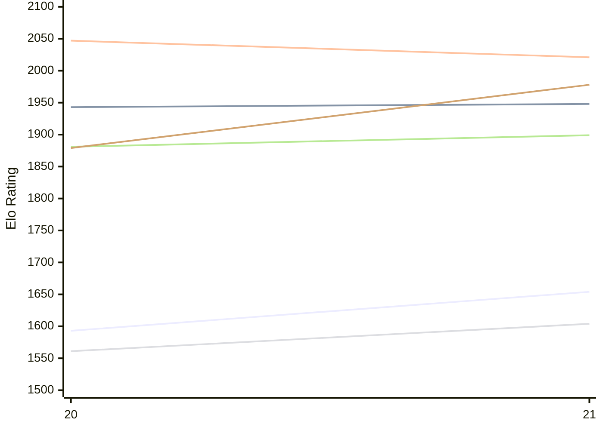
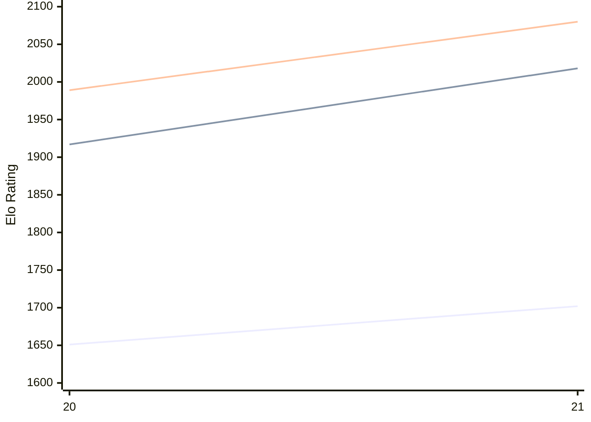

# Engine: PurplePanda

Author: Jakob Steininger

Home: https://github.com/Jakob256/PurplePanda

## Elo Ratings E1 (Ultra 7 265T (1.50 GHz) - E-Core)

| Version | Published | STC 8.0+0.08s  | LTC 60.0+0.60s | VLTC 2m24s+1.12s | Comment |
| --- | --- | --- | --- | --- | --- |
| 21 | 2026-07-12 | 1654(+61) | 1948(+5) | 2021(-26) |  |
| 20 | 2025-12-15 | 1593 | 1943 | 2047 |  |
 | | | cElo (∆ prev) | cElo (∆ prev) | cElo (∆ prev) | 

## Elo Ratings P1 (Ultra 7 265T (1.50 GHz) - P-Core)

| Version | Published | STC 8.0+0.08s  | LTC 60.0+0.60s | VLTC 2m24s+1.12s | Comment |
| --- | --- | --- | --- | --- | --- |
| 21 | 2026-07-12 | 1604(+43) | 1899(+18) | 1978(+99) |  |
| 20 | 2025-12-15 | 1561 | 1881 | 1879 |  |
 | | | cElo (∆ prev) | cElo (∆ prev) | cElo (∆ prev) | 

## Elo Ratings T1 (i5-7500T 2.70GHz)

| Version | Published | STC 8.0+0.08s  | LTC 60.0+0.60s | VLTC 2m24s+1.12s | Comment |
| --- | --- | --- | --- | --- | --- |
| 21 | 2026-07-12 | 1702(+51) | 2018(+101) | 2080(+91) |  |
| 20 | 2025-12-15 | 1651 | 1917 | 1989 |  |
 | | | cElo (∆ prev) | cElo (∆ prev) | cElo (∆ prev) | 

<a href="https://github.com/computer-chess-index/cci/issues/new?template=submit-version.yml&title=[VERSION]+PurplePanda+<version>&body=###%20Engine%20name%0APurplePanda%0A%0A###%20Version%0A21" target="_blank">Submit new version</a>

 Test Conditions:

GUI/CLI: <a href=https://github.com/cutechess/cutechess target="_blank">Cute-Chess</a> 
Elo Calculation: <a href=https://www.remi-coulom.fr/Bayesian-Elo/ target="_blank">Bayesian-Elo</a> 
CPU for P1: Intel(R) Core(TM) Ultra 7 265T (1.50 GHz) - P-Core 
CPU for E1: Intel(R) Core(TM) Ultra 7 265T (1.50 GHz) - E-Core 
CPU for T1: Intel(R) Core(TM) i5-7500T 2.70GHz 
Opening book: 8_moves_v3 
\* STC: 8.0+0.08s, LTC: 60.0+0.60s, VLTC: 2m24s+1.12s

 Lists:
Ratings: <a href=https://github.com/computer-chess-index/cci/blob/main/lists/CCIRatings.csv target="_blank">Complete list</a>

Generated: 2026-11-15 05:41:29

## Ratings Verlauf E1 / P1

## Ratings Verlauf T1

## Detailed Evaluation Results

| Version | Time Control | Variant | Elo  | Range +/- | Matches | Score | Average Opponent Elo | Draws |
| --- | --- |--- | --- | --- | --- | --- | --- | --- |
| 21 | VLTC (2m24s+1.12s) | T1 | 2080 | 34 | 322 | 47% | 2115 | 17% |
|  |  | P1 | 1978 | 39 | 246 | 47% | 2013 | 18% |
|  |  | E1 | 2021 | 32 | 394 | 47% | 2057 | 14% |
|  | LTC (60.0+0.60s) | T1 | 2018 | 34 | 312 | 50% | 2033 | 19% |
|  |  | P1 | 1899 | 44 | 192 | 48% | 1931 | 16% |
|  |  | E1 | 1948 | 35 | 306 | 49% | 1960 | 17% |
|  | STC (8.0+0.08s) | T1 | 1702 | 33 | 338 | 50% | 1698 | 16% |
|  |  | P1 | 1604 | 41 | 234 | 50% | 1616 | 12% |
|  |  | E1 | 1654 | 31 | 376 | 49% | 1665 | 17% |
| --- | --- |--- | --- | --- | --- | --- | --- | --- |
| 20 | VLTC (2m24s+1.12s) | E1 | 2047 | 66 | 84 | 46% | 2103 | 20% |
|  |  | T1 | 1989 | 25 | 566 | 48% | 2018 | 21% |
|  |  | P1 | 1879 | 70 | 84 | 51% | 1899 | 13% |
|  | LTC (60.0+0.60s) | E1 | 1943 | 68 | 86 | 42% | 2086 | 17% |
|  |  | T1 | 1917 | 25 | 580 | 50% | 1922 | 17% |
|  |  | P1 | 1881 | 85 | 56 | 46% | 1975 | 14% |
|  | STC (8.0+0.08s) | E1 | 1593 | 63 | 112 | 47% | 1696 | 13% |
|  |  | T1 | 1651 | 25 | 640 | 47% | 1679 | 16% |
|  |  | P1 | 1561 | 81 | 64 | 34% | 1862 | 23% |