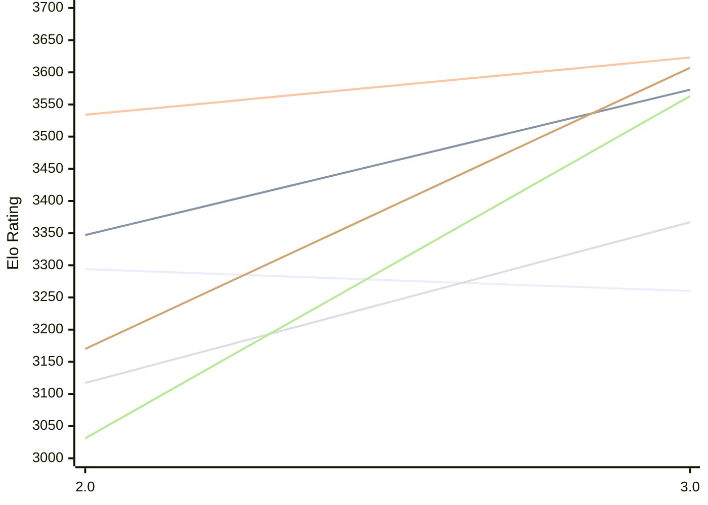
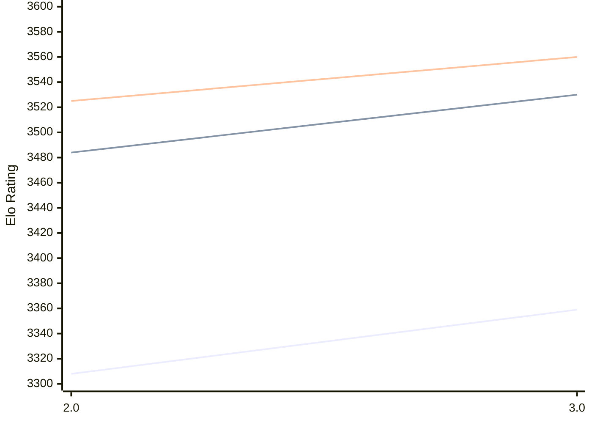

# Engine: Quanticade

Author: Martin Botka

Home: https://github.com/Quanticade/Quanticade

## Elo Ratings E1 (Ultra 7 265T (1.50 GHz) - E-Core)

| Version | Published | STC 8.0+0.08s  | LTC 60.0+0.60s | VLTC 2m24s+1.12s | Comment |
| --- | --- | --- | --- | --- | --- |
| 3.0 | 2025-12-15 | 3260(-34) | 3573(+226) | 3623(+89) |  |
| 2.0 | 2025-05-21 | 3294 | 3347 | 3534 |  |
 | | | cElo (∆ prev) | cElo (∆ prev) | cElo (∆ prev) | 

## Elo Ratings P1 (Ultra 7 265T (1.50 GHz) - P-Core)

| Version | Published | STC 8.0+0.08s  | LTC 60.0+0.60s | VLTC 2m24s+1.12s | Comment |
| --- | --- | --- | --- | --- | --- |
| 3.0 | 2025-12-15 | 3367(+250) | 3563(+532) | 3607(+437) |  |
| 2.0 | 2025-05-21 | 3117 | 3031 | 3170 |  |
 | | | cElo (∆ prev) | cElo (∆ prev) | cElo (∆ prev) | 

## Elo Ratings T1 (i5-7500T 2.70GHz)

| Version | Published | STC 8.0+0.08s  | LTC 60.0+0.60s | VLTC 2m24s+1.12s | Comment |
| --- | --- | --- | --- | --- | --- |
| 3.0 | 2025-12-15 | 3359(+51) | 3530(+46) | 3560(+35) |  |
| 2.0 | 2025-05-21 | 3308 | 3484 | 3525 |  |
 | | | cElo (∆ prev) | cElo (∆ prev) | cElo (∆ prev) | 

<a href="https://github.com/computer-chess-index/cci/issues/new?template=submit-version.yml&title=[VERSION]+Quanticade+<version>&body=###%20Engine%20name%0AQuanticade%0A%0A###%20Version%0A3.0" target="_blank">Submit new version</a>

 Test Conditions:

GUI/CLI: <a href=https://github.com/cutechess/cutechess target="_blank">Cute-Chess</a> 
Elo Calculation: <a href=https://www.remi-coulom.fr/Bayesian-Elo/ target="_blank">Bayesian-Elo</a> 
CPU for P1: Intel(R) Core(TM) Ultra 7 265T (1.50 GHz) - P-Core 
CPU for E1: Intel(R) Core(TM) Ultra 7 265T (1.50 GHz) - E-Core 
CPU for T1: Intel(R) Core(TM) i5-7500T 2.70GHz 
Opening book: 8_moves_v3 
\* STC: 8.0+0.08s, LTC: 60.0+0.60s, VLTC: 2m24s+1.12s

 Lists:
Ratings: <a href=https://github.com/computer-chess-index/cci/blob/main/lists/CCIRatings.csv target="_blank">Complete list</a>

Generated: 2026-11-13 05:41:41

## Ratings Verlauf E1 / P1

## Ratings Verlauf T1

## Detailed Evaluation Results

| Version | Time Control | Variant | Elo  | Range +/- | Matches | Score | Average Opponent Elo | Draws |
| --- | --- |--- | --- | --- | --- | --- | --- | --- |
| 3.0 | VLTC (2m24s+1.12s) | E1 | 3623 | 32 | 222 | 51% | 3617 | 86% |
|  |  | T1 | 3560 | 21 | 500 | 51% | 3553 | 89% |
|  |  | P1 | 3607 | 39 | 152 | 52% | 3591 | 88% |
|  | LTC (60.0+0.60s) | P1 | 3563 | 34 | 200 | 52% | 3552 | 87% |
|  |  | T1 | 3530 | 22 | 498 | 50% | 3528 | 86% |
|  |  | E1 | 3573 | 29 | 266 | 49% | 3582 | 88% |
|  | STC (8.0+0.08s) | P1 | 3367 | 32 | 250 | 50% | 3368 | 72% |
|  |  | T1 | 3359 | 19 | 690 | 51% | 3355 | 70% |
|  |  | E1 | 3260 | 25 | 414 | 46% | 3287 | 64% |
| --- | --- |--- | --- | --- | --- | --- | --- | --- |
| 2.0 | VLTC (2m24s+1.12s) | E1 | 3534 | 182 | 20 | 90% | 2921 | 20% |
|  |  | T1 | 3525 | 26 | 340 | 50% | 3521 | 84% |
|  |  | P1 | 3170 | 275 | 20 | 100% | 2241 | 0% |
|  | LTC (60.0+0.60s) | P1 | 3031 | 151 | 8 | 56% | 2998 | 88% |
|  |  | E1 | 3347 | 152 | 16 | 84% | 3006 | 31% |
|  |  | T1 | 3484 | 26 | 352 | 50% | 3480 | 81% |
|  | STC (8.0+0.08s) | P1 | 3117 | 132 | 12 | 50% | 3123 | 83% |
|  |  | E1 | 3294 | 117 | 20 | 53% | 3268 | 45% |
|  |  | T1 | 3308 | 25 | 414 | 52% | 3294 | 64% |