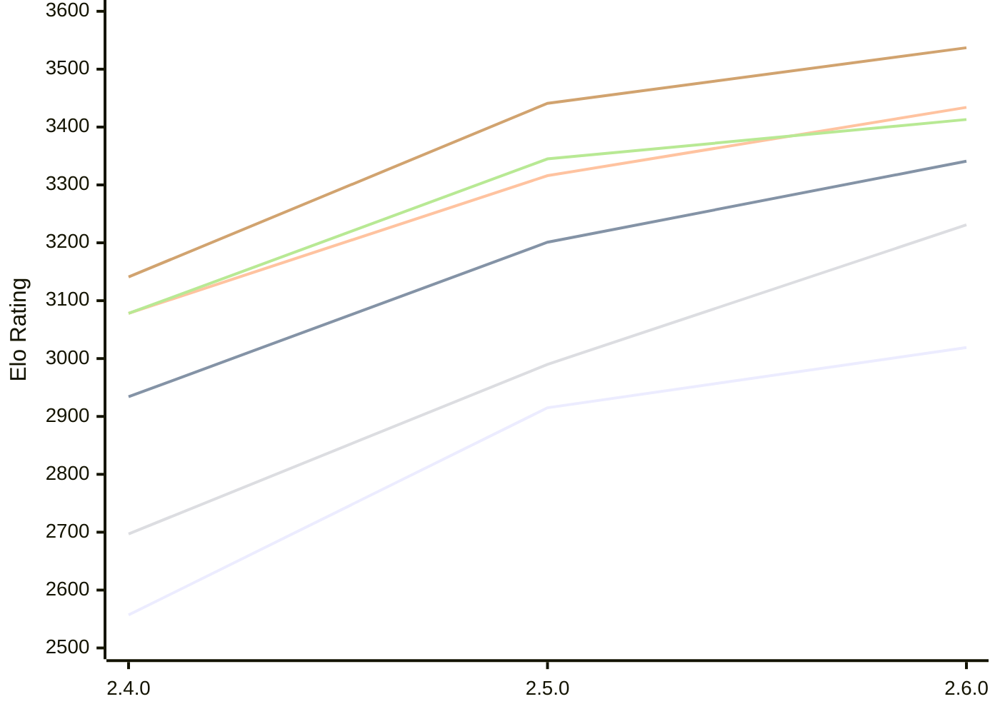

# Engine: Rarog

Author: Miloslav Macůrek

Home: https://github.com/maelic13/rarog

## Elo Ratings E1 (Ultra 7 265T (1.50 GHz) - E-Core)

| Version | Published | STC 8.0+0.08s  | LTC 60.0+0.60s | VLTC 2m24s+1.12s | Comment |
| --- | --- | --- | --- | --- | --- |
| 2.6.0 | 2026-10-22 | 3019(+104) | 3341(+140) | 3434(+118) |  |
| 2.5.0 | 2026-10-05 | 2915(+358) | 3201(+267) | 3316(+238) |  |
| 2.4.0 | 2026-09-11 | 2557 | 2934 | 3078 |  |
 | | | cElo (∆ prev) | cElo (∆ prev) | cElo (∆ prev) | 

## Elo Ratings P1 (Ultra 7 265T (1.50 GHz) - P-Core)

| Version | Published | STC 8.0+0.08s  | LTC 60.0+0.60s | VLTC 2m24s+1.12s | Comment |
| --- | --- | --- | --- | --- | --- |
| 2.6.0 | 2026-10-22 | 3231(+241) | 3413(+68) | 3537(+96) |  |
| 2.5.0 | 2026-10-05 | 2990(+293) | 3345(+267) | 3441(+300) |  |
| 2.4.0 | 2026-09-11 | 2697 | 3078 | 3141 |  |
 | | | cElo (∆ prev) | cElo (∆ prev) | cElo (∆ prev) | 

## Elo Ratings T1 (i5-7500T 2.70GHz)

| Version | Published | STC 8.0+0.08s  | LTC 60.0+0.60s | VLTC 2m24s+1.12s | Comment |
| --- | --- | --- | --- | --- | --- |
| 2.4.0 | 2026-09-11 | 2614 | 2930 | 3015 |  |
 | | | cElo (∆ prev) | cElo (∆ prev) | cElo (∆ prev) | 

<a href="https://github.com/computer-chess-index/cci/issues/new?template=submit-version.yml&title=[VERSION]+Rarog+<version>&body=###%20Engine%20name%0ARarog%0A%0A###%20Version%0A2.4.0" target="_blank">Submit new version</a>

 Test Conditions:

GUI/CLI: <a href=https://github.com/cutechess/cutechess target="_blank">Cute-Chess</a> 
Elo Calculation: <a href=https://www.remi-coulom.fr/Bayesian-Elo/ target="_blank">Bayesian-Elo</a> 
CPU for P1: Intel(R) Core(TM) Ultra 7 265T (1.50 GHz) - P-Core 
CPU for E1: Intel(R) Core(TM) Ultra 7 265T (1.50 GHz) - E-Core 
CPU for T1: Intel(R) Core(TM) i5-7500T 2.70GHz 
Opening book: 8_moves_v3 
\* STC: 8.0+0.08s, LTC: 60.0+0.60s, VLTC: 2m24s+1.12s

 Lists:
Ratings: <a href=https://github.com/computer-chess-index/cci/blob/main/lists/CCIRatings.csv target="_blank">Complete list</a>

Generated: 2026-11-04 05:41:51

## Ratings Verlauf E1 / P1

## Detailed Evaluation Results

| Version | Time Control | Variant | Elo  | Range +/- | Matches | Score | Average Opponent Elo | Draws |
| --- | --- |--- | --- | --- | --- | --- | --- | --- |
| 2.6.0 | VLTC (2m24s+1.12s) | P1 | 3537 | 38 | 180 | 51% | 3532 | 61% |
|  |  | E1 | 3434 | 30 | 300 | 49% | 3445 | 61% |
|  | LTC (60.0+0.60s) | P1 | 3413 | 39 | 178 | 52% | 3395 | 57% |
|  |  | E1 | 3341 | 31 | 280 | 50% | 3341 | 55% |
|  | STC (8.0+0.08s) | P1 | 3231 | 45 | 146 | 53% | 3205 | 44% |
|  |  | E1 | 3019 | 35 | 248 | 49% | 3023 | 41% |
| --- | --- |--- | --- | --- | --- | --- | --- | --- |
| 2.5.0 | VLTC (2m24s+1.12s) | P1 | 3441 | 36 | 206 | 53% | 3421 | 61% |
|  |  | E1 | 3316 | 30 | 312 | 54% | 3290 | 55% |
|  | LTC (60.0+0.60s) | E1 | 3201 | 33 | 264 | 53% | 3174 | 55% |
|  |  | P1 | 3345 | 35 | 230 | 48% | 3357 | 52% |
|  | STC (8.0+0.08s) | E1 | 2915 | 32 | 312 | 56% | 2861 | 38% |
|  |  | P1 | 2990 | 45 | 150 | 51% | 2977 | 40% |
| --- | --- |--- | --- | --- | --- | --- | --- | --- |
| 2.4.0 | VLTC (2m24s+1.12s) | T1 | 3015 | 35 | 256 | 53% | 2984 | 40% |
|  |  | P1 | 3141 | 39 | 198 | 51% | 3133 | 42% |
|  |  | E1 | 3078 | 29 | 367 | 52% | 3067 | 41% |
|  | LTC (60.0+0.60s) | T1 | 2930 | 33 | 292 | 57% | 2861 | 38% |
|  |  | P1 | 3078 | 42 | 168 | 53% | 3043 | 43% |
|  |  | E1 | 2934 | 32 | 310 | 47% | 2965 | 38% |
|  | STC (8.0+0.08s) | T1 | 2614 | 36 | 266 | 52% | 2564 | 29% |
|  |  | P1 | 2697 | 46 | 156 | 46% | 2734 | 31% |
|  |  | E1 | 2557 | 36 | 252 | 41% | 2651 | 33% |