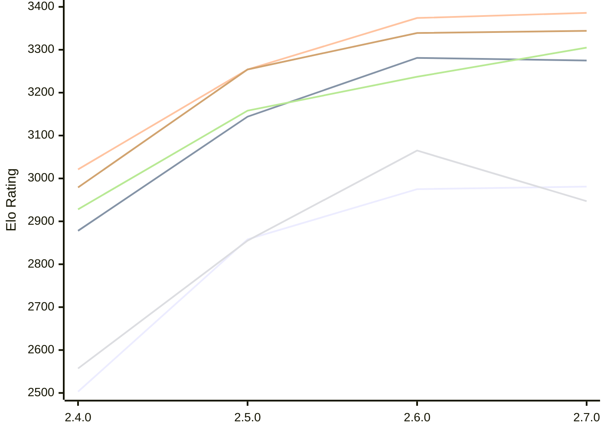

# Engine: Rarog

Author: Miloslav Macůrek

Home: https://github.com/maelic13/rarog

## Elo Ratings E1 (Ultra 7 265T (1.50 GHz) - E-Core)

| Version | Published | STC 8.0+0.08s  | LTC 60.0+0.60s | VLTC 2m24s+1.12s | Comment |
| --- | --- | --- | --- | --- | --- |
| 2.7.0 | 2026-11-13 | 2981(+6) | 3275(-6) | 3386(+12) |  |
| 2.6.0 | 2026-10-22 | 2975(+117) | 3281(+137) | 3374(+120) |  |
| 2.5.0 | 2026-10-05 | 2858(+355) | 3144(+266) | 3254(+233) |  |
| 2.4.0 | 2026-09-11 | 2503 | 2878 | 3021 |  |
 | | | cElo (∆ prev) | cElo (∆ prev) | cElo (∆ prev) | 

## Elo Ratings P1 (Ultra 7 265T (1.50 GHz) - P-Core)

| Version | Published | STC 8.0+0.08s  | LTC 60.0+0.60s | VLTC 2m24s+1.12s | Comment |
| --- | --- | --- | --- | --- | --- |
| 2.7.0 | 2026-11-13 | 2947(-118) | 3305(+68) | 3344(+5) |  |
| 2.6.0 | 2026-10-22 | 3065(+210) | 3237(+79) | 3339(+85) |  |
| 2.5.0 | 2026-10-05 | 2855(+298) | 3158(+230) | 3254(+275) |  |
| 2.4.0 | 2026-09-11 | 2557 | 2928 | 2979 |  |
 | | | cElo (∆ prev) | cElo (∆ prev) | cElo (∆ prev) | 

## Elo Ratings T1 (i5-7500T 2.70GHz)

| Version | Published | STC 8.0+0.08s  | LTC 60.0+0.60s | VLTC 2m24s+1.12s | Comment |
| --- | --- | --- | --- | --- | --- |
| 2.4.0 | 2026-09-11 | 2614 | 2930 | 3015 |  |
 | | | cElo (∆ prev) | cElo (∆ prev) | cElo (∆ prev) | 

<a href="https://github.com/computer-chess-index/cci/issues/new?template=submit-version.yml&title=[VERSION]+Rarog+<version>&body=###%20Engine%20name%0ARarog%0A%0A###%20Version%0A2.4.0" target="_blank">Submit new version</a>

 Test Conditions:

GUI/CLI: <a href=https://github.com/cutechess/cutechess target="_blank">Cute-Chess</a> 
Elo Calculation: <a href=https://www.remi-coulom.fr/Bayesian-Elo/ target="_blank">Bayesian-Elo</a> 
CPU for P1: Intel(R) Core(TM) Ultra 7 265T (1.50 GHz) - P-Core 
CPU for E1: Intel(R) Core(TM) Ultra 7 265T (1.50 GHz) - E-Core 
CPU for T1: Intel(R) Core(TM) i5-7500T 2.70GHz 
Opening book: 8_moves_v3 
\* STC: 8.0+0.08s, LTC: 60.0+0.60s, VLTC: 2m24s+1.12s

 Lists:
Ratings: <a href=https://github.com/computer-chess-index/cci/blob/main/lists/CCIRatings.csv target="_blank">Complete list</a>

Generated: 2026-11-25 05:42:06

## Ratings Verlauf E1 / P1

## Detailed Evaluation Results

| Version | Time Control | Variant | Elo  | Range +/- | Matches | Score | Average Opponent Elo | Draws |
| --- | --- |--- | --- | --- | --- | --- | --- | --- |
| 2.7.0 | VLTC (2m24s+1.12s) | E1 | 3386 | 38 | 178 | 51% | 3383 | 64% |
|  |  | P1 | 3344 | 38 | 184 | 52% | 3328 | 59% |
|  | LTC (60.0+0.60s) | E1 | 3275 | 36 | 216 | 49% | 3282 | 56% |
|  |  | P1 | 3305 | 45 | 128 | 51% | 3301 | 61% |
|  | STC (8.0+0.08s) | P1 | 2947 | 41 | 190 | 54% | 2913 | 37% |
|  |  | E1 | 2981 | 30 | 334 | 53% | 2952 | 43% |
| --- | --- |--- | --- | --- | --- | --- | --- | --- |
| 2.6.0 | VLTC (2m24s+1.12s) | P1 | 3339 | 36 | 204 | 50% | 3337 | 62% |
|  |  | E1 | 3374 | 28 | 346 | 49% | 3383 | 62% |
|  | LTC (60.0+0.60s) | P1 | 3237 | 33 | 258 | 52% | 3220 | 53% |
|  |  | E1 | 3281 | 29 | 336 | 51% | 3274 | 55% |
|  | STC (8.0+0.08s) | P1 | 3065 | 40 | 192 | 50% | 3066 | 42% |
|  |  | E1 | 2975 | 31 | 324 | 50% | 2975 | 41% |
| --- | --- |--- | --- | --- | --- | --- | --- | --- |
| 2.5.0 | VLTC (2m24s+1.12s) | P1 | 3254 | 36 | 206 | 53% | 3232 | 61% |
|  |  | E1 | 3254 | 29 | 320 | 53% | 3229 | 55% |
|  | LTC (60.0+0.60s) | E1 | 3144 | 32 | 280 | 54% | 3117 | 55% |
|  |  | P1 | 3158 | 35 | 238 | 47% | 3181 | 52% |
|  | STC (8.0+0.08s) | E1 | 2858 | 32 | 320 | 55% | 2813 | 38% |
|  |  | P1 | 2855 | 43 | 170 | 50% | 2859 | 41% |
| --- | --- |--- | --- | --- | --- | --- | --- | --- |
| 2.4.0 | VLTC (2m24s+1.12s) | T1 | 3015 | 35 | 256 | 53% | 2984 | 40% |
|  |  | P1 | 2979 | 39 | 198 | 51% | 2971 | 42% |
|  |  | E1 | 3021 | 29 | 367 | 52% | 3011 | 41% |
|  | LTC (60.0+0.60s) | T1 | 2930 | 33 | 292 | 57% | 2861 | 38% |
|  |  | P1 | 2928 | 42 | 168 | 53% | 2894 | 43% |
|  |  | E1 | 2878 | 32 | 310 | 47% | 2909 | 38% |
|  | STC (8.0+0.08s) | T1 | 2614 | 36 | 266 | 52% | 2564 | 29% |
|  |  | P1 | 2557 | 46 | 156 | 46% | 2593 | 31% |
|  |  | E1 | 2503 | 36 | 252 | 41% | 2596 | 33% |