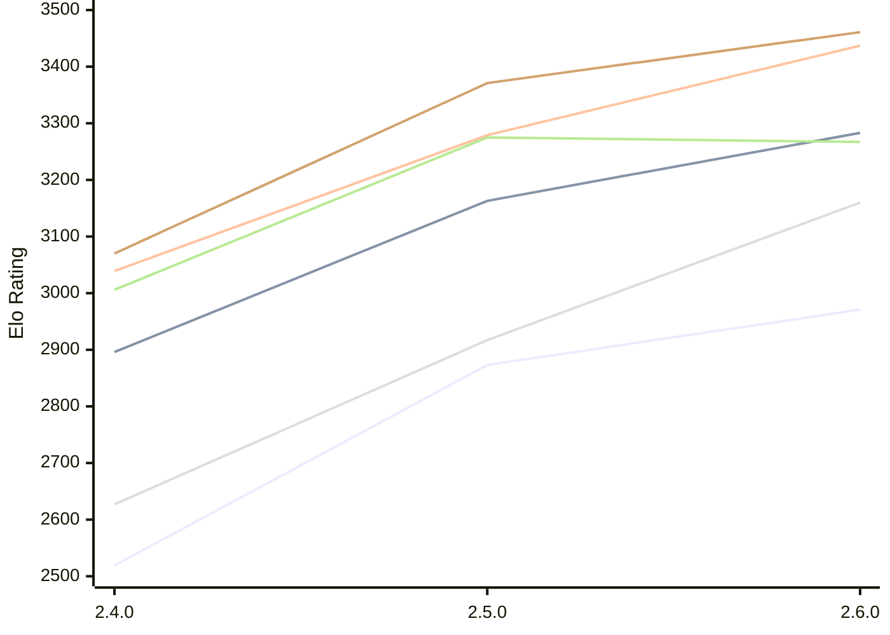

# Engine: Rarog

Author: Miloslav Macůrek

Home: https://github.com/maelic13/rarog

## Elo Ratings E1 (Ultra 7 265T (1.50 GHz) - E-Core)

| Version | Published | STC 8.0+0.08s  | LTC 60.0+0.60s | VLTC 2m24s+1.12s | Comment |
| --- | --- | --- | --- | --- | --- |
| 2.6.0 | 2026-10-22 | 2971(+98) | 3283(+120) | 3437(+158) |  |
| 2.5.0 | 2026-10-05 | 2873(+354) | 3163(+267) | 3279(+240) |  |
| 2.4.0 | 2026-09-11 | 2519 | 2896 | 3039 |  |
 | | | cElo (∆ prev) | cElo (∆ prev) | cElo (∆ prev) | 

## Elo Ratings P1 (Ultra 7 265T (1.50 GHz) - P-Core)

| Version | Published | STC 8.0+0.08s  | LTC 60.0+0.60s | VLTC 2m24s+1.12s | Comment |
| --- | --- | --- | --- | --- | --- |
| 2.6.0 | 2026-10-22 | 3160(+243) | 3267(-8) | 3461(+90) |  |
| 2.5.0 | 2026-10-05 | 2917(+290) | 3275(+269) | 3371(+301) |  |
| 2.4.0 | 2026-09-11 | 2627 | 3006 | 3070 |  |
 | | | cElo (∆ prev) | cElo (∆ prev) | cElo (∆ prev) | 

## Elo Ratings T1 (i5-7500T 2.70GHz)

| Version | Published | STC 8.0+0.08s  | LTC 60.0+0.60s | VLTC 2m24s+1.12s | Comment |
| --- | --- | --- | --- | --- | --- |
| 2.4.0 | 2026-09-11 | 2614 | 2930 | 3015 |  |
 | | | cElo (∆ prev) | cElo (∆ prev) | cElo (∆ prev) | 

<a href="https://github.com/computer-chess-index/cci/issues/new?template=submit-version.yml&title=[VERSION]+Rarog+<version>&body=###%20Engine%20name%0ARarog%0A%0A###%20Version%0A2.4.0" target="_blank">Submit new version</a>

 Test Conditions:

GUI/CLI: <a href=https://github.com/cutechess/cutechess target="_blank">Cute-Chess</a> 
Elo Calculation: <a href=https://www.remi-coulom.fr/Bayesian-Elo/ target="_blank">Bayesian-Elo</a> 
CPU for P1: Intel(R) Core(TM) Ultra 7 265T (1.50 GHz) - P-Core 
CPU for E1: Intel(R) Core(TM) Ultra 7 265T (1.50 GHz) - E-Core 
CPU for T1: Intel(R) Core(TM) i5-7500T 2.70GHz 
Opening book: 8_moves_v3 
\* STC: 8.0+0.08s, LTC: 60.0+0.60s, VLTC: 2m24s+1.12s

 Lists:
Ratings: <a href=https://github.com/computer-chess-index/cci/blob/main/lists/CCIRatings.csv target="_blank">Complete list</a>

Generated: 2026-10-23 04:42:16

## Ratings Verlauf E1 / P1

## Detailed Evaluation Results

| Version | Time Control | Variant | Elo  | Range +/- | Matches | Score | Average Opponent Elo | Draws |
| --- | --- |--- | --- | --- | --- | --- | --- | --- |
| 2.6.0 | VLTC (2m24s+1.12s) | P1 | 3461 | 89 | 30 | 50% | 3461 | 73% |
|  |  | E1 | 3437 | 91 | 32 | 56% | 3386 | 56% |
|  | LTC (60.0+0.60s) | P1 | 3267 | 108 | 24 | 48% | 3286 | 46% |
|  |  | E1 | 3283 | 92 | 32 | 55% | 3247 | 53% |
|  | STC (8.0+0.08s) | P1 | 3160 | 102 | 32 | 59% | 3066 | 25% |
|  |  | E1 | 2971 | 97 | 32 | 53% | 2942 | 38% |
| --- | --- |--- | --- | --- | --- | --- | --- | --- |
| 2.5.0 | VLTC (2m24s+1.12s) | E1 | 3279 | 30 | 308 | 54% | 3251 | 56% |
|  |  | P1 | 3371 | 36 | 206 | 53% | 3349 | 61% |
|  | LTC (60.0+0.60s) | E1 | 3163 | 33 | 264 | 53% | 3136 | 55% |
|  |  | P1 | 3275 | 35 | 230 | 48% | 3287 | 52% |
|  | STC (8.0+0.08s) | P1 | 2917 | 45 | 150 | 51% | 2904 | 40% |
|  |  | E1 | 2873 | 32 | 308 | 56% | 2822 | 38% |
| --- | --- |--- | --- | --- | --- | --- | --- | --- |
| 2.4.0 | VLTC (2m24s+1.12s) | T1 | 3015 | 35 | 256 | 53% | 2984 | 40% |
|  |  | P1 | 3070 | 39 | 198 | 51% | 3062 | 42% |
|  |  | E1 | 3039 | 29 | 367 | 52% | 3028 | 41% |
|  | LTC (60.0+0.60s) | T1 | 2930 | 33 | 292 | 57% | 2861 | 38% |
|  |  | P1 | 3006 | 42 | 168 | 53% | 2973 | 43% |
|  |  | E1 | 2896 | 32 | 310 | 47% | 2927 | 38% |
|  | STC (8.0+0.08s) | T1 | 2614 | 36 | 266 | 52% | 2564 | 29% |
|  |  | P1 | 2627 | 46 | 156 | 46% | 2664 | 31% |
|  |  | E1 | 2519 | 36 | 252 | 41% | 2614 | 33% |