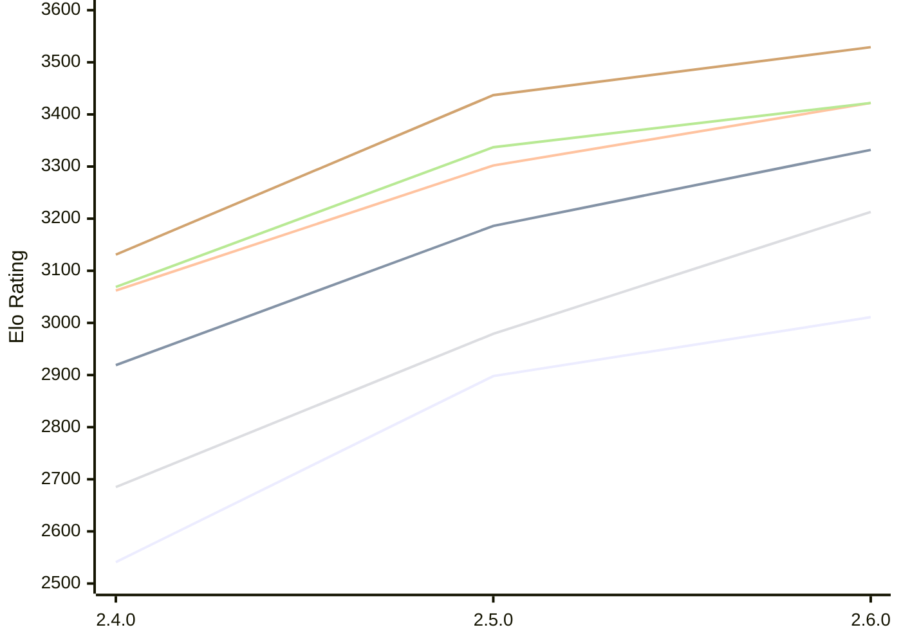

# Engine: Rarog

Author: Miloslav Macůrek

Home: https://github.com/maelic13/rarog

## Elo Ratings E1 (Ultra 7 265T (1.50 GHz) - E-Core)

| Version | Published | STC 8.0+0.08s  | LTC 60.0+0.60s | VLTC 2m24s+1.12s | Comment |
| --- | --- | --- | --- | --- | --- |
| 2.6.0 | 2026-10-22 | 3011(+113) | 3332(+146) | 3422(+120) |  |
| 2.5.0 | 2026-10-05 | 2898(+357) | 3186(+267) | 3302(+240) |  |
| 2.4.0 | 2026-09-11 | 2541 | 2919 | 3062 |  |
 | | | cElo (∆ prev) | cElo (∆ prev) | cElo (∆ prev) | 

## Elo Ratings P1 (Ultra 7 265T (1.50 GHz) - P-Core)

| Version | Published | STC 8.0+0.08s  | LTC 60.0+0.60s | VLTC 2m24s+1.12s | Comment |
| --- | --- | --- | --- | --- | --- |
| 2.6.0 | 2026-10-22 | 3213(+234) | 3422(+85) | 3529(+92) |  |
| 2.5.0 | 2026-10-05 | 2979(+294) | 3337(+268) | 3437(+306) |  |
| 2.4.0 | 2026-09-11 | 2685 | 3069 | 3131 |  |
 | | | cElo (∆ prev) | cElo (∆ prev) | cElo (∆ prev) | 

## Elo Ratings T1 (i5-7500T 2.70GHz)

| Version | Published | STC 8.0+0.08s  | LTC 60.0+0.60s | VLTC 2m24s+1.12s | Comment |
| --- | --- | --- | --- | --- | --- |
| 2.4.0 | 2026-09-11 | 2614 | 2930 | 3015 |  |
 | | | cElo (∆ prev) | cElo (∆ prev) | cElo (∆ prev) | 

<a href="https://github.com/computer-chess-index/cci/issues/new?template=submit-version.yml&title=[VERSION]+Rarog+<version>&body=###%20Engine%20name%0ARarog%0A%0A###%20Version%0A2.4.0" target="_blank">Submit new version</a>

 Test Conditions:

GUI/CLI: <a href=https://github.com/cutechess/cutechess target="_blank">Cute-Chess</a> 
Elo Calculation: <a href=https://www.remi-coulom.fr/Bayesian-Elo/ target="_blank">Bayesian-Elo</a> 
CPU for P1: Intel(R) Core(TM) Ultra 7 265T (1.50 GHz) - P-Core 
CPU for E1: Intel(R) Core(TM) Ultra 7 265T (1.50 GHz) - E-Core 
CPU for T1: Intel(R) Core(TM) i5-7500T 2.70GHz 
Opening book: 8_moves_v3 
\* STC: 8.0+0.08s, LTC: 60.0+0.60s, VLTC: 2m24s+1.12s

 Lists:
Ratings: <a href=https://github.com/computer-chess-index/cci/blob/main/lists/CCIRatings.csv target="_blank">Complete list</a>

Generated: 2026-11-12 05:41:27

## Ratings Verlauf E1 / P1

## Detailed Evaluation Results

| Version | Time Control | Variant | Elo  | Range +/- | Matches | Score | Average Opponent Elo | Draws |
| --- | --- |--- | --- | --- | --- | --- | --- | --- |
| 2.6.0 | VLTC (2m24s+1.12s) | P1 | 3529 | 36 | 200 | 51% | 3525 | 62% |
|  |  | E1 | 3422 | 28 | 334 | 49% | 3432 | 62% |
|  | LTC (60.0+0.60s) | P1 | 3422 | 34 | 238 | 54% | 3393 | 55% |
|  |  | E1 | 3332 | 30 | 312 | 51% | 3325 | 54% |
|  | STC (8.0+0.08s) | P1 | 3213 | 43 | 158 | 52% | 3197 | 45% |
|  |  | E1 | 3011 | 32 | 300 | 50% | 3006 | 41% |
| --- | --- |--- | --- | --- | --- | --- | --- | --- |
| 2.5.0 | VLTC (2m24s+1.12s) | P1 | 3437 | 36 | 206 | 53% | 3416 | 61% |
|  |  | E1 | 3302 | 30 | 312 | 54% | 3276 | 55% |
|  | LTC (60.0+0.60s) | P1 | 3337 | 35 | 230 | 48% | 3351 | 52% |
|  |  | E1 | 3186 | 33 | 264 | 53% | 3159 | 55% |
|  | STC (8.0+0.08s) | E1 | 2898 | 32 | 312 | 56% | 2844 | 38% |
|  |  | P1 | 2979 | 45 | 150 | 51% | 2966 | 40% |
| --- | --- |--- | --- | --- | --- | --- | --- | --- |
| 2.4.0 | VLTC (2m24s+1.12s) | E1 | 3062 | 29 | 367 | 52% | 3051 | 41% |
|  |  | T1 | 3015 | 35 | 256 | 53% | 2984 | 40% |
|  |  | P1 | 3131 | 39 | 198 | 51% | 3123 | 42% |
|  | LTC (60.0+0.60s) | T1 | 2930 | 33 | 292 | 57% | 2861 | 38% |
|  |  | P1 | 3069 | 42 | 168 | 53% | 3035 | 43% |
|  |  | E1 | 2919 | 32 | 310 | 47% | 2950 | 38% |
|  | STC (8.0+0.08s) | T1 | 2614 | 36 | 266 | 52% | 2564 | 29% |
|  |  | P1 | 2685 | 46 | 156 | 46% | 2722 | 31% |
|  |  | E1 | 2541 | 36 | 252 | 41% | 2635 | 33% |