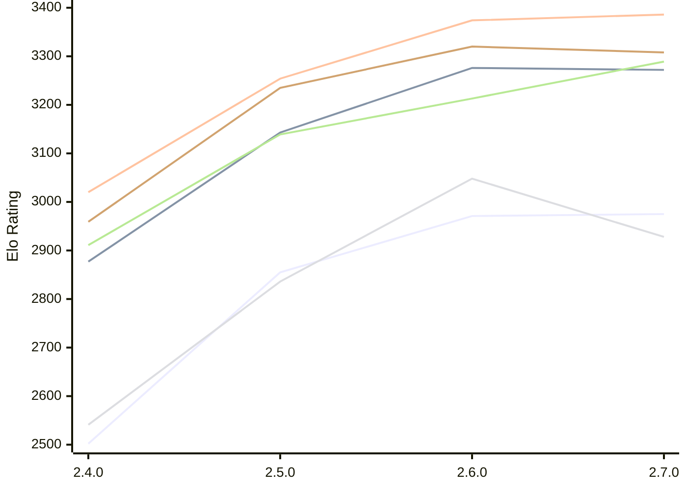

# Engine: Rarog

Author: Miloslav Macůrek

Home: https://github.com/maelic13/rarog

## Elo Ratings E1 (Ultra 7 265T (1.50 GHz) - E-Core)

| Version | Published | STC 8.0+0.08s  | LTC 60.0+0.60s | VLTC 2m24s+1.12s | Comment |
| --- | --- | --- | --- | --- | --- |
| 2.7.0 | 2026-11-13 | 2975(+4) | 3272(-4) | 3386(+12) |  |
| 2.6.0 | 2026-10-22 | 2971(+116) | 3276(+133) | 3374(+120) |  |
| 2.5.0 | 2026-10-05 | 2855(+353) | 3143(+266) | 3254(+234) |  |
| 2.4.0 | 2026-09-11 | 2502 | 2877 | 3020 |  |
 | | | cElo (∆ prev) | cElo (∆ prev) | cElo (∆ prev) | 

## Elo Ratings P1 (Ultra 7 265T (1.50 GHz) - P-Core)

| Version | Published | STC 8.0+0.08s  | LTC 60.0+0.60s | VLTC 2m24s+1.12s | Comment |
| --- | --- | --- | --- | --- | --- |
| 2.7.0 | 2026-11-13 | 2928(-120) | 3289(+76) | 3308(-12) |  |
| 2.6.0 | 2026-10-22 | 3048(+212) | 3213(+74) | 3320(+85) |  |
| 2.5.0 | 2026-10-05 | 2836(+295) | 3139(+228) | 3235(+276) |  |
| 2.4.0 | 2026-09-11 | 2541 | 2911 | 2959 |  |
 | | | cElo (∆ prev) | cElo (∆ prev) | cElo (∆ prev) | 

## Elo Ratings T1 (i5-7500T 2.70GHz)

| Version | Published | STC 8.0+0.08s  | LTC 60.0+0.60s | VLTC 2m24s+1.12s | Comment |
| --- | --- | --- | --- | --- | --- |
| 2.4.0 | 2026-09-11 | 2614 | 2930 | 3015 |  |
 | | | cElo (∆ prev) | cElo (∆ prev) | cElo (∆ prev) | 

<a href="https://github.com/computer-chess-index/cci/issues/new?template=submit-version.yml&title=[VERSION]+Rarog+<version>&body=###%20Engine%20name%0ARarog%0A%0A###%20Version%0A2.4.0" target="_blank">Submit new version</a>

 Test Conditions:

GUI/CLI: <a href=https://github.com/cutechess/cutechess target="_blank">Cute-Chess</a> 
Elo Calculation: <a href=https://www.remi-coulom.fr/Bayesian-Elo/ target="_blank">Bayesian-Elo</a> 
CPU for P1: Intel(R) Core(TM) Ultra 7 265T (1.50 GHz) - P-Core 
CPU for E1: Intel(R) Core(TM) Ultra 7 265T (1.50 GHz) - E-Core 
CPU for T1: Intel(R) Core(TM) i5-7500T 2.70GHz 
Opening book: 8_moves_v3 
\* STC: 8.0+0.08s, LTC: 60.0+0.60s, VLTC: 2m24s+1.12s

 Lists:
Ratings: <a href=https://github.com/computer-chess-index/cci/blob/main/lists/CCIRatings.csv target="_blank">Complete list</a>

Generated: 2026-11-22 05:41:49

## Ratings Verlauf E1 / P1

## Detailed Evaluation Results

| Version | Time Control | Variant | Elo  | Range +/- | Matches | Score | Average Opponent Elo | Draws |
| --- | --- |--- | --- | --- | --- | --- | --- | --- |
| 2.7.0 | VLTC (2m24s+1.12s) | P1 | 3308 | 50 | 104 | 51% | 3298 | 62% |
|  |  | E1 | 3386 | 38 | 178 | 51% | 3382 | 64% |
|  | LTC (60.0+0.60s) | P1 | 3289 | 46 | 124 | 51% | 3281 | 62% |
|  |  | E1 | 3272 | 38 | 188 | 49% | 3282 | 55% |
|  | STC (8.0+0.08s) | P1 | 2928 | 42 | 182 | 54% | 2894 | 36% |
|  |  | E1 | 2975 | 30 | 326 | 53% | 2948 | 43% |
| --- | --- |--- | --- | --- | --- | --- | --- | --- |
| 2.6.0 | VLTC (2m24s+1.12s) | P1 | 3320 | 36 | 204 | 50% | 3318 | 62% |
|  |  | E1 | 3374 | 28 | 346 | 49% | 3383 | 62% |
|  | LTC (60.0+0.60s) | P1 | 3213 | 33 | 250 | 52% | 3200 | 54% |
|  |  | E1 | 3276 | 30 | 320 | 50% | 3272 | 54% |
|  | STC (8.0+0.08s) | P1 | 3048 | 41 | 184 | 51% | 3047 | 42% |
|  |  | E1 | 2971 | 31 | 320 | 50% | 2971 | 41% |
| --- | --- |--- | --- | --- | --- | --- | --- | --- |
| 2.5.0 | VLTC (2m24s+1.12s) | P1 | 3235 | 36 | 206 | 53% | 3213 | 61% |
|  |  | E1 | 3254 | 29 | 320 | 53% | 3229 | 55% |
|  | LTC (60.0+0.60s) | P1 | 3139 | 35 | 238 | 47% | 3162 | 52% |
|  |  | E1 | 3143 | 32 | 280 | 54% | 3116 | 55% |
|  | STC (8.0+0.08s) | P1 | 2836 | 43 | 170 | 50% | 2839 | 41% |
|  |  | E1 | 2855 | 32 | 320 | 55% | 2811 | 38% |
| --- | --- |--- | --- | --- | --- | --- | --- | --- |
| 2.4.0 | VLTC (2m24s+1.12s) | P1 | 2959 | 39 | 198 | 51% | 2952 | 42% |
|  |  | E1 | 3020 | 29 | 367 | 52% | 3009 | 41% |
|  |  | T1 | 3015 | 35 | 256 | 53% | 2984 | 40% |
|  | LTC (60.0+0.60s) | E1 | 2877 | 32 | 310 | 47% | 2908 | 38% |
|  |  | T1 | 2930 | 33 | 292 | 57% | 2861 | 38% |
|  |  | P1 | 2911 | 42 | 168 | 53% | 2877 | 43% |
|  | STC (8.0+0.08s) | E1 | 2502 | 36 | 252 | 41% | 2595 | 33% |
|  |  | T1 | 2614 | 36 | 266 | 52% | 2564 | 29% |
|  |  | P1 | 2541 | 46 | 156 | 46% | 2577 | 31% |