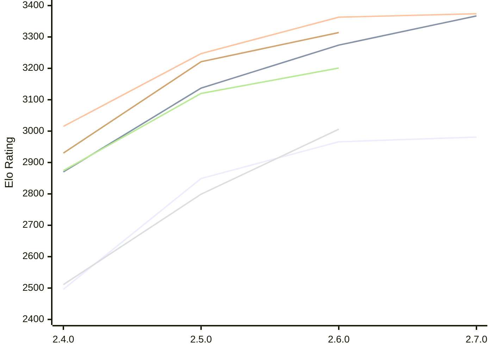

# Engine: Rarog

Author: Miloslav Macůrek

Home: https://github.com/maelic13/rarog

## Elo Ratings E1 (Ultra 7 265T (1.50 GHz) - E-Core)

| Version | Published | STC 8.0+0.08s  | LTC 60.0+0.60s | VLTC 2m24s+1.12s | Comment |
| --- | --- | --- | --- | --- | --- |
| 2.7.0 | 2026-11-13 | 2981(+15) | 3367(+93) | 3374(+11) |  |
| 2.6.0 | 2026-10-22 | 2966(+117) | 3274(+137) | 3363(+116) |  |
| 2.5.0 | 2026-10-05 | 2849(+353) | 3137(+267) | 3247(+232) |  |
| 2.4.0 | 2026-09-11 | 2496 | 2870 | 3015 |  |
 | | | cElo (∆ prev) | cElo (∆ prev) | cElo (∆ prev) | 

## Elo Ratings P1 (Ultra 7 265T (1.50 GHz) - P-Core)

| Version | Published | STC 8.0+0.08s  | LTC 60.0+0.60s | VLTC 2m24s+1.12s | Comment |
| --- | --- | --- | --- | --- | --- |
| 2.6.0 | 2026-10-22 | 3006(+207) | 3201(+81) | 3314(+93) |  |
| 2.5.0 | 2026-10-05 | 2799(+288) | 3120(+246) | 3221(+291) |  |
| 2.4.0 | 2026-09-11 | 2511 | 2874 | 2930 |  |
 | | | cElo (∆ prev) | cElo (∆ prev) | cElo (∆ prev) | 

## Elo Ratings T1 (i5-7500T 2.70GHz)

| Version | Published | STC 8.0+0.08s  | LTC 60.0+0.60s | VLTC 2m24s+1.12s | Comment |
| --- | --- | --- | --- | --- | --- |
| 2.4.0 | 2026-09-11 | 2614 | 2930 | 3015 |  |
 | | | cElo (∆ prev) | cElo (∆ prev) | cElo (∆ prev) | 

<a href="https://github.com/computer-chess-index/cci/issues/new?template=submit-version.yml&title=[VERSION]+Rarog+<version>&body=###%20Engine%20name%0ARarog%0A%0A###%20Version%0A2.4.0" target="_blank">Submit new version</a>

 Test Conditions:

GUI/CLI: <a href=https://github.com/cutechess/cutechess target="_blank">Cute-Chess</a> 
Elo Calculation: <a href=https://www.remi-coulom.fr/Bayesian-Elo/ target="_blank">Bayesian-Elo</a> 
CPU for P1: Intel(R) Core(TM) Ultra 7 265T (1.50 GHz) - P-Core 
CPU for E1: Intel(R) Core(TM) Ultra 7 265T (1.50 GHz) - E-Core 
CPU for T1: Intel(R) Core(TM) i5-7500T 2.70GHz 
Opening book: 8_moves_v3 
\* STC: 8.0+0.08s, LTC: 60.0+0.60s, VLTC: 2m24s+1.12s

 Lists:
Ratings: <a href=https://github.com/computer-chess-index/cci/blob/main/lists/CCIRatings.csv target="_blank">Complete list</a>

Generated: 2026-11-15 05:41:45

## Ratings Verlauf E1 / P1

## Detailed Evaluation Results

| Version | Time Control | Variant | Elo  | Range +/- | Matches | Score | Average Opponent Elo | Draws |
| --- | --- |--- | --- | --- | --- | --- | --- | --- |
| 2.7.0 | VLTC (2m24s+1.12s) | E1 | 3374 | 146 | 12 | 58% | 3318 | 50% |
|  | LTC (60.0+0.60s) | E1 | 3367 | 251 | 4 | 63% | 3274 | 25% |
|  | STC (8.0+0.08s) | P1 | 2784 | 167 | 12 | 50% | 2801 | 17% |
|  |  | E1 | 2981 | 160 | 12 | 63% | 2863 | 25% |
| --- | --- |--- | --- | --- | --- | --- | --- | --- |
| 2.6.0 | VLTC (2m24s+1.12s) | P1 | 3314 | 36 | 200 | 51% | 3310 | 62% |
|  |  | E1 | 3363 | 28 | 338 | 48% | 3374 | 62% |
|  | LTC (60.0+0.60s) | P1 | 3201 | 34 | 246 | 52% | 3183 | 54% |
|  |  | E1 | 3274 | 30 | 312 | 51% | 3266 | 54% |
|  | STC (8.0+0.08s) | P1 | 3006 | 42 | 170 | 49% | 3015 | 44% |
|  |  | E1 | 2966 | 31 | 320 | 50% | 2965 | 41% |
| --- | --- |--- | --- | --- | --- | --- | --- | --- |
| 2.5.0 | VLTC (2m24s+1.12s) | E1 | 3247 | 29 | 320 | 53% | 3222 | 55% |
|  |  | P1 | 3221 | 36 | 206 | 53% | 3200 | 61% |
|  | LTC (60.0+0.60s) | E1 | 3137 | 32 | 280 | 54% | 3109 | 55% |
|  |  | P1 | 3120 | 35 | 238 | 47% | 3143 | 52% |
|  | STC (8.0+0.08s) | P1 | 2799 | 43 | 170 | 50% | 2800 | 41% |
|  |  | E1 | 2849 | 32 | 320 | 55% | 2804 | 38% |
| --- | --- |--- | --- | --- | --- | --- | --- | --- |
| 2.4.0 | VLTC (2m24s+1.12s) | T1 | 3015 | 35 | 256 | 53% | 2984 | 40% |
|  |  | P1 | 2930 | 39 | 198 | 51% | 2921 | 42% |
|  |  | E1 | 3015 | 29 | 367 | 52% | 3002 | 41% |
|  | LTC (60.0+0.60s) | T1 | 2930 | 33 | 292 | 57% | 2861 | 38% |
|  |  | P1 | 2874 | 42 | 168 | 53% | 2840 | 43% |
|  |  | E1 | 2870 | 32 | 310 | 47% | 2901 | 38% |
|  | STC (8.0+0.08s) | T1 | 2614 | 36 | 266 | 52% | 2564 | 29% |
|  |  | P1 | 2511 | 46 | 156 | 46% | 2547 | 31% |
|  |  | E1 | 2496 | 36 | 252 | 41% | 2589 | 33% |