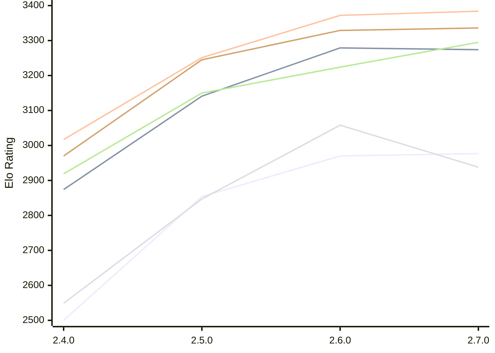

# Engine: Rarog

Author: Miloslav Macůrek

Home: https://github.com/maelic13/rarog

## Elo Ratings E1 (Ultra 7 265T (1.50 GHz) - E-Core)

| Version | Published | STC 8.0+0.08s  | LTC 60.0+0.60s | VLTC 2m24s+1.12s | Comment |
| --- | --- | --- | --- | --- | --- |
| 2.7.0 | 2026-11-13 | 2977(+7) | 3274(-5) | 3384(+12) |  |
| 2.6.0 | 2026-10-22 | 2970(+116) | 3279(+138) | 3372(+121) |  |
| 2.5.0 | 2026-10-05 | 2854(+354) | 3141(+267) | 3251(+234) |  |
| 2.4.0 | 2026-09-11 | 2500 | 2874 | 3017 |  |
 | | | cElo (∆ prev) | cElo (∆ prev) | cElo (∆ prev) | 

## Elo Ratings P1 (Ultra 7 265T (1.50 GHz) - P-Core)

| Version | Published | STC 8.0+0.08s  | LTC 60.0+0.60s | VLTC 2m24s+1.12s | Comment |
| --- | --- | --- | --- | --- | --- |
| 2.7.0 | 2026-11-13 | 2938(-120) | 3295(+71) | 3336(+7) |  |
| 2.6.0 | 2026-10-22 | 3058(+211) | 3224(+74) | 3329(+84) |  |
| 2.5.0 | 2026-10-05 | 2847(+298) | 3150(+231) | 3245(+275) |  |
| 2.4.0 | 2026-09-11 | 2549 | 2919 | 2970 |  |
 | | | cElo (∆ prev) | cElo (∆ prev) | cElo (∆ prev) | 

## Elo Ratings T1 (i5-7500T 2.70GHz)

| Version | Published | STC 8.0+0.08s  | LTC 60.0+0.60s | VLTC 2m24s+1.12s | Comment |
| --- | --- | --- | --- | --- | --- |
| 2.4.0 | 2026-09-11 | 2614 | 2930 | 3015 |  |
 | | | cElo (∆ prev) | cElo (∆ prev) | cElo (∆ prev) | 

<a href="https://github.com/computer-chess-index/cci/issues/new?template=submit-version.yml&title=[VERSION]+Rarog+<version>&body=###%20Engine%20name%0ARarog%0A%0A###%20Version%0A2.4.0" target="_blank">Submit new version</a>

 Test Conditions:

GUI/CLI: <a href=https://github.com/cutechess/cutechess target="_blank">Cute-Chess</a> 
Elo Calculation: <a href=https://www.remi-coulom.fr/Bayesian-Elo/ target="_blank">Bayesian-Elo</a> 
CPU for P1: Intel(R) Core(TM) Ultra 7 265T (1.50 GHz) - P-Core 
CPU for E1: Intel(R) Core(TM) Ultra 7 265T (1.50 GHz) - E-Core 
CPU for T1: Intel(R) Core(TM) i5-7500T 2.70GHz 
Opening book: 8_moves_v3 
\* STC: 8.0+0.08s, LTC: 60.0+0.60s, VLTC: 2m24s+1.12s

 Lists:
Ratings: <a href=https://github.com/computer-chess-index/cci/blob/main/lists/CCIRatings.csv target="_blank">Complete list</a>

Generated: 2026-11-24 05:41:59

## Ratings Verlauf E1 / P1

## Detailed Evaluation Results

| Version | Time Control | Variant | Elo  | Range +/- | Matches | Score | Average Opponent Elo | Draws |
| --- | --- |--- | --- | --- | --- | --- | --- | --- |
| 2.7.0 | VLTC (2m24s+1.12s) | P1 | 3336 | 38 | 184 | 52% | 3320 | 59% |
|  |  | E1 | 3384 | 38 | 178 | 51% | 3380 | 64% |
|  | LTC (60.0+0.60s) | P1 | 3295 | 45 | 128 | 51% | 3291 | 61% |
|  |  | E1 | 3274 | 37 | 200 | 49% | 3279 | 56% |
|  | STC (8.0+0.08s) | P1 | 2938 | 41 | 186 | 54% | 2904 | 37% |
|  |  | E1 | 2977 | 30 | 334 | 53% | 2948 | 43% |
| --- | --- |--- | --- | --- | --- | --- | --- | --- |
| 2.6.0 | VLTC (2m24s+1.12s) | P1 | 3329 | 36 | 204 | 50% | 3329 | 62% |
|  |  | E1 | 3372 | 28 | 346 | 49% | 3382 | 62% |
|  | LTC (60.0+0.60s) | P1 | 3224 | 33 | 250 | 52% | 3210 | 54% |
|  |  | E1 | 3279 | 29 | 328 | 51% | 3271 | 54% |
|  | STC (8.0+0.08s) | P1 | 3058 | 41 | 184 | 51% | 3056 | 42% |
|  |  | E1 | 2970 | 31 | 320 | 50% | 2970 | 41% |
| --- | --- |--- | --- | --- | --- | --- | --- | --- |
| 2.5.0 | VLTC (2m24s+1.12s) | P1 | 3245 | 36 | 206 | 53% | 3224 | 61% |
|  |  | E1 | 3251 | 29 | 320 | 53% | 3228 | 55% |
|  | LTC (60.0+0.60s) | P1 | 3150 | 35 | 238 | 47% | 3173 | 52% |
|  |  | E1 | 3141 | 32 | 280 | 54% | 3113 | 55% |
|  | STC (8.0+0.08s) | P1 | 2847 | 43 | 170 | 50% | 2850 | 41% |
|  |  | E1 | 2854 | 32 | 320 | 55% | 2809 | 38% |
| --- | --- |--- | --- | --- | --- | --- | --- | --- |
| 2.4.0 | VLTC (2m24s+1.12s) | T1 | 3015 | 35 | 256 | 53% | 2984 | 40% |
|  |  | P1 | 2970 | 39 | 198 | 51% | 2963 | 42% |
|  |  | E1 | 3017 | 29 | 367 | 52% | 3006 | 41% |
|  | LTC (60.0+0.60s) | T1 | 2930 | 33 | 292 | 57% | 2861 | 38% |
|  |  | P1 | 2919 | 42 | 168 | 53% | 2886 | 43% |
|  |  | E1 | 2874 | 32 | 310 | 47% | 2905 | 38% |
|  | STC (8.0+0.08s) | T1 | 2614 | 36 | 266 | 52% | 2564 | 29% |
|  |  | P1 | 2549 | 46 | 156 | 46% | 2585 | 31% |
|  |  | E1 | 2500 | 36 | 252 | 41% | 2595 | 33% |