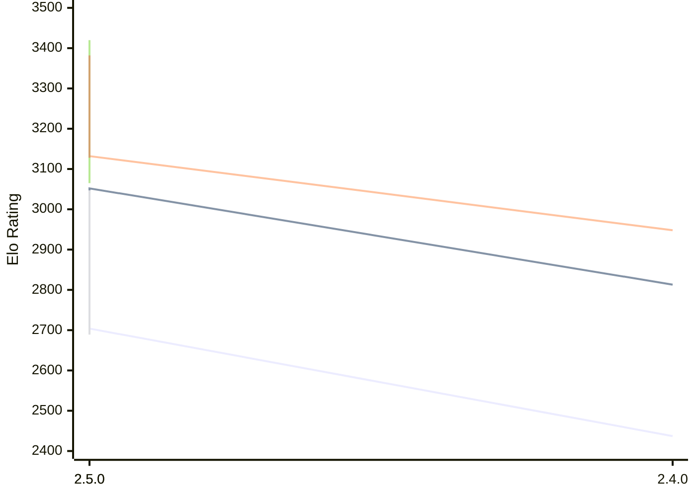

# Engine: Rarog

Author: Miloslav Macůrek

Home: https://github.com/maelic13/rarog

## Elo Ratings E1

| Version | Published | STC 8.0+0.08s  | LTC 60.0+0.60s | VLTC 2m24s+1.12s | Comment |
| --- | --- | --- | --- | --- | --- |
| 2.5.0 | 2026-10-05 | 2696(-8) | 3039(-13) | 3128(-4) |  |
| 2.5.0 | 2026-10-05 | 2704(+267) | 3052(+239) | 3132(+184) |  |
| 2.4.0 | 2026-09-11 | 2437 | 2813 | 2948 |  |
 | | | cElo (∆ prev) | cElo (∆ prev) | cElo (∆ prev) | 

## Elo Ratings P1

| Version | Published | STC 8.0+0.08s  | LTC 60.0+0.60s | VLTC 2m24s+1.12s | Comment |
| --- | --- | --- | --- | --- | --- |
| 2.5.0 | 2026-10-05 | 3047(+358) | 3420(+355) | 3382(+254) |  |
| 2.4.0 | 2026-09-11 | 2689 | 3065 | 3128 |  |
 | | | cElo (∆ prev) | cElo (∆ prev) | cElo (∆ prev) | 

## Elo Ratings T1

| Version | Published | STC 8.0+0.08s  | LTC 60.0+0.60s | VLTC 2m24s+1.12s | Comment |
| --- | --- | --- | --- | --- | --- |
| 2.4.0 | 2026-09-11 | 2614 | 2930 | 3015 |  |
 | | | cElo (∆ prev) | cElo (∆ prev) | cElo (∆ prev) | 

<a href="https://github.com/computer-chess-index/cci/issues/new?template=submit-version.yml&title=[VERSION]+Rarog+<version>&body=###%20Engine%20name%0ARarog%0A%0A###%20Version%0A2.4.0" target="_blank">Submit new version</a>

 Test Conditions:

GUI/CLI: <a href=https://github.com/cutechess/cutechess target="_blank">Cute-Chess</a> 
Elo Calculation: <a href=https://www.remi-coulom.fr/Bayesian-Elo/ target="_blank">Bayesian-Elo</a> 
CPU for P1: Intel(R) Core(TM) Ultra 7 265T (1.50 GHz) - P-Core 
CPU for E1: Intel(R) Core(TM) Ultra 7 265T (1.50 GHz) - E-Core 
CPU for T1: Intel(R) Core(TM) i5-7500T 2.70GHz 
Opening book: 8_moves_v3 
\* STC: 8.0+0.08s, LTC: 60.0+0.60s, VLTC: 2m24s+1.12s

 Lists:
Ratings: <a href=https://github.com/computer-chess-index/cci/blob/main/lists/CCIRatings.csv target="_blank">Complete list</a>

Generated: 2026-10-11 11:18:19

## Ratings Verlauf E1 / P1

## Detailed Evaluation Results

| Version | Time Control | Elo  | Range +/- | Matches | Score | Average Opponent Elo | Draws |
| --- | --- | --- | --- | --- | --- | --- | --- |
| 2.5.0 | VLTC (2m24s+1.12s) | 3128 | 80 | 40 | 59% | 3065 | 68% |
| 2.5.0 | VLTC (2m24s+1.12s) | 3382 | 117 | 22 | 59% | 3302 | 36% |
| 2.5.0 | VLTC (2m24s+1.12s) | 3132 | 69 | 56 | 57% | 3081 | 61% |
| 2.5.0 | LTC (60.0+0.60s) | 3039 | 82 | 44 | 63% | 2939 | 48% |
| 2.5.0 | LTC (60.0+0.60s) | 3420 | 121 | 22 | 64% | 3290 | 36% |
| 2.5.0 | LTC (60.0+0.60s) | 3052 | 69 | 60 | 61% | 2965 | 52% |
| 2.5.0 | STC (8.0+0.08s) | 2696 | 85 | 44 | 63% | 2577 | 39% |
| --- | --- | --- | --- | --- | --- | --- | --- |
| 2.5.0 | STC (8.0+0.08s) | 3047 | 110 | 26 | 65% | 2896 | 38% |
| --- | --- | --- | --- | --- | --- | --- | --- |
| 2.5.0 | STC (8.0+0.08s) | 2704 | 72 | 60 | 60% | 2607 | 40% |
| --- | --- | --- | --- | --- | --- | --- | --- |
| 2.4.0 | VLTC (2m24s+1.12s) | 3015 | 35 | 256 | 53% | 2984 | 40% |
| 2.4.0 | VLTC (2m24s+1.12s) | 3128 | 39 | 198 | 51% | 3120 | 42% |
| 2.4.0 | VLTC (2m24s+1.12s) | 2948 | 29 | 365 | 52% | 2938 | 40% |
| 2.4.0 | LTC (60.0+0.60s) | 2930 | 33 | 292 | 57% | 2861 | 38% |
| 2.4.0 | LTC (60.0+0.60s) | 3065 | 42 | 168 | 53% | 3031 | 43% |
| 2.4.0 | LTC (60.0+0.60s) | 2813 | 33 | 294 | 47% | 2842 | 39% |
| 2.4.0 | STC (8.0+0.08s) | 2614 | 36 | 266 | 52% | 2564 | 29% |
| --- | --- | --- | --- | --- | --- | --- | --- |
| 2.4.0 | STC (8.0+0.08s) | 2689 | 46 | 154 | 46% | 2727 | 31% |
| --- | --- | --- | --- | --- | --- | --- | --- |
| 2.4.0 | STC (8.0+0.08s) | 2437 | 37 | 248 | 41% | 2531 | 33% |
| --- | --- | --- | --- | --- | --- | --- | --- |