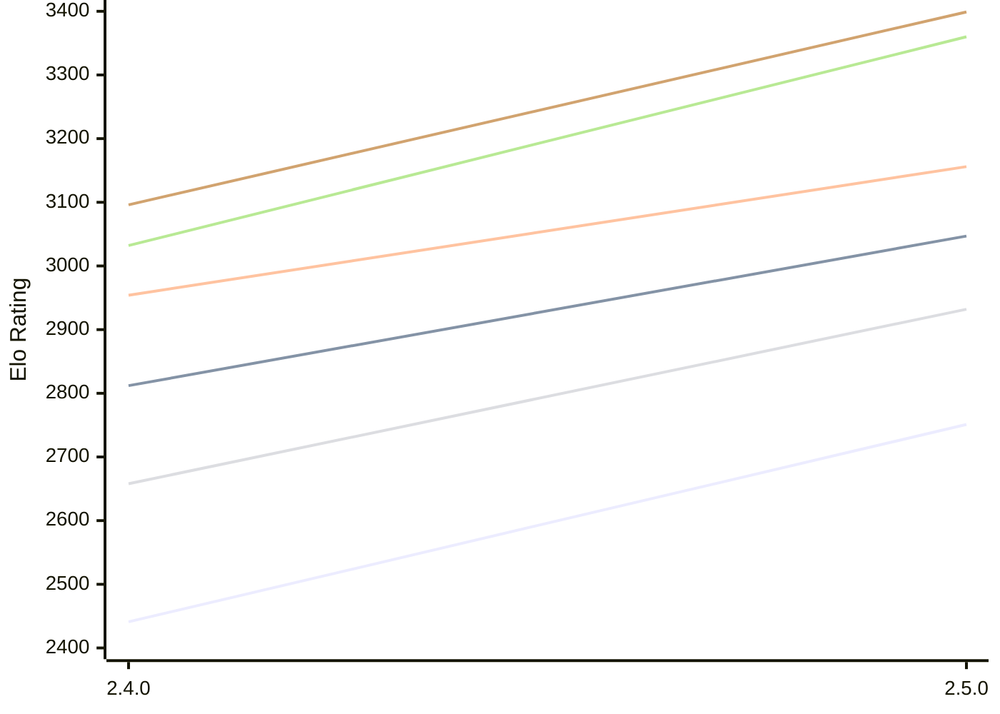

# Engine: Rarog

Author: Miloslav Macůrek

Home: https://github.com/maelic13/rarog

## Elo Ratings E1

| Version | Published | STC 8.0+0.08s  | LTC 60.0+0.60s | VLTC 2m24s+1.12s | Comment |
| --- | --- | --- | --- | --- | --- |
| 2.5.0 | 2026-10-05 | 2751(+310) | 3047(+235) | 3156(+202) |  |
| 2.4.0 | 2026-09-11 | 2441 | 2812 | 2954 |  |
 | | | cElo (∆ prev) | cElo (∆ prev) | cElo (∆ prev) | 

## Elo Ratings P1

| Version | Published | STC 8.0+0.08s  | LTC 60.0+0.60s | VLTC 2m24s+1.12s | Comment |
| --- | --- | --- | --- | --- | --- |
| 2.5.0 | 2026-10-05 | 2932(+274) | 3360(+328) | 3399(+303) |  |
| 2.4.0 | 2026-09-11 | 2658 | 3032 | 3096 |  |
 | | | cElo (∆ prev) | cElo (∆ prev) | cElo (∆ prev) | 

## Elo Ratings T1

| Version | Published | STC 8.0+0.08s  | LTC 60.0+0.60s | VLTC 2m24s+1.12s | Comment |
| --- | --- | --- | --- | --- | --- |
| 2.4.0 | 2026-09-11 | 2614 | 2930 | 3015 |  |
 | | | cElo (∆ prev) | cElo (∆ prev) | cElo (∆ prev) | 

<a href="https://github.com/computer-chess-index/cci/issues/new?template=submit-version.yml&title=[VERSION]+Rarog+<version>&body=###%20Engine%20name%0ARarog%0A%0A###%20Version%0A2.4.0" target="_blank">Submit new version</a>

 Test Conditions:

GUI/CLI: <a href=https://github.com/cutechess/cutechess target="_blank">Cute-Chess</a> 
Elo Calculation: <a href=https://www.remi-coulom.fr/Bayesian-Elo/ target="_blank">Bayesian-Elo</a> 
CPU for P1: Intel(R) Core(TM) Ultra 7 265T (1.50 GHz) - P-Core 
CPU for E1: Intel(R) Core(TM) Ultra 7 265T (1.50 GHz) - E-Core 
CPU for T1: Intel(R) Core(TM) i5-7500T 2.70GHz 
Opening book: 8_moves_v3 
\* STC: 8.0+0.08s, LTC: 60.0+0.60s, VLTC: 2m24s+1.12s

 Lists:
Ratings: <a href=https://github.com/computer-chess-index/cci/blob/main/lists/CCIRatings.csv target="_blank">Complete list</a>

Generated: 2026-10-13 04:42:18

## Ratings Verlauf E1 / P1

## Detailed Evaluation Results

| Version | Time Control | Elo  | Range +/- | Matches | Score | Average Opponent Elo | Draws |
| --- | --- | --- | --- | --- | --- | --- | --- |
| 2.5.0 | VLTC (2m24s+1.12s) | 3399 | 72 | 52 | 59% | 3328 | 60% |
| 2.5.0 | VLTC (2m24s+1.12s) | 3156 | 49 | 116 | 55% | 3120 | 54% |
| 2.5.0 | LTC (60.0+0.60s) | 3360 | 90 | 36 | 57% | 3295 | 47% |
| 2.5.0 | LTC (60.0+0.60s) | 3047 | 50 | 114 | 54% | 3015 | 54% |
| 2.5.0 | STC (8.0+0.08s) | 2751 | 48 | 136 | 58% | 2677 | 38% |
| --- | --- | --- | --- | --- | --- | --- | --- |
| 2.5.0 | STC (8.0+0.08s) | 2932 | 74 | 56 | 50% | 2921 | 39% |
| --- | --- | --- | --- | --- | --- | --- | --- |
| 2.4.0 | VLTC (2m24s+1.12s) | 2954 | 29 | 367 | 52% | 2943 | 41% |
| 2.4.0 | VLTC (2m24s+1.12s) | 3015 | 35 | 256 | 53% | 2984 | 40% |
| 2.4.0 | VLTC (2m24s+1.12s) | 3096 | 39 | 198 | 51% | 3087 | 42% |
| 2.4.0 | LTC (60.0+0.60s) | 2930 | 33 | 292 | 57% | 2861 | 38% |
| 2.4.0 | LTC (60.0+0.60s) | 3032 | 42 | 168 | 53% | 2998 | 43% |
| 2.4.0 | LTC (60.0+0.60s) | 2812 | 32 | 306 | 47% | 2844 | 38% |
| 2.4.0 | STC (8.0+0.08s) | 2614 | 36 | 266 | 52% | 2564 | 29% |
| --- | --- | --- | --- | --- | --- | --- | --- |
| 2.4.0 | STC (8.0+0.08s) | 2658 | 46 | 156 | 46% | 2695 | 31% |
| --- | --- | --- | --- | --- | --- | --- | --- |
| 2.4.0 | STC (8.0+0.08s) | 2441 | 36 | 252 | 41% | 2535 | 33% |
| --- | --- | --- | --- | --- | --- | --- | --- |