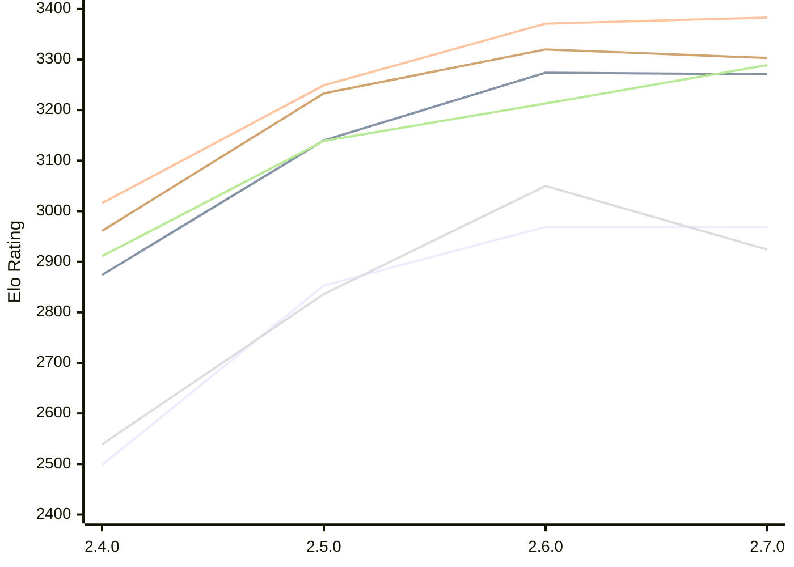

# Engine: Rarog

Author: Miloslav Macůrek

Home: https://github.com/maelic13/rarog

## Elo Ratings E1 (Ultra 7 265T (1.50 GHz) - E-Core)

| Version | Published | STC 8.0+0.08s  | LTC 60.0+0.60s | VLTC 2m24s+1.12s | Comment |
| --- | --- | --- | --- | --- | --- |
| 2.7.0 | 2026-11-13 | 2969(0) | 3271(-3) | 3383(+12) |  |
| 2.6.0 | 2026-10-22 | 2969(+116) | 3274(+134) | 3371(+122) |  |
| 2.5.0 | 2026-10-05 | 2853(+355) | 3140(+266) | 3249(+233) |  |
| 2.4.0 | 2026-09-11 | 2498 | 2874 | 3016 |  |
 | | | cElo (∆ prev) | cElo (∆ prev) | cElo (∆ prev) | 

## Elo Ratings P1 (Ultra 7 265T (1.50 GHz) - P-Core)

| Version | Published | STC 8.0+0.08s  | LTC 60.0+0.60s | VLTC 2m24s+1.12s | Comment |
| --- | --- | --- | --- | --- | --- |
| 2.7.0 | 2026-11-13 | 2924(-126) | 3289(+76) | 3303(-17) |  |
| 2.6.0 | 2026-10-22 | 3050(+214) | 3213(+74) | 3320(+87) |  |
| 2.5.0 | 2026-10-05 | 2836(+297) | 3139(+228) | 3233(+272) |  |
| 2.4.0 | 2026-09-11 | 2539 | 2911 | 2961 |  |
 | | | cElo (∆ prev) | cElo (∆ prev) | cElo (∆ prev) | 

## Elo Ratings T1 (i5-7500T 2.70GHz)

| Version | Published | STC 8.0+0.08s  | LTC 60.0+0.60s | VLTC 2m24s+1.12s | Comment |
| --- | --- | --- | --- | --- | --- |
| 2.4.0 | 2026-09-11 | 2614 | 2930 | 3015 |  |
 | | | cElo (∆ prev) | cElo (∆ prev) | cElo (∆ prev) | 

<a href="https://github.com/computer-chess-index/cci/issues/new?template=submit-version.yml&title=[VERSION]+Rarog+<version>&body=###%20Engine%20name%0ARarog%0A%0A###%20Version%0A2.4.0" target="_blank">Submit new version</a>

 Test Conditions:

GUI/CLI: <a href=https://github.com/cutechess/cutechess target="_blank">Cute-Chess</a> 
Elo Calculation: <a href=https://www.remi-coulom.fr/Bayesian-Elo/ target="_blank">Bayesian-Elo</a> 
CPU for P1: Intel(R) Core(TM) Ultra 7 265T (1.50 GHz) - P-Core 
CPU for E1: Intel(R) Core(TM) Ultra 7 265T (1.50 GHz) - E-Core 
CPU for T1: Intel(R) Core(TM) i5-7500T 2.70GHz 
Opening book: 8_moves_v3 
\* STC: 8.0+0.08s, LTC: 60.0+0.60s, VLTC: 2m24s+1.12s

 Lists:
Ratings: <a href=https://github.com/computer-chess-index/cci/blob/main/lists/CCIRatings.csv target="_blank">Complete list</a>

Generated: 2026-11-21 05:41:41

## Ratings Verlauf E1 / P1

## Detailed Evaluation Results

| Version | Time Control | Variant | Elo  | Range +/- | Matches | Score | Average Opponent Elo | Draws |
| --- | --- |--- | --- | --- | --- | --- | --- | --- |
| 2.7.0 | VLTC (2m24s+1.12s) | P1 | 3303 | 51 | 100 | 51% | 3297 | 63% |
|  |  | E1 | 3383 | 38 | 178 | 51% | 3379 | 64% |
|  | LTC (60.0+0.60s) | P1 | 3289 | 46 | 124 | 51% | 3281 | 62% |
|  |  | E1 | 3271 | 39 | 184 | 49% | 3279 | 54% |
|  | STC (8.0+0.08s) | P1 | 2924 | 44 | 166 | 54% | 2890 | 36% |
|  |  | E1 | 2969 | 30 | 322 | 53% | 2946 | 43% |
| --- | --- |--- | --- | --- | --- | --- | --- | --- |
| 2.6.0 | VLTC (2m24s+1.12s) | P1 | 3320 | 36 | 204 | 50% | 3318 | 62% |
|  |  | E1 | 3371 | 28 | 346 | 49% | 3380 | 62% |
|  | LTC (60.0+0.60s) | P1 | 3213 | 33 | 250 | 52% | 3200 | 54% |
|  |  | E1 | 3274 | 30 | 320 | 50% | 3270 | 54% |
|  | STC (8.0+0.08s) | P1 | 3050 | 41 | 184 | 51% | 3047 | 42% |
|  |  | E1 | 2969 | 31 | 320 | 50% | 2969 | 41% |
| --- | --- |--- | --- | --- | --- | --- | --- | --- |
| 2.5.0 | VLTC (2m24s+1.12s) | P1 | 3233 | 36 | 206 | 53% | 3212 | 61% |
|  |  | E1 | 3249 | 29 | 320 | 53% | 3225 | 55% |
|  | LTC (60.0+0.60s) | P1 | 3139 | 35 | 238 | 47% | 3162 | 52% |
|  |  | E1 | 3140 | 32 | 280 | 54% | 3113 | 55% |
|  | STC (8.0+0.08s) | P1 | 2836 | 43 | 170 | 50% | 2839 | 41% |
|  |  | E1 | 2853 | 32 | 320 | 55% | 2808 | 38% |
| --- | --- |--- | --- | --- | --- | --- | --- | --- |
| 2.4.0 | VLTC (2m24s+1.12s) | T1 | 3015 | 35 | 256 | 53% | 2984 | 40% |
|  |  | P1 | 2961 | 39 | 198 | 51% | 2952 | 42% |
|  |  | E1 | 3016 | 29 | 367 | 52% | 3005 | 41% |
|  | LTC (60.0+0.60s) | T1 | 2930 | 33 | 292 | 57% | 2861 | 38% |
|  |  | P1 | 2911 | 42 | 168 | 53% | 2877 | 43% |
|  |  | E1 | 2874 | 32 | 310 | 47% | 2905 | 38% |
|  | STC (8.0+0.08s) | T1 | 2614 | 36 | 266 | 52% | 2564 | 29% |
|  |  | P1 | 2539 | 46 | 156 | 46% | 2576 | 31% |
|  |  | E1 | 2498 | 36 | 252 | 41% | 2591 | 33% |