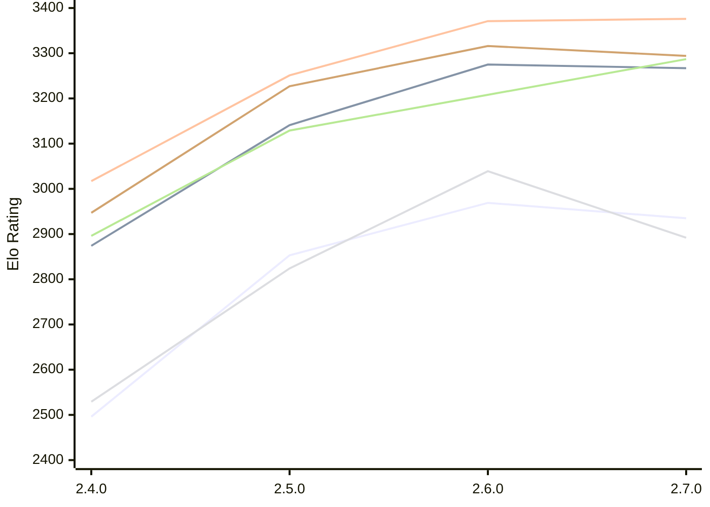

# Engine: Rarog

Author: Miloslav Macůrek

Home: https://github.com/maelic13/rarog

## Elo Ratings E1 (Ultra 7 265T (1.50 GHz) - E-Core)

| Version | Published | STC 8.0+0.08s  | LTC 60.0+0.60s | VLTC 2m24s+1.12s | Comment |
| --- | --- | --- | --- | --- | --- |
| 2.7.0 | 2026-11-13 | 2935(-34) | 3267(-8) | 3376(+5) |  |
| 2.6.0 | 2026-10-22 | 2969(+116) | 3275(+134) | 3371(+120) |  |
| 2.5.0 | 2026-10-05 | 2853(+357) | 3141(+267) | 3251(+234) |  |
| 2.4.0 | 2026-09-11 | 2496 | 2874 | 3017 |  |
 | | | cElo (∆ prev) | cElo (∆ prev) | cElo (∆ prev) | 

## Elo Ratings P1 (Ultra 7 265T (1.50 GHz) - P-Core)

| Version | Published | STC 8.0+0.08s  | LTC 60.0+0.60s | VLTC 2m24s+1.12s | Comment |
| --- | --- | --- | --- | --- | --- |
| 2.7.0 | 2026-11-13 | 2892(-147) | 3287(+79) | 3294(-22) |  |
| 2.6.0 | 2026-10-22 | 3039(+215) | 3208(+79) | 3316(+89) |  |
| 2.5.0 | 2026-10-05 | 2824(+295) | 3129(+233) | 3227(+280) |  |
| 2.4.0 | 2026-09-11 | 2529 | 2896 | 2947 |  |
 | | | cElo (∆ prev) | cElo (∆ prev) | cElo (∆ prev) | 

## Elo Ratings T1 (i5-7500T 2.70GHz)

| Version | Published | STC 8.0+0.08s  | LTC 60.0+0.60s | VLTC 2m24s+1.12s | Comment |
| --- | --- | --- | --- | --- | --- |
| 2.4.0 | 2026-09-11 | 2614 | 2930 | 3015 |  |
 | | | cElo (∆ prev) | cElo (∆ prev) | cElo (∆ prev) | 

<a href="https://github.com/computer-chess-index/cci/issues/new?template=submit-version.yml&title=[VERSION]+Rarog+<version>&body=###%20Engine%20name%0ARarog%0A%0A###%20Version%0A2.4.0" target="_blank">Submit new version</a>

 Test Conditions:

GUI/CLI: <a href=https://github.com/cutechess/cutechess target="_blank">Cute-Chess</a> 
Elo Calculation: <a href=https://www.remi-coulom.fr/Bayesian-Elo/ target="_blank">Bayesian-Elo</a> 
CPU for P1: Intel(R) Core(TM) Ultra 7 265T (1.50 GHz) - P-Core 
CPU for E1: Intel(R) Core(TM) Ultra 7 265T (1.50 GHz) - E-Core 
CPU for T1: Intel(R) Core(TM) i5-7500T 2.70GHz 
Opening book: 8_moves_v3 
\* STC: 8.0+0.08s, LTC: 60.0+0.60s, VLTC: 2m24s+1.12s

 Lists:
Ratings: <a href=https://github.com/computer-chess-index/cci/blob/main/lists/CCIRatings.csv target="_blank">Complete list</a>

Generated: 2026-11-18 05:42:18

## Ratings Verlauf E1 / P1

## Detailed Evaluation Results

| Version | Time Control | Variant | Elo  | Range +/- | Matches | Score | Average Opponent Elo | Draws |
| --- | --- |--- | --- | --- | --- | --- | --- | --- |
| 2.7.0 | VLTC (2m24s+1.12s) | P1 | 3294 | 55 | 88 | 50% | 3291 | 59% |
|  |  | E1 | 3376 | 52 | 100 | 50% | 3380 | 59% |
|  | LTC (60.0+0.60s) | P1 | 3287 | 52 | 96 | 53% | 3270 | 59% |
|  |  | E1 | 3267 | 45 | 136 | 48% | 3286 | 51% |
|  | STC (8.0+0.08s) | P1 | 2892 | 65 | 76 | 56% | 2843 | 36% |
|  |  | E1 | 2935 | 43 | 160 | 51% | 2925 | 42% |
| --- | --- |--- | --- | --- | --- | --- | --- | --- |
| 2.6.0 | VLTC (2m24s+1.12s) | P1 | 3316 | 36 | 204 | 50% | 3316 | 62% |
|  |  | E1 | 3371 | 28 | 346 | 49% | 3380 | 62% |
|  | LTC (60.0+0.60s) | P1 | 3208 | 34 | 246 | 52% | 3190 | 54% |
|  |  | E1 | 3275 | 30 | 320 | 50% | 3271 | 54% |
|  | STC (8.0+0.08s) | E1 | 2969 | 31 | 320 | 50% | 2969 | 41% |
|  |  | P1 | 3039 | 41 | 184 | 51% | 3036 | 42% |
| --- | --- |--- | --- | --- | --- | --- | --- | --- |
| 2.5.0 | VLTC (2m24s+1.12s) | P1 | 3227 | 36 | 206 | 53% | 3205 | 61% |
|  |  | E1 | 3251 | 29 | 320 | 53% | 3227 | 55% |
|  | LTC (60.0+0.60s) | P1 | 3129 | 35 | 238 | 47% | 3152 | 52% |
|  |  | E1 | 3141 | 32 | 280 | 54% | 3113 | 55% |
|  | STC (8.0+0.08s) | P1 | 2824 | 43 | 170 | 50% | 2827 | 41% |
|  |  | E1 | 2853 | 32 | 320 | 55% | 2808 | 38% |
| --- | --- |--- | --- | --- | --- | --- | --- | --- |
| 2.4.0 | VLTC (2m24s+1.12s) | T1 | 3015 | 35 | 256 | 53% | 2984 | 40% |
|  |  | P1 | 2947 | 39 | 198 | 51% | 2939 | 42% |
|  |  | E1 | 3017 | 29 | 367 | 52% | 3006 | 41% |
|  | LTC (60.0+0.60s) | T1 | 2930 | 33 | 292 | 57% | 2861 | 38% |
|  |  | P1 | 2896 | 42 | 168 | 53% | 2862 | 43% |
|  |  | E1 | 2874 | 32 | 310 | 47% | 2905 | 38% |
|  | STC (8.0+0.08s) | T1 | 2614 | 36 | 266 | 52% | 2564 | 29% |
|  |  | P1 | 2529 | 46 | 156 | 46% | 2565 | 31% |
|  |  | E1 | 2496 | 36 | 252 | 41% | 2589 | 33% |