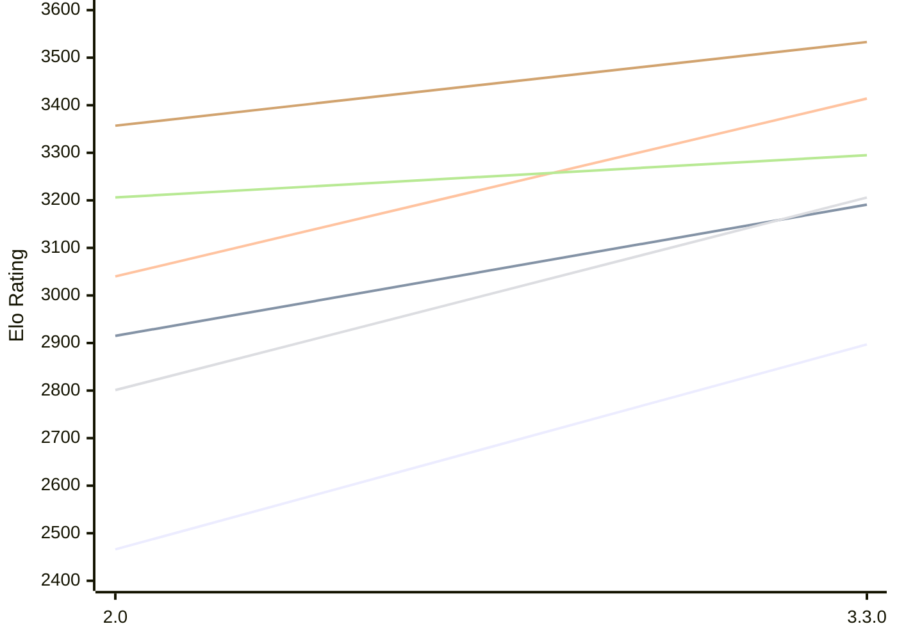

# Engine: Ravager

Author: Abhinav Tiwari

Home: https://github.com/erensh27/Ravager

## Elo Ratings E1

| Version | Published | STC 8.0+0.08s  | LTC 60.0+0.60s | VLTC 2m24s+1.12s | Comment |
| --- | --- | --- | --- | --- | --- |
| 3.3.0 | 2026-10-09 | 2897(+431) | 3191(+276) | 3414(+374) |  |
| 2.0 | 2026-08-23 | 2466 | 2915 | 3040 |  |
 | | | cElo (∆ prev) | cElo (∆ prev) | cElo (∆ prev) | 

## Elo Ratings P1

| Version | Published | STC 8.0+0.08s  | LTC 60.0+0.60s | VLTC 2m24s+1.12s | Comment |
| --- | --- | --- | --- | --- | --- |
| 3.3.0 | 2026-10-09 | 3206(+405) | 3295(+89) | 3533(+176) |  |
| 2.0 | 2026-08-23 | 2801 | 3206 | 3357 |  |
 | | | cElo (∆ prev) | cElo (∆ prev) | cElo (∆ prev) | 

## Elo Ratings T1

| Version | Published | STC 8.0+0.08s  | LTC 60.0+0.60s | VLTC 2m24s+1.12s | Comment |
| --- | --- | --- | --- | --- | --- |
| 2.0 | 2026-08-23 | 2757 | 3109 | 3220 |  |
 | | | cElo (∆ prev) | cElo (∆ prev) | cElo (∆ prev) | 

<a href="https://github.com/computer-chess-index/cci/issues/new?template=submit-version.yml&title=[VERSION]+Ravager+<version>&body=###%20Engine%20name%0ARavager%0A%0A###%20Version%0A2.0" target="_blank">Submit new version</a>

 Test Conditions:

GUI/CLI: <a href=https://github.com/cutechess/cutechess target="_blank">Cute-Chess</a> 
Elo Calculation: <a href=https://www.remi-coulom.fr/Bayesian-Elo/ target="_blank">Bayesian-Elo</a> 
CPU for P1: Intel(R) Core(TM) Ultra 7 265T (1.50 GHz) - P-Core 
CPU for E1: Intel(R) Core(TM) Ultra 7 265T (1.50 GHz) - E-Core 
CPU for T1: Intel(R) Core(TM) i5-7500T 2.70GHz 
Opening book: 8_moves_v3 
\* STC: 8.0+0.08s, LTC: 60.0+0.60s, VLTC: 2m24s+1.12s

 Lists:
Ratings: <a href=https://github.com/computer-chess-index/cci/blob/main/lists/CCIRatings.csv target="_blank">Complete list</a>

Generated: 2026-10-11 15:23:17

## Ratings Verlauf E1 / P1

## Detailed Evaluation Results

| Version | Time Control | Elo  | Range +/- | Matches | Score | Average Opponent Elo | Draws |
| --- | --- | --- | --- | --- | --- | --- | --- |
| 3.3.0 | VLTC (2m24s+1.12s) | 3533 | 105 | 22 | 64% | 3441 | 73% |
| 3.3.0 | VLTC (2m24s+1.12s) | 3414 | 77 | 44 | 59% | 3317 | 68% |
| 3.3.0 | LTC (60.0+0.60s) | 3295 | 116 | 18 | 56% | 3260 | 67% |
| 3.3.0 | LTC (60.0+0.60s) | 3191 | 66 | 66 | 59% | 3113 | 48% |
| 3.3.0 | STC (8.0+0.08s) | 3206 | 107 | 28 | 70% | 3017 | 46% |
| --- | --- | --- | --- | --- | --- | --- | --- |
| 3.3.0 | STC (8.0+0.08s) | 2897 | 66 | 68 | 64% | 2780 | 51% |
| --- | --- | --- | --- | --- | --- | --- | --- |
| 2.0 | VLTC (2m24s+1.12s) | 3220 | 31 | 274 | 50% | 3218 | 64% |
| 2.0 | VLTC (2m24s+1.12s) | 3357 | 38 | 188 | 47% | 3382 | 55% |
| 2.0 | VLTC (2m24s+1.12s) | 3040 | 31 | 280 | 42% | 3102 | 58% |
| 2.0 | LTC (60.0+0.60s) | 3206 | 39 | 184 | 48% | 3220 | 52% |
| 2.0 | LTC (60.0+0.60s) | 2915 | 30 | 318 | 42% | 2977 | 56% |
| 2.0 | LTC (60.0+0.60s) | 3109 | 30 | 302 | 50% | 3109 | 57% |
| 2.0 | STC (8.0+0.08s) | 2801 | 39 | 196 | 50% | 2797 | 45% |
| --- | --- | --- | --- | --- | --- | --- | --- |
| 2.0 | STC (8.0+0.08s) | 2466 | 35 | 298 | 39% | 2585 | 26% |
| --- | --- | --- | --- | --- | --- | --- | --- |
| 2.0 | STC (8.0+0.08s) | 2757 | 35 | 256 | 49% | 2761 | 38% |
| --- | --- | --- | --- | --- | --- | --- | --- |