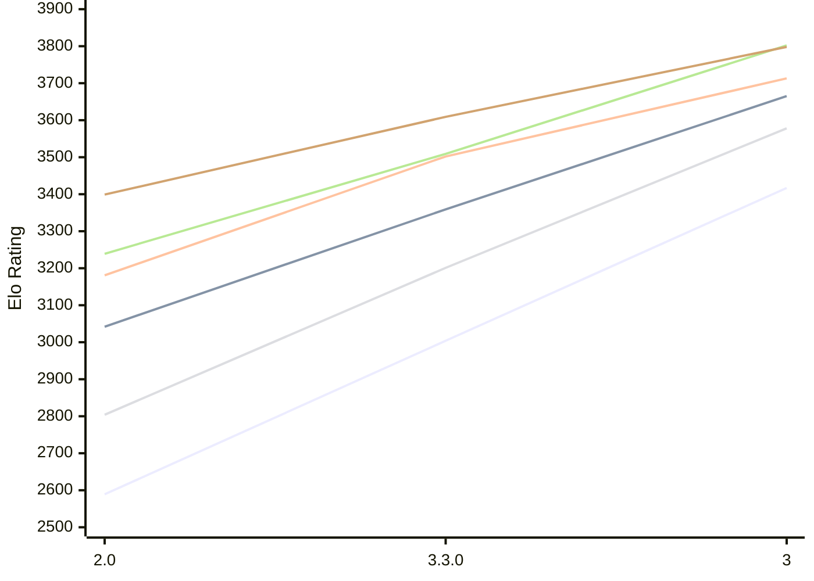

# Engine: Ravager

Author: Abhinav Tiwari

Home: https://github.com/erensh27/Ravager

## Elo Ratings E1 (Ultra 7 265T (1.50 GHz) - E-Core)

| Version | Published | STC 8.0+0.08s  | LTC 60.0+0.60s | VLTC 2m24s+1.12s | Comment |
| --- | --- | --- | --- | --- | --- |
| 3 | 2026-10-22 | 3417(+413) | 3665(+306) | 3713(+211) |  |
| 3.3.0 | 2026-10-09 | 3004(+415) | 3359(+317) | 3502(+321) |  |
| 2.0 | 2026-08-23 | 2589 | 3042 | 3181 |  |
 | | | cElo (∆ prev) | cElo (∆ prev) | cElo (∆ prev) | 

## Elo Ratings P1 (Ultra 7 265T (1.50 GHz) - P-Core)

| Version | Published | STC 8.0+0.08s  | LTC 60.0+0.60s | VLTC 2m24s+1.12s | Comment |
| --- | --- | --- | --- | --- | --- |
| 3 | 2026-10-22 | 3578(+377) | 3802(+293) | 3798(+189) |  |
| 3.3.0 | 2026-10-09 | 3201(+397) | 3509(+270) | 3609(+210) |  |
| 2.0 | 2026-08-23 | 2804 | 3239 | 3399 |  |
 | | | cElo (∆ prev) | cElo (∆ prev) | cElo (∆ prev) | 

## Elo Ratings T1 (i5-7500T 2.70GHz)

| Version | Published | STC 8.0+0.08s  | LTC 60.0+0.60s | VLTC 2m24s+1.12s | Comment |
| --- | --- | --- | --- | --- | --- |
| 2.0 | 2026-08-23 | 2757 | 3109 | 3220 |  |
 | | | cElo (∆ prev) | cElo (∆ prev) | cElo (∆ prev) | 

<a href="https://github.com/computer-chess-index/cci/issues/new?template=submit-version.yml&title=[VERSION]+Ravager+<version>&body=###%20Engine%20name%0ARavager%0A%0A###%20Version%0A2.0" target="_blank">Submit new version</a>

 Test Conditions:

GUI/CLI: <a href=https://github.com/cutechess/cutechess target="_blank">Cute-Chess</a> 
Elo Calculation: <a href=https://www.remi-coulom.fr/Bayesian-Elo/ target="_blank">Bayesian-Elo</a> 
CPU for P1: Intel(R) Core(TM) Ultra 7 265T (1.50 GHz) - P-Core 
CPU for E1: Intel(R) Core(TM) Ultra 7 265T (1.50 GHz) - E-Core 
CPU for T1: Intel(R) Core(TM) i5-7500T 2.70GHz 
Opening book: 8_moves_v3 
\* STC: 8.0+0.08s, LTC: 60.0+0.60s, VLTC: 2m24s+1.12s

 Lists:
Ratings: <a href=https://github.com/computer-chess-index/cci/blob/main/lists/CCIRatings.csv target="_blank">Complete list</a>

Generated: 2026-11-04 05:41:56

## Ratings Verlauf E1 / P1

## Detailed Evaluation Results

| Version | Time Control | Variant | Elo  | Range +/- | Matches | Score | Average Opponent Elo | Draws |
| --- | --- |--- | --- | --- | --- | --- | --- | --- |
| 3 | VLTC (2m24s+1.12s) | P1 | 3798 | 40 | 152 | 55% | 3762 | 80% |
|  |  | E1 | 3713 | 31 | 242 | 48% | 3727 | 87% |
|  | LTC (60.0+0.60s) | P1 | 3802 | 41 | 140 | 48% | 3811 | 80% |
|  |  | E1 | 3665 | 38 | 170 | 54% | 3632 | 81% |
|  | STC (8.0+0.08s) | E1 | 3417 | 31 | 288 | 55% | 3372 | 60% |
|  |  | P1 | 3578 | 43 | 136 | 53% | 3548 | 71% |
| --- | --- |--- | --- | --- | --- | --- | --- | --- |
| 3.3.0 | VLTC (2m24s+1.12s) | P1 | 3609 | 43 | 134 | 53% | 3586 | 69% |
|  |  | E1 | 3502 | 34 | 208 | 50% | 3499 | 76% |
|  | LTC (60.0+0.60s) | P1 | 3509 | 28 | 322 | 56% | 3461 | 68% |
|  |  | E1 | 3359 | 31 | 276 | 54% | 3325 | 68% |
|  | STC (8.0+0.08s) | P1 | 3201 | 36 | 216 | 50% | 3190 | 56% |
|  |  | E1 | 3004 | 36 | 226 | 54% | 2973 | 48% |
| --- | --- |--- | --- | --- | --- | --- | --- | --- |
| 2.0 | VLTC (2m24s+1.12s) | P1 | 3399 | 37 | 204 | 49% | 3410 | 54% |
|  |  | E1 | 3181 | 30 | 302 | 44% | 3231 | 56% |
|  |  | T1 | 3220 | 31 | 274 | 50% | 3218 | 64% |
|  | LTC (60.0+0.60s) | P1 | 3239 | 39 | 184 | 48% | 3252 | 52% |
|  |  | E1 | 3042 | 30 | 322 | 42% | 3105 | 56% |
|  |  | T1 | 3109 | 30 | 302 | 50% | 3109 | 57% |
|  | STC (8.0+0.08s) | E1 | 2589 | 35 | 298 | 39% | 2708 | 26% |
|  |  | T1 | 2757 | 35 | 256 | 49% | 2761 | 38% |
|  |  | P1 | 2804 | 37 | 216 | 48% | 2815 | 43% |