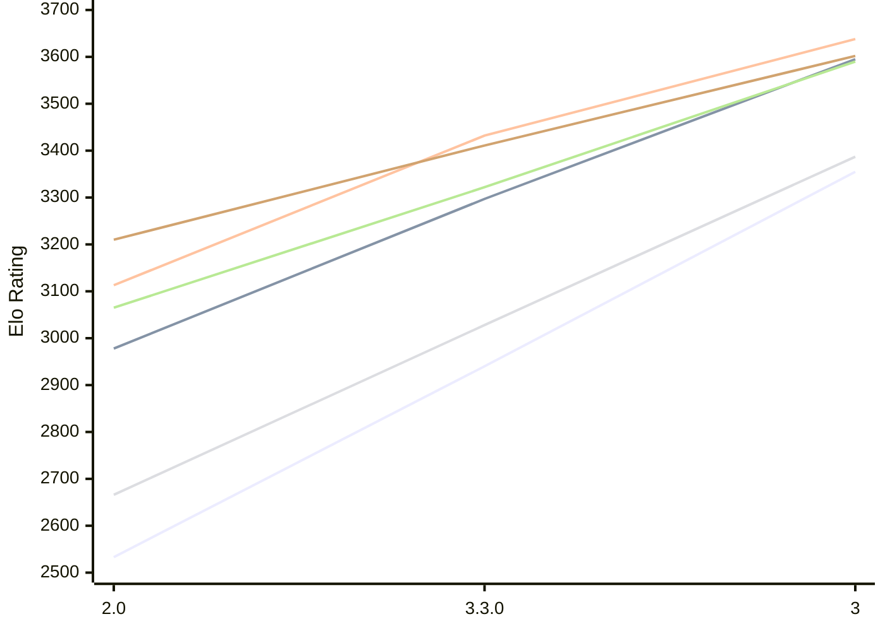

# Engine: Ravager

Author: Abhinav Tiwari

Home: https://github.com/erensh27/Ravager

## Elo Ratings E1 (Ultra 7 265T (1.50 GHz) - E-Core)

| Version | Published | STC 8.0+0.08s  | LTC 60.0+0.60s | VLTC 2m24s+1.12s | Comment |
| --- | --- | --- | --- | --- | --- |
| 3 | 2026-10-22 | 3355(+415) | 3595(+298) | 3638(+206) |  |
| 3.3.0 | 2026-10-09 | 2940(+407) | 3297(+319) | 3432(+319) |  |
| 2.0 | 2026-08-23 | 2533 | 2978 | 3113 |  |
 | | | cElo (∆ prev) | cElo (∆ prev) | cElo (∆ prev) | 

## Elo Ratings P1 (Ultra 7 265T (1.50 GHz) - P-Core)

| Version | Published | STC 8.0+0.08s  | LTC 60.0+0.60s | VLTC 2m24s+1.12s | Comment |
| --- | --- | --- | --- | --- | --- |
| 3 | 2026-10-22 | 3387(+359) | 3590(+268) | 3602(+191) |  |
| 3.3.0 | 2026-10-09 | 3028(+362) | 3322(+257) | 3411(+201) |  |
| 2.0 | 2026-08-23 | 2666 | 3065 | 3210 |  |
 | | | cElo (∆ prev) | cElo (∆ prev) | cElo (∆ prev) | 

## Elo Ratings T1 (i5-7500T 2.70GHz)

| Version | Published | STC 8.0+0.08s  | LTC 60.0+0.60s | VLTC 2m24s+1.12s | Comment |
| --- | --- | --- | --- | --- | --- |
| 2.0 | 2026-08-23 | 2757 | 3109 | 3220 |  |
 | | | cElo (∆ prev) | cElo (∆ prev) | cElo (∆ prev) | 

<a href="https://github.com/computer-chess-index/cci/issues/new?template=submit-version.yml&title=[VERSION]+Ravager+<version>&body=###%20Engine%20name%0ARavager%0A%0A###%20Version%0A2.0" target="_blank">Submit new version</a>

 Test Conditions:

GUI/CLI: <a href=https://github.com/cutechess/cutechess target="_blank">Cute-Chess</a> 
Elo Calculation: <a href=https://www.remi-coulom.fr/Bayesian-Elo/ target="_blank">Bayesian-Elo</a> 
CPU for P1: Intel(R) Core(TM) Ultra 7 265T (1.50 GHz) - P-Core 
CPU for E1: Intel(R) Core(TM) Ultra 7 265T (1.50 GHz) - E-Core 
CPU for T1: Intel(R) Core(TM) i5-7500T 2.70GHz 
Opening book: 8_moves_v3 
\* STC: 8.0+0.08s, LTC: 60.0+0.60s, VLTC: 2m24s+1.12s

 Lists:
Ratings: <a href=https://github.com/computer-chess-index/cci/blob/main/lists/CCIRatings.csv target="_blank">Complete list</a>

Generated: 2026-11-28 05:42:10

## Ratings Verlauf E1 / P1

## Detailed Evaluation Results

| Version | Time Control | Variant | Elo  | Range +/- | Matches | Score | Average Opponent Elo | Draws |
| --- | --- |--- | --- | --- | --- | --- | --- | --- |
| 3 | VLTC (2m24s+1.12s) | P1 | 3602 | 39 | 160 | 55% | 3568 | 81% |
|  |  | E1 | 3638 | 28 | 294 | 48% | 3650 | 86% |
|  | LTC (60.0+0.60s) | P1 | 3590 | 35 | 196 | 46% | 3610 | 82% |
|  |  | E1 | 3595 | 31 | 246 | 53% | 3572 | 80% |
|  | STC (8.0+0.08s) | P1 | 3387 | 37 | 180 | 53% | 3362 | 71% |
|  |  | E1 | 3355 | 25 | 414 | 54% | 3320 | 62% |
| --- | --- |--- | --- | --- | --- | --- | --- | --- |
| 3.3.0 | VLTC (2m24s+1.12s) | E1 | 3432 | 31 | 252 | 50% | 3430 | 76% |
|  |  | P1 | 3411 | 41 | 150 | 53% | 3391 | 71% |
|  | LTC (60.0+0.60s) | P1 | 3322 | 27 | 346 | 57% | 3275 | 68% |
|  |  | E1 | 3297 | 27 | 344 | 54% | 3267 | 68% |
|  | STC (8.0+0.08s) | P1 | 3028 | 34 | 256 | 50% | 3013 | 53% |
|  |  | E1 | 2940 | 32 | 290 | 52% | 2924 | 48% |
| --- | --- |--- | --- | --- | --- | --- | --- | --- |
| 2.0 | VLTC (2m24s+1.12s) | T1 | 3220 | 31 | 274 | 50% | 3218 | 64% |
|  |  | P1 | 3210 | 37 | 204 | 49% | 3221 | 54% |
|  |  | E1 | 3113 | 30 | 302 | 44% | 3163 | 56% |
|  | LTC (60.0+0.60s) | T1 | 3109 | 30 | 302 | 50% | 3109 | 57% |
|  |  | P1 | 3065 | 39 | 184 | 48% | 3078 | 52% |
|  |  | E1 | 2978 | 30 | 322 | 42% | 3042 | 56% |
|  | STC (8.0+0.08s) | T1 | 2757 | 35 | 256 | 49% | 2761 | 38% |
|  |  | P1 | 2666 | 37 | 216 | 48% | 2677 | 43% |
|  |  | E1 | 2533 | 35 | 298 | 39% | 2651 | 26% |