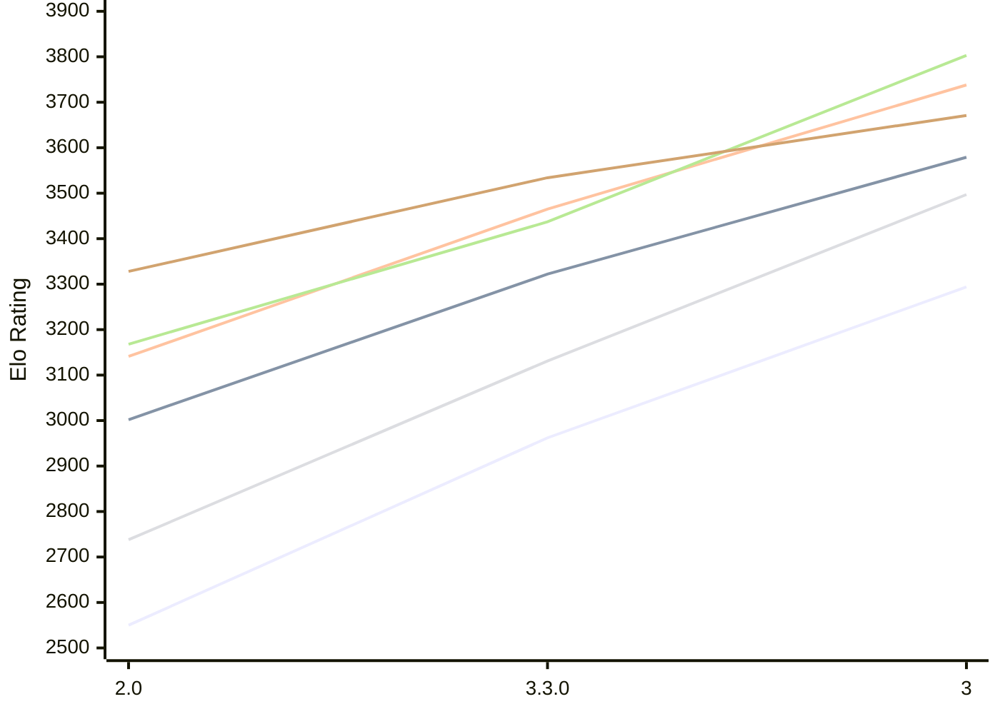

# Engine: Ravager

Author: Abhinav Tiwari

Home: https://github.com/erensh27/Ravager

## Elo Ratings E1 (Ultra 7 265T (1.50 GHz) - E-Core)

| Version | Published | STC 8.0+0.08s  | LTC 60.0+0.60s | VLTC 2m24s+1.12s | Comment |
| --- | --- | --- | --- | --- | --- |
| 3 | 2026-10-22 | 3294(+332) | 3579(+257) | 3738(+273) |  |
| 3.3.0 | 2026-10-09 | 2962(+412) | 3322(+320) | 3465(+324) |  |
| 2.0 | 2026-08-23 | 2550 | 3002 | 3141 |  |
 | | | cElo (∆ prev) | cElo (∆ prev) | cElo (∆ prev) | 

## Elo Ratings P1 (Ultra 7 265T (1.50 GHz) - P-Core)

| Version | Published | STC 8.0+0.08s  | LTC 60.0+0.60s | VLTC 2m24s+1.12s | Comment |
| --- | --- | --- | --- | --- | --- |
| 3 | 2026-10-22 | 3497(+366) | 3803(+366) | 3671(+137) |  |
| 3.3.0 | 2026-10-09 | 3131(+393) | 3437(+269) | 3534(+206) |  |
| 2.0 | 2026-08-23 | 2738 | 3168 | 3328 |  |
 | | | cElo (∆ prev) | cElo (∆ prev) | cElo (∆ prev) | 

## Elo Ratings T1 (i5-7500T 2.70GHz)

| Version | Published | STC 8.0+0.08s  | LTC 60.0+0.60s | VLTC 2m24s+1.12s | Comment |
| --- | --- | --- | --- | --- | --- |
| 2.0 | 2026-08-23 | 2757 | 3109 | 3220 |  |
 | | | cElo (∆ prev) | cElo (∆ prev) | cElo (∆ prev) | 

<a href="https://github.com/computer-chess-index/cci/issues/new?template=submit-version.yml&title=[VERSION]+Ravager+<version>&body=###%20Engine%20name%0ARavager%0A%0A###%20Version%0A2.0" target="_blank">Submit new version</a>

 Test Conditions:

GUI/CLI: <a href=https://github.com/cutechess/cutechess target="_blank">Cute-Chess</a> 
Elo Calculation: <a href=https://www.remi-coulom.fr/Bayesian-Elo/ target="_blank">Bayesian-Elo</a> 
CPU for P1: Intel(R) Core(TM) Ultra 7 265T (1.50 GHz) - P-Core 
CPU for E1: Intel(R) Core(TM) Ultra 7 265T (1.50 GHz) - E-Core 
CPU for T1: Intel(R) Core(TM) i5-7500T 2.70GHz 
Opening book: 8_moves_v3 
\* STC: 8.0+0.08s, LTC: 60.0+0.60s, VLTC: 2m24s+1.12s

 Lists:
Ratings: <a href=https://github.com/computer-chess-index/cci/blob/main/lists/CCIRatings.csv target="_blank">Complete list</a>

Generated: 2026-10-23 04:42:21

## Ratings Verlauf E1 / P1

## Detailed Evaluation Results

| Version | Time Control | Variant | Elo  | Range +/- | Matches | Score | Average Opponent Elo | Draws |
| --- | --- |--- | --- | --- | --- | --- | --- | --- |
| 3 | VLTC (2m24s+1.12s) | E1 | 3738 | 115 | 20 | 60% | 3641 | 60% |
|  |  | P1 | 3671 | 91 | 28 | 61% | 3595 | 79% |
|  | LTC (60.0+0.60s) | E1 | 3579 | 111 | 24 | 67% | 3451 | 50% |
|  |  | P1 | 3803 | 111 | 22 | 61% | 3681 | 59% |
|  | STC (8.0+0.08s) | E1 | 3294 | 97 | 32 | 59% | 3208 | 44% |
|  |  | P1 | 3497 | 88 | 32 | 63% | 3386 | 75% |
| --- | --- |--- | --- | --- | --- | --- | --- | --- |
| 3.3.0 | VLTC (2m24s+1.12s) | P1 | 3534 | 43 | 134 | 53% | 3511 | 69% |
|  |  | E1 | 3465 | 35 | 200 | 50% | 3463 | 76% |
|  | LTC (60.0+0.60s) | P1 | 3437 | 28 | 322 | 56% | 3390 | 68% |
|  |  | E1 | 3322 | 31 | 272 | 54% | 3285 | 68% |
|  | STC (8.0+0.08s) | P1 | 3131 | 36 | 216 | 50% | 3120 | 56% |
|  |  | E1 | 2962 | 36 | 222 | 53% | 2934 | 49% |
| --- | --- |--- | --- | --- | --- | --- | --- | --- |
| 2.0 | VLTC (2m24s+1.12s) | E1 | 3141 | 30 | 302 | 44% | 3191 | 56% |
|  |  | T1 | 3220 | 31 | 274 | 50% | 3218 | 64% |
|  |  | P1 | 3328 | 37 | 204 | 49% | 3339 | 54% |
|  | LTC (60.0+0.60s) | E1 | 3002 | 30 | 322 | 42% | 3066 | 56% |
|  |  | T1 | 3109 | 30 | 302 | 50% | 3109 | 57% |
|  |  | P1 | 3168 | 39 | 184 | 48% | 3182 | 52% |
|  | STC (8.0+0.08s) | E1 | 2550 | 35 | 298 | 39% | 2669 | 26% |
|  |  | T1 | 2757 | 35 | 256 | 49% | 2761 | 38% |
|  |  | P1 | 2738 | 37 | 216 | 48% | 2747 | 43% |